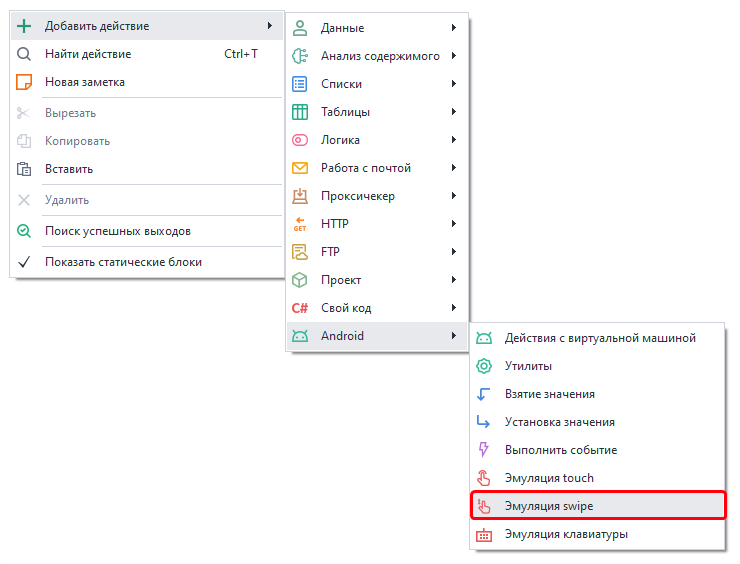
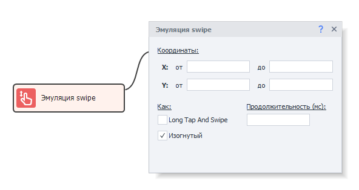

import DisclaimerNotice from '@site/src/components/DisclaimerNotice';

# Эмуляция движения Swipe
<DisclaimerNotice />

## Эмуляция swipe в ZD.   
С помощью этого действия можно совершить свайп. Он применяется при вертикальной прокрутке страниц в браузере и других приложениях; при перемещении по горизонтальному меню; при движении по экрану по диагонали.   
### Как добавить в проект?  
*Нажимаем ПКМ → Добавить действие → Android → Эмуляция swipe*  

 
_______________________________________________ 
### Доступные параметры.  
 
#### Координаты.  
Указываем координаты начальной ***(X от и Y от)*** и конечной ***(X до и Y до)*** точек свайпа.  
Где ***X*** – координата по горизонтали, а ***Y*** – по вертикали.  
Начальная точка должна быть на экране, иначе экшен завершится ошибкой, например *«Точка (1200, 300) за пределами экрана устройства 1080x2400»*. Конечная точка может выходить за край экрана.  
#### Координаты в процентах.  
:::info **Доступно начиная с версии ZennoDroid 2.6.3.0.**
:::

Координаты можно задать и в процентах от экрана, по тем же правилам, что у [**Эмуляции touch**](./Touch_Emulation#координаты-в-процентах): `0%` - первый пиксель, `100%` - последний. Такой свайп одинаково работает на экранах с разным разрешением. Например, прокрутка вниз: **X от** `50%`, **Y от** `80%`, **X до** `50%`, **Y до** `20%`. На экране 1080x2400 это свайп из точки (540, 1919) в (540, 480), на экране 720x1280 - из (360, 1023) в (360, 256).  
#### Long Tap And Swipe.  
Если поставить здесь галочку, то перед свайпом будет эмулировано долгое нажатие.  
#### Продолжительность (мс).  
Эта настройка регулирует скорость в милисекундах, с которой должен быть осуществлён свайп.  
#### Изогнутый.  
Позволяет выполнить более реалистичное движение пальца не по прямой, а кривой линии.
