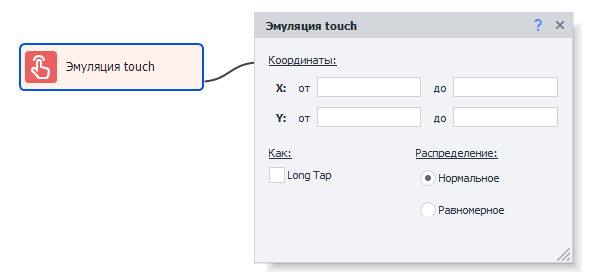
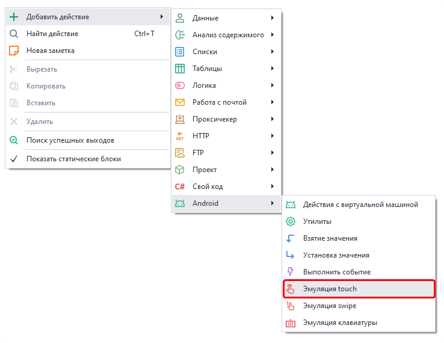
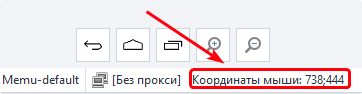

import DisclaimerNotice from '@site/src/components/DisclaimerNotice';

# Эмуляция Touch
<DisclaimerNotice />

## Описание.  
Экшен позволяет эмулировать нажатие на экран (touch-событие) в пределах указанных координат.  

  

:::warning **Разрешение эмулятора должно быть одинаковым.**
Как во время разработки, так и во время выполнения проекта. Так как при изменении разрешения меняются также и координаты элементов. Это касается координат в пикселях: координаты [**в процентах от экрана**](#координаты-в-процентах) пересчитываются под разрешение устройства.
:::  

### Для чего использовать?  
Эмуляция нажатия пальцем пригодится в случаях, когда тяжело или невозможно сделать клик с помощью экшена **Выполнить событие**.  

### Как добавить в проект?  
***Нажимаем ПКМ → Добавить действие → Android → Эмуляция touch***  

  
_______________________________________________ 
## Работа с экшеном.  
### Координаты.  
Тут мы указываем координаты интересующего элемента. Узнать их можно в [**Окне эмулятора**](../../pm/Interface/DeviceWindowEmulator), в нижней его части отображается текущая позиция курсора (если он в пределах этого окна).  

  

**X (от, до)** — координаты по горизонтали.  
**Y (от, до)** — координаты по вертикали.  

*Нажатие Touch* будет выполнено по указанным координатам.  
Если область частично выходит за край экрана, нажатие придётся на её часть, которая на экране. Если за пределами экрана вся область, экшен завершится ошибкой, например *«Точка (1200, 300) за пределами экрана устройства 1080x2400»*.  

### Координаты в процентах.  
:::info **Доступно начиная с версии ZennoDroid 2.6.3.0.**
:::

Любую координату можно задать не в пикселях, а в процентах от экрана: X - от ширины, Y - от высоты. Процент - это число от 0 до 100 со знаком `%` в конце, дробную часть можно отделить точкой или запятой: `50%`, `12.5%`, `12,5%`. Формат напоминает подсказка у полей: *«Пиксели или процент экрана: 540 или 12.5%»*.  

Перед нажатием процент пересчитывается в пиксели по разрешению экрана устройства: `0%` - первый пиксель, `100%` - последний, между ними - пропорционально, с округлением до целого пикселя. Например, на экране 1080x2400 `50%` по X - это 540, а `100%` по Y - 2399. Поэтому один и тот же экшен нажимает в ту же часть экрана на устройствах с разным разрешением.  

- Пиксели и проценты можно смешивать: например, X в процентах, а Y в пикселях.  
- Процент можно взять из переменной: `{-Variable.x-}%`, если в переменной число, или `{-Variable.x-}`, если в ней уже есть знак `%`.  
- Если процент меньше 0, больше 100 или не число, экшен завершится ошибкой, например *«Неверное значение Xmin: «101%». Нужны пиксели или процент экрана от 0% до 100%, например 540 или 50%.»* Значение без переменных ProjectMaker проверяет ещё до запуска и обводит такой экшен на схеме красным пунктиром.  

Проценты рядом с пикселями показывает [**Окно устройства**](../../pm/Interface/DeviceWindowEmulator#координаты-мыши), а [**запись проекта**](../../Settings/Record_and_InputMethods#координаты-в-процентах-от-экрана) может сразу записывать нажатия в процентах.  

:::warning **Ограничения.**
- Проценты считаются от разрешения, которое ZennoDroid запоминает при первом обращении к экрану. Если экран после этого повернулся, ширина и высота не меняются местами.  
- Проценты переносят точку в ту же часть экрана, но не делают переносимым нажатие на конкретную кнопку: на экране с другим соотношением сторон приложение может расположить её иначе. Для кнопок надёжнее [**Выполнить событие**](./RunEvent) или [**поиск по картинке**](../../pm/Creating/SearchByPic).  
:::

### Long Tap.  
Выполняет длительное нажатие, как будто вы удерживаете палец на экране.  

### Распределение.  
Определяет то, насколько точно будет выполнено нажатие по экрану:
- **Нормальное**. В этом варианте более вероятно попадание ближе к центру объекта.  
- **Равномерное**. Распределение будет происходить равномерно в пределаз указанных координат.  
_______________________________________________ 