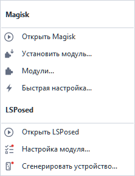
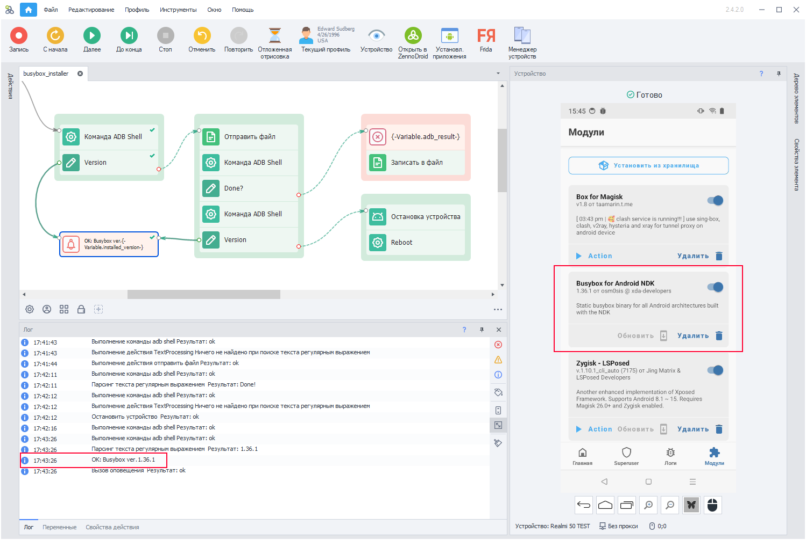
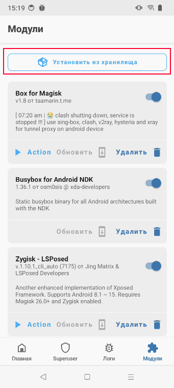
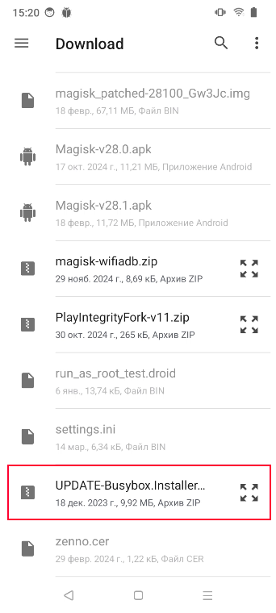

import DisclaimerNotice from '@site/src/components/DisclaimerNotice';

# Установка BusyBox
<DisclaimerNotice />

## Описание.
BusyBox представляет собой набор UNIX-утилит командной строки. Используется в функциях:
- [Сохранения и восстановления данных приложения](../Android/Enterprise/App#сохранить-данные-приложения);
- [Установки прокси в режиме Clash](../Android/Enterprise/setting#clash) *(необходима версия BusyBox не ниже 1.36.1)*;  

Для установки модуля вам понадобится смартфон с [**Magisk**](https://github.com/topjohnwu/Magisk).  
_______________________________________________
## Установка через меню действий (ZennoDroid 2.6.2+).
BusyBox поставляется вместе с ZennoDroid - скачивать его не нужно.  

1. В [**меню действий**](../pm/Interface/DeviceWindow#меню-действий) окна устройства выбираем **Magisk / LSPosed** → **Модули...** - откроется окно [**Модули Magisk**](../pm/Interface/DeviceWindow#модули-magisk).  
2. Нажимаем **Установить...** → **Установить Busybox**.  
3. Когда внизу окна появится надпись *Модуль установлен*, перезагружаем устройство, например пунктом меню [**Устройство** → **Перезагрузить**](../pm/Interface/DeviceWindow#устройство).  

**Меню «Magisk / LSPosed» и окно «Модули Magisk».**

<!--All you need is a blank line-->

 

_______________________________________________
## Автоматическая установка (ZennoDroid 2.4.2+).
Мы подготовили [**Шаблон для установки Busybox 1.36.1**](https://www.dropbox.com/scl/fi/079hbifq0keal5gmu9d1i/UPDATE-Busybox.Installer.v1.36.1-ALL-signed.zip?rlkey=r76ihn7ez64lo0a2j6zq8zoph&e=1&st=h8da6r8y&dl=0), чтобы вам было легче развернуть BusyBox на большом количестве устройств. Он проверяет текущую версию, и если она ниже 1.36.1, то автоматически устанавливает актуальный модуль для Magisk.  

:::info **После установки телефон автоматически перезагрузится.**
:::

Затем нужно снова подключиться к устройству и запустить шаблон. Сообщение в логе `OK: Busybox ver. 1.36.1` говорит о том, что BusyBox установлен и работает правильно.  

**Сообщение в логе.**

<!--All you need is a blank line-->

_______________________________________________
## Установка вручную.
Скачать модуль [Busybox for Android NDK 1.36.1](https://www.dropbox.com/scl/fi/079hbifq0keal5gmu9d1i/UPDATE-Busybox.Installer.v1.36.1-ALL-signed.zip?rlkey=r76ihn7ez64lo0a2j6zq8zoph&st=h8da6r8y&dl=0) нужно в папку телефона `sdcard/Download/` и установить с помощью стандартного меню:  

1. Открываем Magisk → раздел *Модули* → Установить из хранилища.  
2. Находим установщик среди скачанных файлов.  
3. Подтверждаем установку.  
4. В логе появится надпись `Done!`, если установка пройдёт успешно.  

**Установка модуля в Magisk.**

<!--All you need is a blank line-->

   

:::warning **После установки необходимо перезагрузить устройство.**
:::
