import DisclaimerNotice from '@site/src/components/DisclaimerNotice';

# Настройка LSPosed
<DisclaimerNotice />

export const VideoSample = ({source}) => (
  <video controls playsInline muted preload="auto" className='docsVideo'>
    <source src={source} type="video/mp4" />
</video>
);

## Описание. 
Модуль ZennoDroid необходим для подмены основных параметров устройства: IMEI, Android ID, сотового оператора, модели, WiFi, Bluetooth и других.  
:::info **Для функционирования модуля необходимы Root-права**
Поддерживаются телефоны с Android 9-16 
:::  

Начиная с версии ZennoDroid 2.5.0.0, для установки модуля необходим [**Magisk**](https://github.com/topjohnwu/Magisk/releases/latest) с активным **Zygisk** и **LSPosed v.2**.  
_________________  
## Активация Zygisk
### Активация встроенного Zygisk
Открываем настройки Magisk, включаем **Zygisk** и перезагружаем устройство.  

**Настройки Magisk.**

<!--All you need is a blank line-->

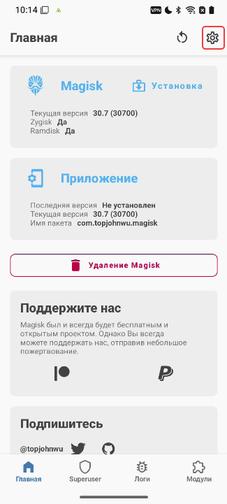 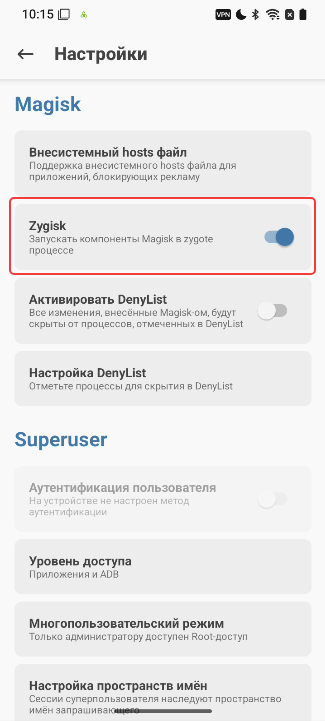

### Активация стороннего Zygisk
Для улучшения антидетекта Magisk рекомендуется использовать сторонний Zygisk (например, [**Zygisk Next**](https://github.com/LSPosed/ZygiskNext/releases/latest)) вместо встроенного в Magisk.  

1. Скачиваем модуль Zygisk Next. В [**меню действий**](../pm/Interface/DeviceWindow#меню-действий) окна устройства выбираем **Magisk / LSPosed** → **Установить модуль...**, указываем скачанный файл и нажимаем **Установить**.  
2. Открываем настройки Magisk и выключаем встроенный **Zygisk**.  
3. Перезагружаем устройство.  

**Окно «Установить модуль Magisk» и настройки Magisk.**

<!--All you need is a blank line-->

 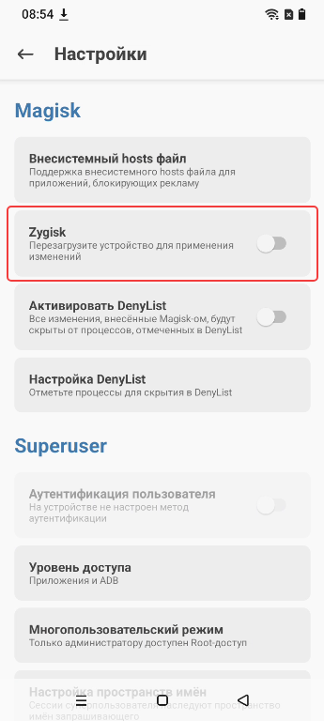 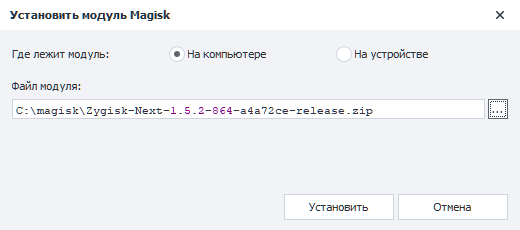 

_________________
## Установка LSPosed Framework    
### Установка через меню действий (ZennoDroid 2.6.2+)
**LSPosed v.2** поставляется вместе с ZennoDroid, установить его можно прямо из ProjectMaker через Меню действий:  

1. В [**меню действий**](../pm/Interface/DeviceWindow#меню-действий) окна устройства выбираем **Magisk / LSPosed** → **Модули...** - откроется окно [**Модули Magisk**](../pm/Interface/DeviceWindow#модули-magisk).  
2. Нажимаем **Установить...** → **Установить LSPosed**.  
3. Когда внизу окна появится надпись *Модуль установлен*, перезагружаем устройство, например пунктом меню [**Устройство** → **Перезагрузить**](../pm/Interface/DeviceWindow#устройство).  

**Меню «Magisk / LSPosed» и окно «Модули Magisk».**

<!--All you need is a blank line-->

 

### Установка вручную
Актуальная официальная версия **LSPosed** распространяется через официальный [**Telegram канал**](https://t.me/LSPosed). Также последнюю версию LSPosed можно скачать по [**ссылке**](https://www.dropbox.com/scl/fo/bve4et0ilt6bocnbi7ba9/AI0JuEpsjOHkKKlYMgx9aM0?rlkey=je4fi8u0np6267i0e5iblsyu3&st=rlrsg76a&dl=0). Этот билд нужно скачать на телефон в папку **sdcard/Download/** и установить с помощью стандартного меню.  

**Установка модуля в Magisk.**

<!--All you need is a blank line-->

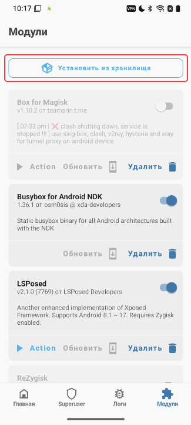 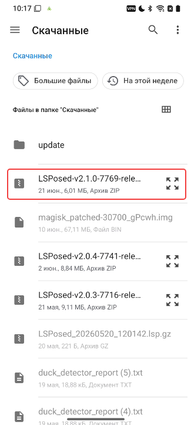

 
_________________
## Установка модуля «ZennoDroid»  
### Установка через меню действий (ZennoDroid 2.6.2+)
Модуль ZennoDroid проще всего установить прямо из ProjectMaker:  

1. В [**меню действий**](../pm/Interface/DeviceWindow#меню-действий) окна устройства выбираем **Magisk / LSPosed** → **Настройка модуля...** - откроется окно [**Настройка модуля LSPosed**](../pm/Interface/DeviceWindow#настройка-модуля-lsposed).  
2. Оставляем в поле **Модуль** `com.zennolab.zennodroid`, ставим флажок **Включить модуль** и отмечаем приложения, к которым будет применяться подмена параметров устройства.  
3. Нажимаем **Применить**.  

ZennoDroid сам установит модуль и включит его для отмеченных приложений.  

**Меню «Magisk / LSPosed» и окно «Настройка модуля LSPosed».**

<!--All you need is a blank line-->

 

### Установка вручную
Модуль ZennoDroid устанавливается автоматически при первой попытке изменить параметры устройства или при выполнении любого экшена из группы [Управление LSPosed](./LSPosed_Control).  

При запуске на экране устройства возникнет запрос прав суперпользователя. Необходимо нажать на кнопку **«Разрешить»** (при использовании magisk, разрешение предоставляется автоматически).  

**Запрос прав суперпользователя.**

<!--All you need is a blank line-->

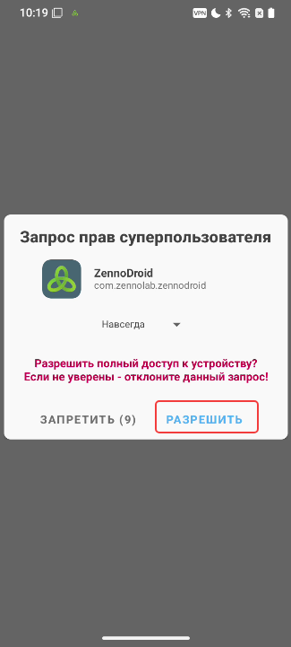

Если вы не успели этого сделать или случайно нажали на кнопку **«Запретить»**, тогда нужно открыть **Magisk**. Там переходим на вкладку **Superuser (Суперпользователь)** и включаем *автоматическую выдачу прав суперпользователя для ZennoDroid*.  

**Вкладка Superuser в Magisk.**

<!--All you need is a blank line-->

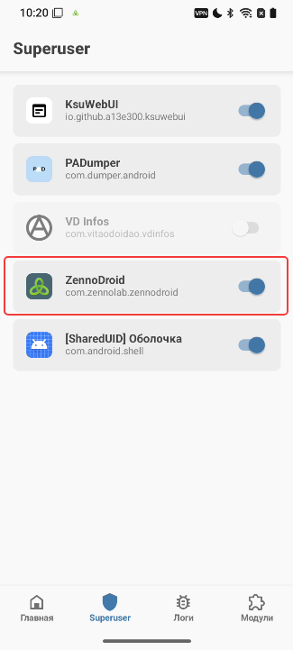

После запуска модуля на экране устройства появится уведомление о том, что он выключен.  

**Модуль ZennoDroid выключен.**

<!--All you need is a blank line-->

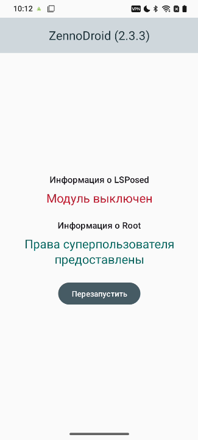

Нам нужно запустить LSPosed через меню в шторке, переключиться на вкладку **Модули** и включить *модуль ZennoDroid*.  

**Включение модуля в LSPosed.**

<!--All you need is a blank line-->

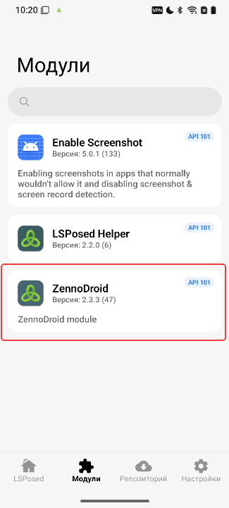 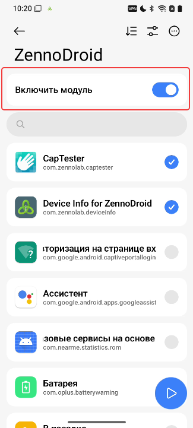

После этого можно будет выбрать программы, к которым будет применяться подмена параметров устройства.  
_________________
### Важная информация  
- Рекомендуем добавлять в список подмены только те приложения, для которых действительно требуется изменять данные. **Не нужно добавлять в список системный фреймворк (system framework)**.  
- Если после активации вы удалили приложение, а затем установили его повторно, необходимо обязательно заново активировать приложение в списке подмены **(снять и установить галочку)**.  
  
:::tip **В LSPosed есть визуальный баг**
При удалении приложения оно также автоматически удаляется из списка подменяемых. Однако после повторной установки приложение автоматически не попадает в список подменяемых (галочка при этом стоит, но подмены не работают).
:::     
  
- По умолчанию в списке программ отображаются не все приложения. Если вы не видите нужного, например, Google Chrome, то нужно зайти в меню **Настройки** и выбрать нужную группу.  

**Выбор группы приложений.**

<!--All you need is a blank line-->

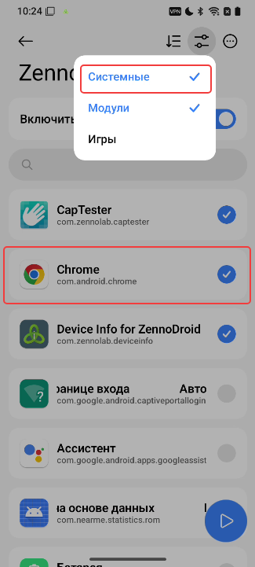

- После выбора приложений для подмены нужно вернуться в модуль ZennoDroid и нажать на кнопку **«Перезапустить»**. Далее при перезапуске на экран устройства будет выведено уведомление о том, что модуль готов к работе. Можно менять параметры устройства с помощью экшенов.  

**Модуль готов к работе.**

<!--All you need is a blank line-->

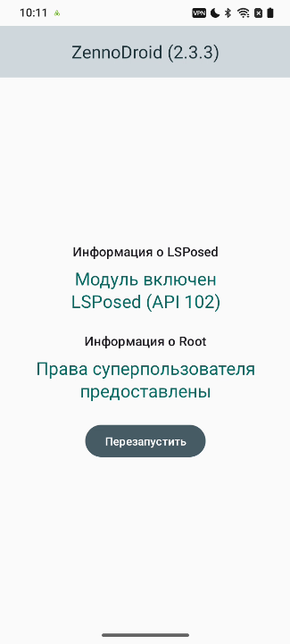

- Завершите работу нужных приложений после подмены параметров устройства. Предпочтительно делать это экшеном **«Закрыть приложение»**.   

:::tip **Можно закрывать приложения и до подмены.**
Но тогда некоторые системные приложения тут же перезапускаются, поэтому могут считать старые параметры.
:::  
_________________
## Управление LSPosed с помощью экшенов (ZennoDroid 2.4.6+)
В версии **ZennoDroid 2.4.6** была добавлена возможность удобного [**управления LSPosed**](./LSPosed_Control) с помощью группы экшенов.

_________________
## API для управления LSPosed (ZennoDroid 2.4.0+)
В версии **ZennoDroid 2.4.0** мы добавили API для управления LSPosed.

Основные функции:
- включить и выключить нужный модуль;  
- выбрать приложения в списке подмены нужного модуля, а также добавить или удалить их из списка;  
- создать и восстановить бэкап настроек (поддерживается сохранение как на телефон, так и на компьютер);  
- получить информацию о LSPosed.

### Видеоинструкция (пример работы с API) 
> Настройка модуля ZennoDroid и модуля [DisableFlagSecure](https://github.com/LSPosed/DisableFlagSecure/releases/latest) (`io.github.lsposed.disableflagsecure`), позволяющего просматривать защищенные страницы.  

<VideoSample source={require("@site/static/video/LSPosedAPI.mp4").default}/>  

Также примеры работы с API приведены в архиве [LSPosedAPI.zip](https://www.dropbox.com/scl/fi/xsw5q8ej1wtmhpg5695we/LSPosedAPI.zip?rlkey=menqd2q7a0g6qnmc1l3omq4fr&st=0byf2hwb&dl=0&roistat_visit=1429674).  

_________________
## Полезные ссылки.  
- Шаблон для подмены параметров устройства с помощью экшенов и API: [**fakeDeviceBrief.droid**](https://www.dropbox.com/scl/fi/xkyhg4e72l9su4xvqsdn9/fakeDeviceBrief.droid?rlkey=583ltzuficlyh0kxrma83qodb&dl=0)  
- [**Последняя версия LSPosed Framework v.2**](https://www.dropbox.com/scl/fo/bve4et0ilt6bocnbi7ba9/AI0JuEpsjOHkKKlYMgx9aM0?rlkey=je4fi8u0np6267i0e5iblsyu3&st=rlrsg76a&dl=0)  
- [**Подключение реального устройства к ZennoDroid**](./Connection).  
- [**Настройки устройства**](../Settings/Settings_for_Enterprise).

 