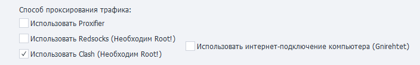

---
sidebar_position: 11
sidebar_label: Проксирование трафика (Enterprise)
title: Проксирование трафика (Enterprise) | Документация ZennoDroid | ZennoLab
description: Проксирование трафика (Enterprise) - раздел официальной документации ZennoDroid от ZennoLab. Подробные инструкции, примеры использования и руководство по настройке
---  
# Проксирование трафика (Enterprise)
:::info **Пожалуйста, ознакомьтесь с [*Правилами использования материалов на данном ресурсе*](../Disclaimer).**
:::

## Описание.  
ZennoDroid позволяет выбрать способ проксирования трафика для выполнения экшена [**Установка прокси**](../Android/Enterprise/setting#как-поставить-прокси). Параметры задаются на вкладке [**Настройки Android**](../Android/Enterprise/setting#как-поставить-прокси).   

    

:::info **Статья актуальна для версий 2.4.2 и выше**
Теперь способ проксирования трафика и другие настройки были вынесены в экшен [**Установка прокси**](../Android/Enterprise/setting#как-поставить-прокси).

[Информацию для старых версий можно найти здесь](./Legacy/Proxy_Traffic_Ent).
:::
_______________________________________________ 
## [Proxifier](https://proxifier.com/).  
Это мощная и гибкая программа для перенаправления интернет-трафика через прокси-сервер. Она позволяет приложениям, которые не поддерживают работу через прокси, использовать его.   

Используется интернет-подключение компьютера. Весь трафик с телефона заворачивается в VPN с помощью Gnirehtet и передаётся на ПК, где уже проксируется через приложение Proxifier.  

:::tip **Gnirehtet — это инструмент, который позволяет раздавать интернет с компьютера на Android-устройство.**
Работает, как привычная всем "точка доступа", но с обратным смыслом. Это полезно в ситуациях, когда у вашего телефона нет мобильного интернета или доступа к Wi-Fi, но ваш компьютер подключен к сети.  

Программа работает через USB-кабель или по беспроводной сети и не требует root-прав на устройстве. 
:::
__________________________________________ 
## ProxyBridge.  
:::info **Доступно начиная с версии ZennoDroid 2.6.3.0.**
:::
Альтернатива Proxifier. Трафик телефона так же заворачивается в VPN с помощью Gnirehtet и передаётся на ПК, но там перехватывается на уровне сетевых пакетов. Поэтому мимо прокси не уходит и UDP: через прокси SOCKS5 с поддержкой UDP он идёт через прокси, а через остальные блокируется.

Поддерживаются прокси HTTP и SOCKS5, с авторизацией и без. SOCKS4 ставится только через Proxifier. Root на телефоне не нужен.

Всё нужное ставит установщик ZennoDroid: отдельная программа и служба Windows не нужны. ProxyBridge нужны права администратора, но ProjectMaker и ZennoDroid и так запускаются с ними. Смена прокси перезапускает туннель, и открытые соединения телефона обрываются.  
__________________________________________ 
## Redsocks.  
Данная утилита нужна для перенаправления сетевого трафика через прокси-сервер, минуя необходимость ручной настройки прокси в каждом отдельном приложении. Выполняется прозрачный редиректор TCP/UDP-соединений в прокси.  

Все необходимые файлы копируются на устройство автоматически при первой установке прокси.

:::warning **Работает только на устройствах с Root.**
:::  

_______________________________________________ 
## [Clash](/zennodroid/Android/Enterprise/Clash) (рекомендуем).  
Это продвинутый прокси-клиент с возможностью маршрутизации трафика по заданным правилам. Он отличается мощным rule-based подходом и сам решает через какой сервер направить трафик в зависимости от настроенных правил. 

Простое и полное проксирование всего UDP-трафика — в отличие от redsocks, не требуется настраивать отдельное проксирование для каждого IP. Благодаря этому, при использовании прокси с поддержкой UDP, даже IP-адрес через WebRTC отображается как адрес прокси.  

Все необходимые файлы копируются на устройство автоматически при первой установке прокси. 

:::warning **Работает только на устройствах с Root.**
Необходим BusyBox версии не ниже 1.36.1.
:::  
__________________________________________
## Использовать интернет-подключение компьютера (Gnirehtet).  
:::warning **Эта опция доступна при использовании Redsocks или Clash**
:::  

Если эта настройка **выключена**, то весь интернет-трафик будет напрямую передаваться через Wi‑Fi-подключение телефона. Однако при её **включении** весь трафик с телефона начинает идти в обход с помощью Gnirehtet и передаваться на компьютер.  

При использовании этого метода нужно выключить передачу данных на телефоне, чтобы исключить случайную утечку трафика в сеть. Сделать это можно вручную или с помощью экшена.  

С Proxifier и ProxyBridge трафик телефона идёт через компьютер всегда, без этой галочки.

Начиная с версии ZennoDroid 2.6.3.0 через компьютер идёт и IPv6-трафик телефона. По умолчанию он тоже проксируется: если прокси не может открыть IPv6-адрес, соединение отклоняется примерно за 3 секунды, и приложение переходит на IPv4. Мимо туннеля с настоящим адресом телефона IPv6 не уходит. Другое поведение задаётся из C# свойством [`Ipv6Mode`](../API/DroidProxySettings#droidipv6mode).

С Proxifier и ProxyBridge DNS-запросы телефона идут по TCP через прокси к серверам из поля **Адреса DNS**, а частный DNS на телефоне на это время выключается и возвращается после снятия прокси. Если прокси не пускает TCP-соединения к DNS-серверу на порт 53, DNS идёт по UDP: через прокси SOCKS5 с поддержкой UDP - через прокси, а в остальных случаях - с адреса компьютера, мимо прокси.  
_______________________________________________
- [**Установка Clash (Box for Root).**](/zennodroid/Android/Enterprise/Clash).