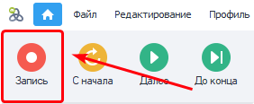
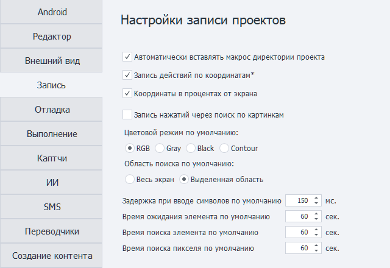
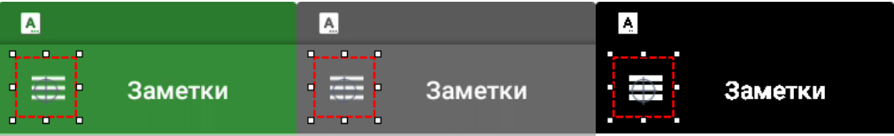

---
sidebar_position: 4
sidebar_label: Запись проекта
title: Запись проекта | Документация ZennoDroid | ZennoLab
description: Запись проекта - раздел официальной документации ZennoDroid от ZennoLab. Подробные инструкции, примеры использования и руководство по настройке
---  
# Запись проекта
:::info **Пожалуйста, ознакомьтесь с [*Правилами использования материалов на данном ресурсе*](../Disclaimer).**
:::

## Запись проекта.  
  

Данная вкладка содержит настройки, которые активируются при включенной записи проекта.  

 
_______________________________________________
## Автоматически вставлять макрос директории.  
:::tip **Эта настройка работает даже *при выключенной записи* проекта.**
:::   

В ZennoDroid существуют [**переменные окружения**](../pm/Creating/Variables). Например, `{-Project.Directory-}`, в которой хранится путь к директории, где сохранён файл проекта.  
:::info **Если проект не сохранён на диске, то переменная содержит пустую строку.**
::: 

При включении данной настройки во время создания проекта ProjectMaker будет подставлять макрос **директории проекта** туда, куда это возможно. Например, в другие настройки и экшены. Указываемый путь должен находиться в той же папке, что и файл проекта, либо в одной из подпапок.  
_______________________________________________
## Запись действий по координатам.  
Эта настройка отвечает за то, что при записи проекта все клики внутри [**Окна эмулятора**](../pm/Interface/DeviceWindow) будут записываться вместе с координатами. В проект добавятся экшены [**эмуляции touch**](../Android/pro-lite/Touch_Emulation), в которые автоматически внесутся координаты нажатия.  
:::warning **Если координаты записываются в пикселях, разрешение эмулятора должно быть одинаковым во время создания и выполнения проекта!**
Чтобы проект работал на устройствах с разным разрешением, включите [**координаты в процентах от экрана**](#координаты-в-процентах-от-экрана).
:::
_______________________________________________ 
## Координаты в процентах от экрана.  
:::info **Доступно начиная с версии ZennoDroid 2.6.3.0.**
:::

С этой настройкой запись сохраняет координаты не в пикселях, а в процентах от ширины и высоты экрана, с точностью до сотых: например, `27.99%` вместо `302`. Проценты получают все экшены, которые запись создаёт с координатами:  
- [**эмуляция touch**](../Android/pro-lite/Touch_Emulation#координаты-в-процентах) для нажатий по координатам;  
- [**эмуляция swipe**](../Android/pro-lite/Swipe) для свайпов;  
- [**масштабирование**](../Android/pro-lite/Utilities#масштабирование) для жестов масштаба.  

Настройка не зависит от **Записи действий по координатам**: та решает, записывать ли нажатия по координатам, а эта - в чём записывать сами координаты. Свайпы и масштабирование записываются с координатами всегда, поэтому для них проценты работают и при выключенной записи по координатам.  

Записанный так проект выполняется на устройствах с другим разрешением без правки координат. Ограничения те же, что у [**координат в процентах**](../Android/pro-lite/Touch_Emulation#координаты-в-процентах) в экшенах: поворот экрана не учитывается, а кнопка на экране с другим соотношением сторон может оказаться в другом месте.  
_______________________________________________ 
## Запись нажатий через поиск по картинкам.  
После включения параметра при каждом клике внутри [**Окна эмулятора**](../pm/Interface/DeviceWindow) в проект будет добавлен [**экшен touch**](../Android/pro-lite/RunEvent) через [**Поиск по картинке**](../pm/Creating/SearchByPic).  
### Цветовой режим.  
Поиск по картинке будет по умолчанию производиться в одном из режимов:    
- **RGB**. Поиск по цветному изображению.        
- **Gray**. Картинка только с оттенками серого.      
- **Black**. Черно-белый режим.  
 
:::tip **Советуем.**
*Для ускорения поиска производите поиск в режиме **Gray** или **Black***
:::   
 
### Область поиска.  
Выбор области, которая будет выставляться по умолчанию:  
- По всему экрану.  
- По выделенной области экрана. 
:::info **В целях снижения нагрузки на CPU лучше производить поиск по области экрана.**
::: 
_______________________________________________
## Задержка при вводе символов 
Используется в экшенах [**Эмуляция клавиатуры**](../Android/pro-lite/Keyboard) и [**Установка значения**](../Android/pro-lite/SetValue) в качестве *значения по умолчанию*.  
_______________________________________________
## Время ожидания элемента.  
Применяется в действиях [**Установка значения**](../Android/pro-lite/SetValue), [**Взятие значения**](../Android/pro-lite/GetValue) и [**Выполнить событие**](../Android/pro-lite/RunEvent)  в качестве *значения по умолчанию* для поля ***«Ждать элемент не более (сек)»***.  
_______________________________________________
## Время поиска элемента.  
Используется в экшене [**Поиск по картинке**](../pm/Creating/SearchByPic) в качестве *значения по умолчанию* для поля  
***«Ждать элемент не более (сек)»***.  
_______________________________________________
