# Окно устройства (эмуляторы)
:::info **Пожалуйста, ознакомьтесь с [*Правилами использования материалов на данном ресурсе*](../../Disclaimer).**
:::

## Начало работы.
В окне устройства идёт работа с эмулятором MEmu, LDPlayer или MuMu: здесь виден его экран, по нему можно кликать и свайпать мышью, а при включённой **Записи** все действия попадают в проект в виде экшенов. Меню и окна у всех эмуляторов одинаковые.  

Работа с реальным телефоном в ZennoDroid Enterprise описана в статье [**Окно устройства**](./DeviceWindow).  

Пока устройство не запущено, окно выглядит так:  

**Окно устройства до запуска.**

<!--All you need is a blank line-->

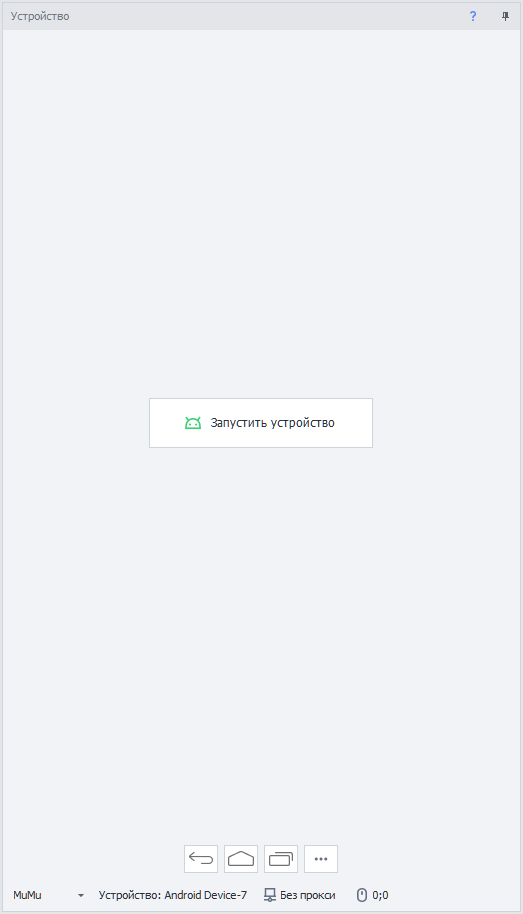

Чтобы начать работу, нажмите **Запустить устройство**. Если при этом включена **Запись** проекта, на холст будут добавлены два действия: **Выбрать устройство** и **Запуск/перезапуск устройства**.  

Если запустить устройство не удалось, под кнопкой появится причина. Устраните её и нажмите кнопку ещё раз.  

{/* СКРИНШОТ 2: причина неудачного запуска под кнопкой «Запустить устройство». */}

:::info **Причина неудачного запуска показывается начиная с версии ZennoDroid 2.6.2.0.**
:::
_______________________________________________
## Компоненты окна.
Такое окно вы увидите после успешного запуска устройства:  

**Окно запущенного устройства.**

<!--All you need is a blank line-->

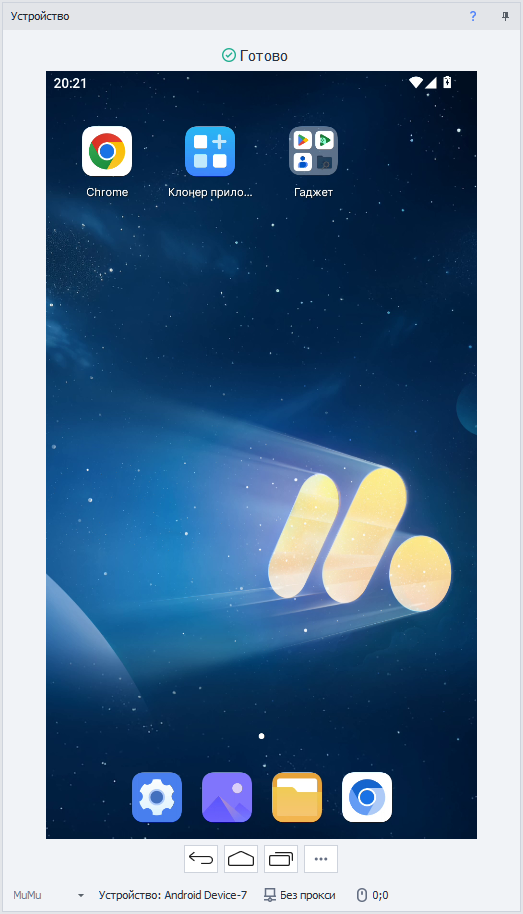

С экраном можно работать напрямую: кликать, свайпать, открывать приложения - все действия передаются на устройство. А если включена запись, они ещё и добавляются на холст в виде соответствующих экшенов.  
_______________________________________________
### Кнопки управления.

| Кнопка | Описание |
| ----------- | ----------- |
| **Назад** | Переход на прошлый экран. |
| **Домой** | Возврат на домашний экран. |
| **Недавние приложения** | Открыть список недавних приложений. |
| **Обновить экран** | Обновить изображение экрана. Кнопка видна, только когда выбран способ захвата изображения [**Вручную**](../../Settings/Settings_for_Android#способ-захвата-изображения). |
| **Действия** (три точки) | Открыть [**меню действий**](#меню-действий). |

Кнопки **Закрыть участок**, **Приблизить**, **Отдалить** и **Запись движений мыши** перенесены в меню действий, в группу [**Другие действия**](#другие-действия).  
_______________________________________________
### Тип эмулятора.
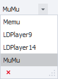

Список слева в строке состояния выбирает эмулятор, с которым работает ZennoDroid: **Memu**, **LDPlayer9**, **LDPlayer14** или **MuMu**. В списке только эмуляторы, установленные на компьютере, а если установлен всего один, списка нет.  

Это тот же выбор, что и [**Тип эмулятора**](../../Settings/Settings_for_Android#тип-эмулятора) в настройках Android: после смены типа окно переключится на устройство выбранного эмулятора. Пока устройство запущено, список недоступен.  

:::info **MuMu поддерживается начиная с версии ZennoDroid 2.6.2.0.**
:::
_______________________________________________
### Текущее устройство.
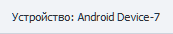

Кнопка с именем текущего устройства. Нажатие открывает [**Менеджер устройств**](../../Tools/Device_Manager), где можно выбрать другое устройство.  
_______________________________________________
### Прокси.

Кнопка показывает прокси, установленный на устройстве, или надпись **Без прокси**. Нажатие открывает окно **Установить прокси**:  

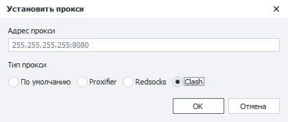

- **Адрес прокси** - строка прокси, например `255.255.255.255:8080` или `protocol://login:pass@IP:port`.  
- **Тип прокси** - способ проксирования: **По умолчанию** (как задано в [**настройках**](../../Settings/Settings_for_Android#способ-проксирования-трафика)), **Proxifier**, **Redsocks** или **Clash**. Чем они отличаются - в статье [**Проксирование трафика**](../../Settings/Proxy_Traffic).  

Кнопка **OK** применяет прокси к устройству.  

:::info **Выбор типа прокси в этом окне доступен начиная с версии ZennoDroid 2.6.2.0.**
:::
_______________________________________________
### Координаты мыши.

Если курсор находится в пределах экрана устройства, здесь отображаются его текущие координаты (X, Y).  
Эти координаты можно использовать в экшенах [**Эмуляция swipe**](../../Android/pro-lite/Swipe) и [**Эмуляция touch**](../../Android/pro-lite/Touch_Emulation).  
_______________________________________________
## Меню действий.
:::info **Меню действий появилось в версии ZennoDroid 2.6.2.0.**
:::

Кнопка **Действия** с тремя точками открывает меню часто используемых действий с устройством:  

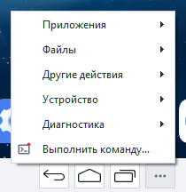

Пункты, у которых на значке **красная точка**, записываются в проект: если включена **Запись**, выполненное действие добавится на холст соответствующим экшеном. Что именно добавляется, показано в таблице [**ниже**](#что-записывается-в-проект).  

Большинство пунктов доступны, только пока устройство запущено. Пункты **Разблокировать экран**, **Очистить logcat**, **Выполнить диагностику...** и **Выполнить команду...** работают и с незапущенным устройством, если оно доступно по adb.  

Окна меню открываются по одному: пока одно из них открыто, кнопка **Действия** недоступна. Экран устройства при этом продолжает работать.  

:::info **Группы Magisk / LSPosed, пункта «Перезагрузить» и управления adb по Wi-Fi у эмуляторов нет: они есть только у реальных телефонов в ZennoDroid Enterprise.**
:::
_______________________________________________
### Приложения.

- **Установить APK...** - открывает окно [**установки приложения**](#установка-apk).  
- **Закрыть все приложения** - убирает все приложения из списка недавних.  

Пункты под заголовком **Активное приложение** работают с приложением, открытым на экране:  
- **Очистить** - очищает данные приложения. Перед очисткой ZennoDroid попросит подтверждение.  
- **Очистить кэш** - очищает только кэш приложения.  
- **Закрыть** - закрывает приложение.  
- **Удалить** - удаляет приложение с устройства, тоже после подтверждения.  
- **Сделать бэкап...** - сохраняет данные приложения в файл.  
- **Восстановить из бэкапа...** - восстанавливает данные приложения из файла бэкапа.  
- **Информация...** - показывает идентификатор приложения, его название и версию.  

#### Установка APK.
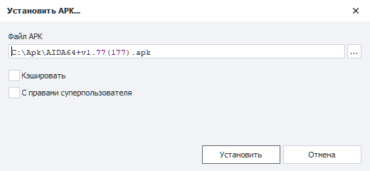

- **Файл APK** - файл приложения на компьютере: `.apk`, `.apks`, `.apkm` или `.xapk`.  
- **Кэшировать** - оставить файл на устройстве: при повторной установке того же APK он не будет копироваться заново.  
- **С правами суперпользователя** - устанавливать от root.  

#### Бэкап и восстановление.
Оба окна работают с приложением, открытым на экране: его идентификатор указан в строке **Приложение**.  

**Окна «Сделать бэкап» и «Восстановить из бэкапа».**

<!--All you need is a blank line-->

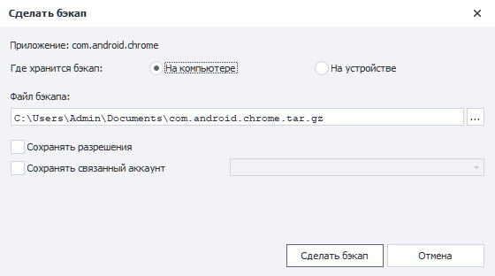

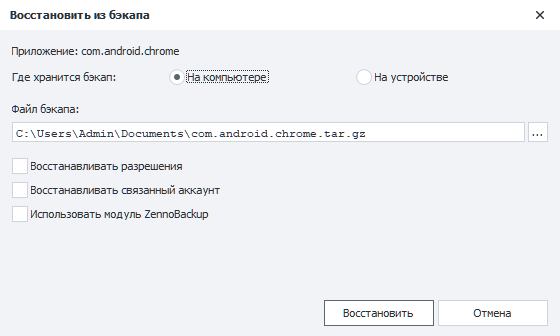

- **Где хранится бэкап** - **На компьютере** или **На устройстве**.  
- **Файл бэкапа** - путь к файлу.  
- При бэкапе: **Сохранять разрешения**, **Сохранять связанный аккаунт** и **Тип аккаунта**.  
- При восстановлении: **Восстанавливать разрешения**, **Восстанавливать связанный аккаунт** и **Использовать модуль ZennoBackup**.  

Эти параметры повторяют параметры экшена [**Действия с приложениями**](../../Android/pro-lite/App#сохранить-данные-приложения).  

:::info **Модуль ZennoBackup работает только на реальных телефонах: на эмуляторе с флажком «Использовать модуль ZennoBackup» восстановление завершится ошибкой.**
:::
_______________________________________________
### Файлы.

- **Отправить файл...** - копирует файлы с компьютера на устройство. В окне указываются **Файл на компьютере** и **Куда положить файл на устройстве**.  
- **Получить файл...** - копирует файл с устройства на компьютер. В окне указываются **Какой файл забрать с устройства** и **Куда сохранить на компьютере**.  
- **Файлы устройства...** - открывает [**файловый менеджер**](#файлы-устройства) устройства.  

В обоих окнах передачи есть флажок **С правами суперпользователя**. Долгую передачу можно остановить кнопкой **Прервать**.  

**Окна «Отправить файл» и «Получить файл».**

<!--All you need is a blank line-->

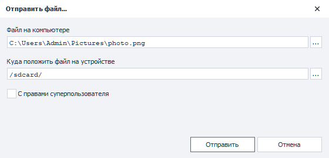

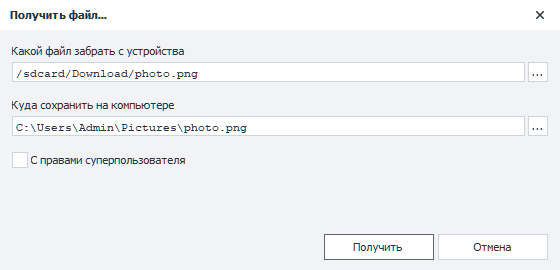

#### Файлы устройства.

**Окно «Файлы устройства».**

<!--All you need is a blank line-->

Файловый менеджер показывает папки и файлы устройства с размером, правами, владельцем, группой, контекстом SELinux и датой изменения. Кнопки над списком открывают корень `/`, папки `/data` и `/sdcard`. Кнопка со звёздочкой добавляет открытую папку в избранное или убирает её оттуда, а стрелка рядом с ней открывает список избранных папок.  

Всё, что можно сделать с файлом или папкой, собрано в меню по правой кнопке мыши:  

- **Открыть** - открыть папку. Файл передаётся приложениям устройства: его откроет приложение для этого типа файлов, или на экране устройства появится выбор приложения.  
- **Получить...** - скопировать файл на компьютер.  
- **Создать папку**, **Переименовать**, **Удалить**.  
- **Владелец и группа...**, **Права доступа...**, **Контекст SELinux...** - изменить владельца и группу, права доступа и контекст SELinux.  

Самые частые из этих действий продублированы кнопками внизу окна. А чтобы отправить файлы на устройство, перетащите их из Проводника в окно: они попадут в открытую папку.  

В окне **Права доступа** права задаются флажками или числом:  

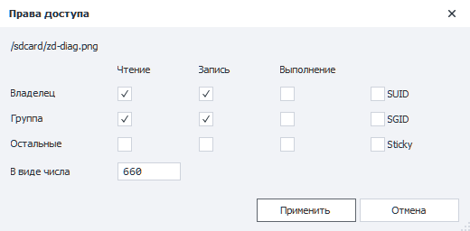
_______________________________________________
### Другие действия.
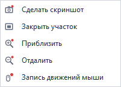

- **Сделать скриншот** - сохраняет снимок экрана устройства в PNG. ZennoDroid спросит, куда сохранить файл, и запомнит папку.  
- **Закрыть участок** - закрывает участок изображения экрана. Используется для тестирования поиска по картинке. Флажок у пункта показывает, закрыт ли участок сейчас.  
- **Приблизить** и **Отдалить** - приближают и отдаляют изображение в приложении, открытом на устройстве.  
- **Запись движений мыши** - записывает движения мыши по экрану устройства. Пока идёт запись, в окне виден значок записи с подсказкой *«Идёт запись движений мыши. Нажмите, чтобы остановить»*: нажатие на него останавливает запись.  
_______________________________________________
### Устройство.
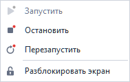

- **Запустить** и **Остановить** - запуск и остановка устройства.  
- **Перезапустить** - запустить устройство заново, как действие **Запуск**: эмулятор перезапускается.  
- **Разблокировать экран** - будит устройство и убирает экран блокировки. Если он защищён PIN-кодом, паролем или графическим ключом, их вводят вручную.  
_______________________________________________
### Диагностика.

- **Информация об устройстве...** - тип эмулятора, состояние, имя, заголовок и индекс устройства, его папка на компьютере и адрес. Текст можно скопировать кнопкой **Скопировать в буфер обмена**.  
- **Очистить logcat** - очищает журнал logcat на устройстве.  
- **Выполнить диагностику...** - собирает logcat, dmesg и последний tombstone в один ZIP-архив. Для dmesg и tombstone нужны права суперпользователя.  
- **Проверить IP-адрес** - показывает внешний IP-адрес устройства и, для сравнения, компьютера. Запрос идёт не из приложения, поэтому прокси, включённый только для выбранных приложений, на него может не действовать.  
- **Проверить IP-адрес в Chrome** - открывает адрес проверки в Chrome и читает ответ страницы: IP-адрес таким, каким его видят приложения. Потом закрывает вкладку, а если Chrome до проверки не был запущен, то и его. Если Chrome на устройстве не установлен, над экраном появится сообщение *«Chrome не установлен»*.  
- **Адреса для проверки IP...** - сервисы, которые спрашивают обе проверки.  

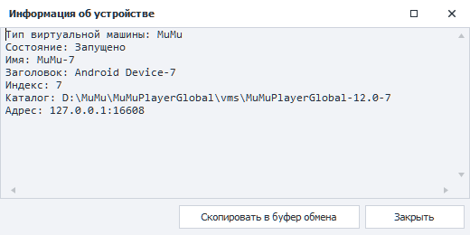

Кроме самих адресов, проверка IP показывает то, что о них сообщает сервис проверки: страну, регион, город, координаты, провайдера, почтовый индекс и часовой пояс, а иногда и имя хоста. Если IP-адрес компьютера совпадает с проверенным, вместо его данных написано *тот же*.  

**Результаты проверки IP-адреса (данные на снимках скрыты).**

<!--All you need is a blank line-->

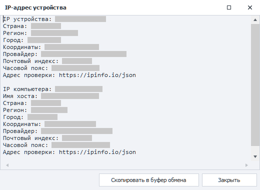

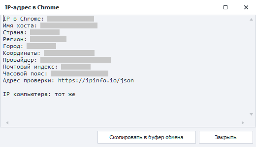

**Окно «Адреса для проверки IP».**

<!--All you need is a blank line-->

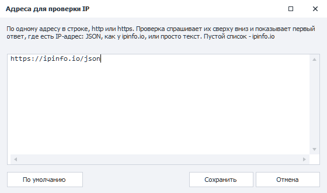

Адреса указываются по одному в строке, `http` или `https`. Проверка спрашивает их сверху вниз и показывает первый ответ, где есть IP-адрес: JSON, как у ipinfo.io, или просто текст. Пустой список - ipinfo.io. Кнопка **По умолчанию** возвращает исходный список.  

В коде проекта то же самое делают методы [**GetExternalIp**](../../API/Proxy#getexternalip) и [**GetExternalIpInBrowser**](../../API/Proxy#getexternalipinbrowser).  
_______________________________________________
### Выполнить команду.

**Окно «Выполнить команду».**

<!--All you need is a blank line-->

Пункт **Выполнить команду...** открывает окно для команд adb shell. Ответ устройства выводится в поле **Результат команды**, а выполненные команды сохраняются в **Истории команд**. Щелчок по команде в истории подставляет её в поле, двойной щелчок сразу выполняет, а кнопка **Удалить из истории** убирает лишнюю.  
- **С правами суперпользователя** - выполнить команду от root.  
- **Не проверять подключение** - не проверять подключение к устройству перед выполнением команды.  
_______________________________________________
### Перетаскивание файлов.
Файлы можно перетащить на окно устройства прямо из Проводника. Если все файлы - приложения (`.apk`, `.apks`, `.apkm`, `.xapk`), откроется окно [**установки APK**](#установка-apk), иначе - окно [**отправки файлов**](#файлы) на устройство.  

{/* СКРИНШОТ 29 (GIF): перетаскивание APK из Проводника на окно устройства и открывшееся окно установки. */}
_______________________________________________
### Что записывается в проект.
| Пункт меню | Экшен в проекте |
| ----------- | ----------- |
| **Установить APK...** | [**Действия с приложениями**](../../Android/pro-lite/App#установка-приложения) → Установка приложения |
| **Закрыть все приложения** | [**C# код**](../../project-editor/custom-code/С): `instance.DroidInstance.App.CloseAll();` |
| **Очистить**, **Очистить кэш** | [**Действия с приложениями**](../../Android/pro-lite/App#очистка-приложения) → Очистка приложения |
| **Закрыть** | [**Действия с приложениями**](../../Android/pro-lite/App#закрыть-приложение) → Закрыть приложение |
| **Удалить** | [**Действия с приложениями**](../../Android/pro-lite/App#удаление-приложения) → Удаление приложения |
| **Сделать бэкап...** | [**Действия с приложениями**](../../Android/pro-lite/App#сохранить-данные-приложения) → Сохранить данные приложения |
| **Восстановить из бэкапа...** | [**Действия с приложениями**](../../Android/pro-lite/App#восстановить-данные-приложения) → Восстановить данные приложения |
| **Отправить файл...**, **Получить файл...** | [**Работа с файлами**](../../Android/pro-lite/Files) → Отправка или получение файла |
| **Сделать скриншот** | [**Обработка изображений**](../../Data/Images): снимок экрана сохраняется в выбранный файл |
| **Приблизить**, **Отдалить** | [**Утилиты**](../../Android/pro-lite/Utilities#масштабирование) → Масштабирование |
| **Запустить**, **Перезапустить** | [**Действия с устройством**](../../Android/pro-lite/action#как-запустить-или-перезапустить-устройство) → Запуск/перезапуск устройства |
| **Остановить** | [**Действия с устройством**](../../Android/pro-lite/action#как-остановить-устройство) → Остановить устройство |
| **Проверить IP-адрес** | [**C# код**](../../project-editor/custom-code/С): `return instance.DroidInstance.Proxy.GetExternalIp();`, ответ - в переменной `ExternalIp` |
| **Проверить IP-адрес в Chrome** | [**C# код**](../../project-editor/custom-code/С): `return instance.DroidInstance.Proxy.GetExternalIpInBrowser();`, ответ - в переменной `ExternalIp` |
| **Выполнить команду...** | [**Утилиты**](../../Android/pro-lite/Utilities#консольная-команда-adb-shell) → Консольная команда (ADB Shell), ответ - в переменной `AdbResult` |

Все эти пункты записываются, только когда включена **Запись**.  
_______________________________________________
## Контекстное меню.
Кликните правой кнопкой мыши по элементу на экране устройства, и откроется контекстное меню. Набор пунктов зависит от элемента. Например, так меню выглядит на поле ввода:  

#### Пункты для полей ввода:  
- **Очистить текст**.  
Очищает поле ввода.  
Если включена запись, то в проект добавится экшен [**Эмуляция клавиатуры**](../../Android/pro-lite/Keyboard) с таким содержимым: `{AndroidKeys.CLEAR}`.  
- **Вставить текст из буфера обмена Windows**.  
Вставляет в поле текст из буфера обмена компьютера. Если буфер пуст, ничего не происходит.  
Если включена запись, то в проект добавится экшен [**Эмуляция клавиатуры**](../../Android/pro-lite/Keyboard) с этим текстом. Если перед ним в проекте тоже стоит эмуляция клавиатуры, текст допишется в неё: например, **Очистить текст** и затем **Вставить текст из буфера обмена Windows** дадут один экшен с содержимым `{AndroidKeys.CLEAR}текст`.  
- **Установить значение из профиля**.  
Вставляет в поле значение из **Профиля** проекта.  
Если включена запись, то в проект добавится экшен [**Установить значение**](../../Android/pro-lite/SetValue) с макросом из выбранного профиля.  
- **Установить значение из переменной**.  
Вставляет в поле значение переменной проекта. Пункт появляется, только если в проекте есть хотя бы одна переменная.  
Если включена запись, то в проект добавится экшен [**Установить значение**](../../Android/pro-lite/SetValue) с макросом выбранной переменной.  

#### Пункты для любого элемента:  
- **Исследовать элемент**.  
Вызывает окно [**Свойства элемента**](./ElementProp) для более детального изучения. Также выбранный элемент будет выделен в окне [**Дерево элементов**](./ElementTree).  
- **Следовать за курсором**.  
Пока пункт включён, элемент под курсором подсвечивается, а его свойства попадают в окно [**Свойства элемента**](./ElementProp). Чтобы выключить подсветку, выберите пункт ещё раз.  

**Пример.**

<!--All you need is a blank line-->

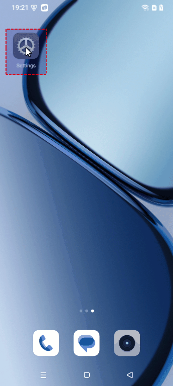

- **В конструктор действий**.  
Отправляет элемент в [**Конструктор действий**](./ActionBuilder).  
- **Поиск XPath**.  
Открывает [**Конструктор действий**](./ActionBuilder) в режиме xPath: в нём уже будет XPath выбранного элемента, а сам элемент обводится на экране устройства.  

**Результат «Поиска XPath» в Конструкторе действий.**

<!--All you need is a blank line-->

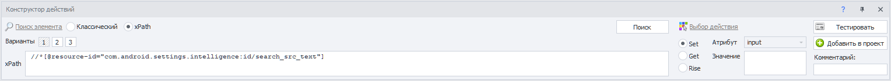

- **Это каптча!**.  
Отмечает элемент как капчу и сразу добавляет в проект экшен её распознавания - даже если запись выключена. Ответ экшен кладёт в новую переменную `RecognitionResult` с номером, например `RecognitionResult0`. По умолчанию капча вводится вручную: откроется окно с картинкой элемента, где нужно набрать ответ и нажать Enter. Модуль распознавания можно сменить в самом экшене (например, на [**CapMonster.Cloud**](https://capmonster.cloud/)).  

**Окно ручного ввода капчи.**

<!--All you need is a blank line-->

- **Приклеить к каптче**.  
Появляется, когда в проекте уже есть капча, отмеченная пунктом **Это каптча!**. Добавляет к ней ещё одну картинку: несколько отдельных картинок соединяются в одну и распознаются вместе.  
- **Поле для результата распознавания каптчи**.  
Тоже появляется, только когда в проекте есть капча. Вводит ответ на капчу в выбранный элемент и, если включена **Запись**, добавляет экшен [**Установить значение**](../../Android/pro-lite/SetValue) с переменной ответа.  
- **Создать проверку наличия текста**.  
Открывает окно **Проверка наличия текста** с текстом элемента. Кнопка **OK** добавляет в проект экшен проверки этого текста - даже если запись выключена. Результат проверки экшен кладёт в новую переменную.  

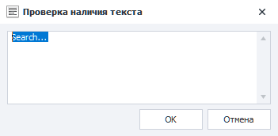

- **Поиск по картинке**.  
Открывает окно поиска по картинке со снимком экрана: в нём выделяется картинка и задаются точность совпадения, цветовой режим и область поиска. Если картинка нашлась, нажмите **Да**, а затем **Добавить в проект**: в проект добавится экшен клика по картинке. Если запись выключена, ZennoDroid спросит, добавить ли экшен всё равно. Подробнее - в статье [**Поиск по картинке**](../Creating/SearchByPic).  

**Окно «Поиск по картинке».**

<!--All you need is a blank line-->

- **Поиск по пикселю**.  
Открывает окно поиска по цвету пикселя, уже с цветом пикселя под курсором. Здесь задаются допустимое отклонение цвета и область поиска, а найденный пиксель обводится на экране. Если пиксель нашёлся, нажмите **Да**: появятся настройки касания, смещение и кнопки **Тестировать** и **Добавить в проект**. Экшен клика по пикселю добавляется в проект, даже если запись выключена.  

**Окно «Поиск по пикселю».**

<!--All you need is a blank line-->

- **Получить цвет пикселя**.  
Копирует цвет пикселя под курсором в буфер обмена в виде `#RRGGBB`. В проект ничего не добавляется.  
_______________________________________________
## Полезные ссылки.  
- [**Конструктор действий**](./ActionBuilder).
- [**Менеджер устройств**](../../Tools/Device_Manager).
- [**Настройки Android (Lite/Pro)**](../../Settings/Settings_for_Android).
- [**Действия с устройством**](../../Android/pro-lite/action).
- [**Действия с приложениями**](../../Android/pro-lite/App).
- [**Работа с файлами**](../../Android/pro-lite/Files).
- [**Эмуляция клавиатуры**](../../Android/pro-lite/Keyboard).
