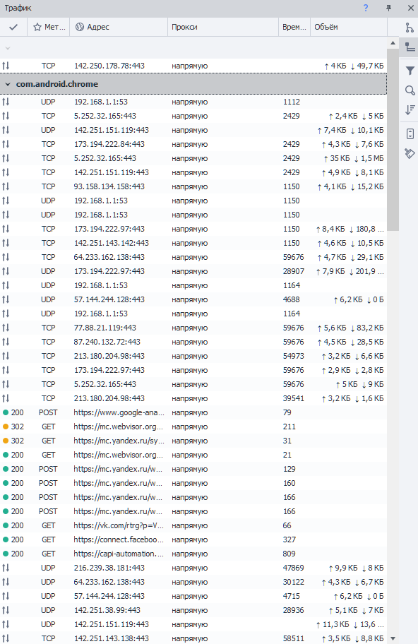

import DisclaimerNotice from '@site/src/components/DisclaimerNotice';

# Окно трафика
<DisclaimerNotice />

:::info **Доступно начиная с версии ZennoDroid 2.6.3.0.**
:::

## Описание.
Окно **Трафик** показывает, куда ходит в сеть подключённый телефон: запросы Chrome, соединения всех приложений, а если трафик телефона идёт через прокси - и содержимое запросов приложений. По нему видно, какие запросы делает приложение, а из любого запроса можно сразу собрать экшен [**HTTP-запроса**](../../project-editor/http-and-ftp/HTTP).

**Окно «Трафик» со строками, сгруппированными по приложению.**

<!--All you need is a blank line-->

_______________________________________________
## Как открыть.
В верхнем меню **Окно → Трафик**. Трафик записывается, пока окно открыто: если его закрыть, запись останавливается.
_______________________________________________
## Что попадает в окно.
- **Запросы Chrome** - целиком: адрес, метод, заголовки, cookie, тела запроса и ответа.  
- **Соединения приложений** - какое приложение, к какому адресу и сколько данных передало. Имя хоста и объём видны, когда телефон выходит в сеть через Clash или через интернет-подключение компьютера (способы описаны в разделе [**Как поставить прокси**](../../Android/Enterprise/setting#как-поставить-прокси)). Объём остальных соединений ZennoDroid считает только на телефоне с root.  
- **Содержимое запросов приложений** - адрес, метод, заголовки и тела, как у Chrome, но только при определённых условиях: подробнее - в разделе [**Расшифровка содержимого**](#расшифровка-содержимого).  

Входящие соединения телефона, например отладка adb по Wi-Fi, в окно не попадают, а пароль прокси в строках телефона скрыт.
_______________________________________________
## Строки и настройки окна.
У строк телефона, кроме статуса, метода, адреса, прокси и времени, есть колонки **Приложение** - пакет, от которого шёл трафик, и **Объём**.

- **Сгруппировать по приложению** - строки собираются по приложениям: сразу видно, кто ходил в сеть.  
- **Только запросы** - скрывает соединения и оставляет запросы.  

Строка соединения отмечена в колонке результата значком со стрелками вверх и вниз. Пустая ячейка результата у запроса значит, что ответ ещё не пришёл.

Двойной клик по запросу открывает его подробности: заголовки, cookie, параметры и ответ. В контекстном меню запроса можно скопировать его данные или выбрать **Создать действие из запроса** - на холсте появится заполненный экшен [**HTTP-запроса**](../../project-editor/http-and-ftp/HTTP). Проверьте значения, которые в него попали.
_______________________________________________
## Расшифровка содержимого.
Запросы приложений, кроме Chrome, зашифрованы. ZennoDroid расшифровывает их на компьютере, пока окно трафика открыто, если:
- трафик телефона идёт через Clash - на телефоне или через компьютер - или через интернет-подключение компьютера способами Proxifier и ProxyBridge;  
- на телефоне есть root: ZennoDroid ставит на него свой корневой сертификат, которому приложения доверяют так же, как системным;  
- прокси указан не адресом IPv6.  

Без прокси и без подключения через компьютер содержимого нет: расшифровать трафик можно только на его пути через компьютер или Clash. Внешний IP телефона при записи не меняется - трафик по-прежнему уходит через прокси.

Расшифровка начинается через несколько секунд после открытия окна: что телефон отправил раньше, остаётся без содержимого. Если во время записи сменить прокси или остановить устройство, расшифровка прекращается - закройте окно трафика и откройте его снова.

Сертификат ставится на телефон один раз и остаётся на нём до перезагрузки телефона.

### Пиннинг сертификатов.
Некоторые приложения проверяют сертификат своего сервера и не принимают чужой. У такого хоста в колонке результата стоит значок отказа, его соединения остаются без содержимого, а приложение продолжает работать.

Расшифровать и такие приложения помогает модуль ZennoDroid для LSPosed: пункт **Расшифровка трафика → Отключить пиннинг сертификатов** в [**меню действий**](./DeviceWindow#расшифровка-трафика) окна устройства передаёт модулю сертификат ZennoDroid, и приложения принимают его вместо своего. Приложение должно быть в области действия модуля и перезапущено после этого.

### Сертификат.
С ZennoDroid поставляется свой корневой сертификат *ZennoDroid Traffic CA*. Он один и тот же на всех компьютерах, поэтому телефон и модуль можно подготовить заранее, до первой записи. Вместо него можно задать свой сертификат пунктом **Расшифровка трафика → Импортировать сертификат**: тогда расшифровка и установка на телефон идут с ним.
_______________________________________________
## Полезные ссылки.
- [**Окно устройства**](./DeviceWindow)  
- [**Настройки устройства (Enterprise)**](../../Android/Enterprise/setting)  
- [**Установка LSPosed и модуля ZennoDroid**](../../Enterprise/LSPosed)  
- [**HTTP-запрос**](../../project-editor/http-and-ftp/HTTP)  
