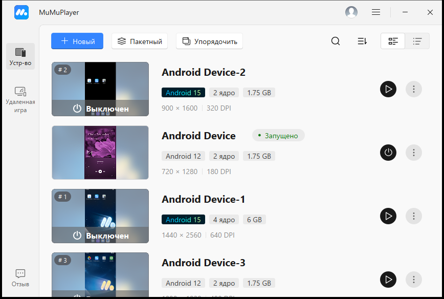
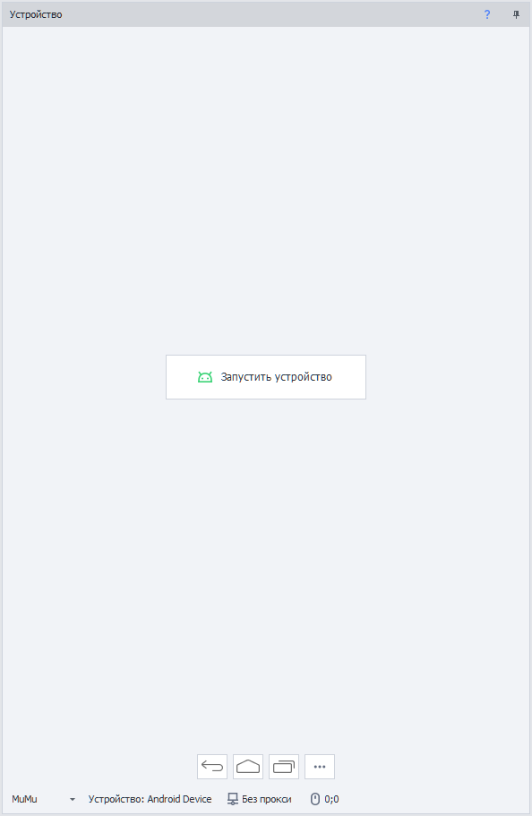

# Установка MuMu
:::info **Пожалуйста, ознакомьтесь с [*Правилами использования материалов на данном ресурсе*](../Disclaimer).**
:::

## Что такое MuMu Player?  
MuMu Player - эмулятор Android от NetEase. Он запускает на компьютере сразу несколько устройств, причём устройства на Android 12 и Android 15 могут работать одновременно.  

**Окно MuMuPlayer со списком устройств.**

<!--All you need is a blank line-->

В окне MuMuPlayer у каждого устройства видны название, номер, версия Android, число ядер, объём памяти и разрешение экрана. По названию или номеру устройство выбирается в экшене [**Выбрать устройство**](../Android/pro-lite/action#как-выбрать-устройство).  

:::info **MuMu поддерживается начиная с версии ZennoDroid 2.6.2.0.**
:::
_______________________________________________  
## Какую версию установить.  
ZennoDroid работает с MuMu Player 6.x - эту версию ставит установщик с официального сайта, а дальше MuMu обновляется сам.   
_______________________________________________  
## Системные требования.  
Рекомендуемые требования с [**официального сайта MuMu**](https://www.mumuplayer.com/):  
- **Операционная система**: Windows 8 или новее, DirectX 11 или OpenGL 4.x.  
- **Процессор**: Intel Core i5-7500 или лучше, от 4 ядер.  
- **Включенная аппаратная виртуализация (VT)**.  
- **Видеокарта**: NVIDIA GeForce GTX 950 или лучше.  
- **ОЗУ (RAM)**: от 4 ГБ.  
- **Свободное место**: от 2 ГБ на диске установки и от 1,5 ГБ на системном диске.  

#### Примечание: 
- Ядра и память задаются каждому устройству отдельно, поэтому для работы в несколько потоков нужен запас и того и другого.  
- Не рекомендуем запускать MuMu на еще одной виртуальной машине.  
_______________________________________________  
## Как установить MuMu?  
1. Скачиваем установщик для Windows [**на официальном сайте**](https://www.mumuplayer.com/download/).  
2. Запускаем его и устанавливаем MuMu Player (лучше на SSD диск).  
3. Включаем MuMu Player и проверяем, что устройство загружается.  

Новые устройства создаются в окне MuMuPlayer или экшеном [**Создать устройство**](../Android/pro-lite/action#как-создать-устройство). Экшен создаёт устройство на Android 12 или 15, только если в MuMu уже есть образ этой версии. Иначе он завершится ошибкой *«Нет образа Android ...»* со списком установленных версий.  
_______________________________________________
## Включение виртуализации.  
MuMu создаёт виртуальное Android-устройство с помощью аппаратной виртуализации, поэтому её нужно включить в BIOS: [**подробнее**](./Virtualization).  
_______________________________________________
## Работа с MuMu в ZennoDroid.  
### Выбор эмулятора.  
MuMu выбирается в списке [**Тип эмулятора**](../Settings/Settings_for_Android#тип-эмулятора) в настройках Android или в таком же списке в строке состояния [**окна устройства**](../pm/Interface/DeviceWindowEmulator#тип-эмулятора).  

**Окно устройства с выбранным MuMu.**

<!--All you need is a blank line-->

### Запуск устройства.  
Права суперпользователя ZennoDroid получает сам - включать root в настройках MuMu не нужно. Текст, в том числе кириллица и эмодзи, вводится без отдельной клавиатуры.  

### Настройки MuMu.  
Если выбран MuMu, в [**настройках Android**](../Settings/Settings_for_Android#патч-образа-mumu) есть два переключателя, которые меняют общий образ системы всех устройств MuMu:  
- **Отключать рекламу** - убирает рекламу с экрана загрузки плеера, а с рабочего стола устройств - магазин MuMu с его рекламой. Для MuMu переключатель включён по умолчанию.  
- **Патч образа MuMu: подмена android_id, оператора и SIM** - без него устройства MuMu не получают заданные им android_id, оператора, IMSI и серийный номер SIM.  

Перед изменением остановите все устройства MuMu: пока хотя бы одно из них запущено, образ изменить нельзя. После обновления MuMu патч образа нужно включить снова.  

### Что доступно на MuMu.  
- Прокси через Proxifier, Redsocks и Clash.  
- [**Действия с устройством**](../Android/pro-lite/action): создание, клонирование, переименование, экспорт и импорт (файл `.mumudata`), полный сброс и удаление.  
- [**Настройки устройства**](../Android/pro-lite/setting), кроме типа камеры и общих папок. Модель, идентификаторы, оператор, производительность, разрешение экрана, режим рендеринга и root вступают в силу при следующем запуске устройства.  
- Бэкап и восстановление данных приложений.  

### Особенности.  
- Папки *Download*, *Pictures*, *Music*, *Movies* и *Screenshots* у всех устройств MuMu общие: это папка компьютера `Документы\MuMuSharedFolder`. Файл, положенный туда на одном устройстве, виден на всех, а полный сброс устройства эти файлы не удаляет.  
- Язык системы на MuMu меняется только на запущенном устройстве.  

_______________________________________________
## Полезные ссылки.   
- [**Включение виртуализации**](./Virtualization).       
- [**Выключение Hyper-V**](./Hyper-V).  
- [**Окно устройства (эмуляторы)**](../pm/Interface/DeviceWindowEmulator).  
- [**Настройки Android (Lite/Pro)**](../Settings/Settings_for_Android).  
