---
sidebar_position: 2
title: "Конструктор действий и Поиск по XPath"
description: ""
date: "2025-08-18"
converted: true
originalFile: "Конструктор действий и Поиск по XPath.txt"
targetUrl: "https://zennolab.atlassian.net/wiki/spaces/RU/pages/483426337/XPath"
---
import DisclaimerNotice from '@site/src/components/DisclaimerNotice';

<DisclaimerNotice />

> 🔗 **[Оригинальная страница](https://zennolab.atlassian.net/wiki/spaces/RU/pages/483426337/XPath)** — Источник данного материала

_______________________________________________  
## Описание
Конструктор действий — это инструмент для работы с элементами веб-страницы. С его помощью можно подобрать свойства, по которым ZennoPoster найдёт нужный элемент, а затем выполнить с ним действие: например, нажать на кнопку, заполнить поле или получить текст.

:::warning Для использования этой функции желательно знать основы HTML
Это поможет лучше понимать структуру страницы, названия элементов и их атрибуты.
:::

### Как открыть?
Существует два способа для вызова конструктора:

#### Способ 1. Через контекстное меню страницы
Нажмите ПКМ по нужному элементу на странице и выберите **В конструктор действий**:

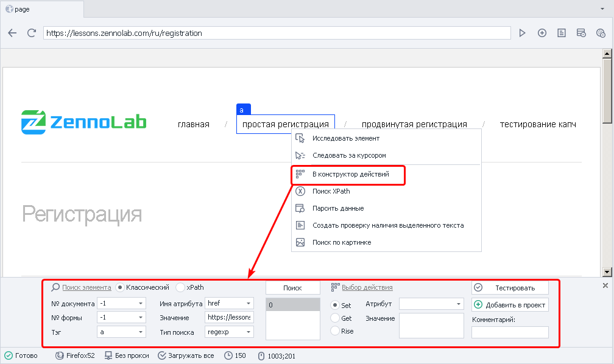

#### Способ 2. Через дерево элементов
Откройте окно [Древа элементов](/zennoposter/ProjectMaker/Program-interface/Element_Tree_Window), далее ПКМ по нужному элементу и **В конструктор действий**:

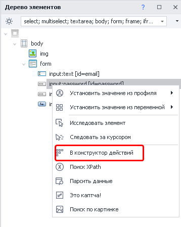

:::tip На заметку
Когда вы добавляете элемент в Конструктор действий, его доступные свойства и значения автоматически появляются в окне **Свойства элемента**.
:::
_______________________________________________ 
## Параметры поиска 
Поддерживаются два способа поиска элементов: классический и поиск по XPath.  

### Классический поиск
В этом случае элемент ищется по его HTML-тегу, атрибутам и их значениям.  

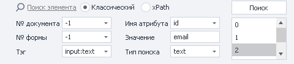

#### № документа
Укажите `-1`, чтобы искать элемент во всех документах на странице. Такое значение делает поиск более универсальным.

#### № формы
Укажите `-1`, чтобы искать элемент во всех формах на странице. Если выбрать номер конкретной формы, шаблон может перестать работать после изменения структуры сайта.  

<details>
  <summary><b>Пример</b></summary>

На странице находятся три формы: поиск, регистрация и заказ товара. Форма заказа имеет номер 2, поскольку нумерация начинается с нуля.  

Если разработчики добавят перед ней форму входа, форма заказа получит другой номер. В результате ZennoPoster может не найти нужную кнопку или выполнить действие с другим элементом.
</details>

:::tip Искать во всех формах/документах на странице
Если включить эти опции в **Настройках Записи**, то для номера формы и документа всегда по умолчанию будет указано значение `-1`.
:::

#### **Тэг**
HTML-тег элемента, который нужно найти.

Наример:  
```
<div class="visible" id="username"></div>
```
В этом примере `div` — название тега.

#### **Имя атрибута**
Атрибут HTML-тега, по которому ZennoPoster будет искать элемент.

В нашем примере:  
```
<div class="visible" id="username"></div>
``` 

`class` и `id` — имена атрибутов.

#### **Значение**
Значение выбранного атрибута.

В приведённом выше примере:  
- **`visible`** — значение атрибута *`class`*;
- **`username`** — значение атрибута *`id`*.

#### **Тип поиска**
Доступны три типа поиска:  
- *`text`* — значение атрибута должно полностью или частично совпадать с указанным текстом;
- *`notext`* — значение атрибута не должно содержать указанный текст;
- *`regexp`* — поиск с помощью регулярного выражения.  

По умолчанию регистр букв не учитывается. Например, значения `Username` и `username` будут считаться одинаковыми.  

> *Чтобы регулярное выражение учитывало регистр, добавьте в его начало конструкцию: `(?-i)`*

:::info На скриншоте выше после нажатия кнопки **Поиск** найдено три элемента.
По возможности подбирайте параметры так, чтобы в результатах оставался только один нужный элемент. Иначе ZennoPoster может выполнить действие не с тем элементом.
:::
 
### Поиск по XPath
XPath позволяет находить элементы по их расположению и свойствам в структуре HTML-документа. С его помощью можно создать более гибкий поиск, который будет устойчивее к изменениям вёрстки сайта.

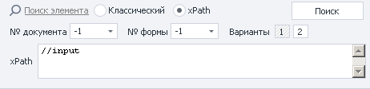

Поля **№ документа** и **№ формы** работают так же, как при классическом поиске. Чтобы искать во всех документах и формах, укажите для них значение `-1`.

#### XPath 
Поле для ввода XPath-выражения, по которому ZennoPoster будет искать элемент.

#### Варианты
Можно выбрать одно из XPath-выражений, которые **Конструктор действий** создал автоматически.

:::tip Если предложенные варианты не подходят
Вы можете составить XPath-выражение самостоятельно и ввести его в поле XPath.
:::
_______________________________________________
## Выбор действия
После настройки поиска выберите действие, которое ZennoPoster должен выполнить с найденным элементом. Доступны три варианта: **Set**, **Get** и **Rise**.

### Set (установить значение)
Действие [Установка значения](/zennoposter/ProjectMaker/Project-editor/Actions-in-ProjectMaker-Actions-Blocks/Tabs/Setting_Value) изменяет значение выбранного атрибута.

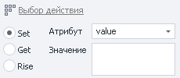

- **Атрибут** — атрибут элемента, для которого нужно установить новое значение.
- **Значение** — данные, которые нужно записать в атрибут. Можно указать обычный текст или использовать переменные проекта, например `{-Variable.someVar-}` или `{-Profile.Name-}`.

### Get (получить значение)
Действие для [Получения значения](/zennoposter/ProjectMaker/Project-editor/Actions-in-ProjectMaker-Actions-Blocks/Tabs/Getting_Value) выбранного атрибута.  

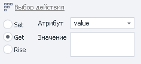

- **Атрибут** значение которого нужно получить.
- **Значение** найденного атрибута.

### Rise (выполнить событие)
[Выполняет действие](/zennoposter/ProjectMaker/Project-editor/Actions-in-ProjectMaker-Actions-Blocks/Tabs/Perform_Event) с найденным элементом. Например, можно нажать на него или вызвать другое доступное действие из списка.  

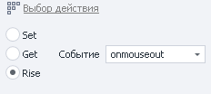   

> *Для действий **drag** и **drop** появятся два дополнительных поля, в которых нужно указать координаты.*  
>
> 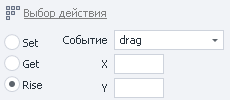 
_______________________________________________
## Завершающие действия
После настройки поиска и выбора действия рекомендуем проверить результат, добавить понятный комментарий и только затем сохранить экшен в проект.

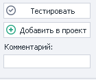

### Тестирование
Когда параметры поиска и действие настроены, нажмите кнопку тестирования. Так можно заранее убедиться, что ZennoPoster находит нужный элемент и правильно выполняет выбранное действие.  

:::info Если найден другой элемент или действие выполняется неправильно
Вернитесь к настройкам и измените параметры поиска.
:::

### Комментарий
Добавьте к экшену короткий и понятный комментарий.  

Стандартные автоматические комментарии не всегда позволяют быстро понять, что именно делает действие.

| Комментарии по умолчанию   | Пользовательские комментарии |
| :--------: | :-------: |
| 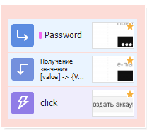  | 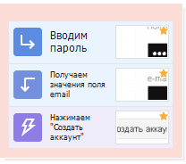   |


### Добавление в проект
Убедитесь, что:
- параметры поиска настроены;
- ZennoPoster находит нужный элемент;
- выбрано правильное действие;
- тестирование прошло успешно.

После этого нажмите **Добавить в проект**. Созданный экшен появится в проекте и будет готов к использованию. 
_______________________________________________
## Полезные ссылки

- [❗→ XPath](https://zennolab.atlassian.net/wiki/spaces/RU/pages/862093419 "https://zennolab.atlassian.net/wiki/spaces/RU/pages/862093419")
- [❗→ Тестер регулярных выражений](https://zennolab.atlassian.net/wiki/spaces/RU/pages/534086111 "https://zennolab.atlassian.net/wiki/spaces/RU/pages/534086111")
- [❗→ Установка значения](https://zennolab.atlassian.net/wiki/spaces/RU/pages/534315117 "https://zennolab.atlassian.net/wiki/spaces/RU/pages/534315117")
- [❗→ Выполнить событие](https://zennolab.atlassian.net/wiki/spaces/RU/pages/534020211 "https://zennolab.atlassian.net/wiki/spaces/RU/pages/534020211")
- [❗→ Получение значения](https://zennolab.atlassian.net/wiki/spaces/RU/pages/534315124 "https://zennolab.atlassian.net/wiki/spaces/RU/pages/534315124")
- [❗→ Окно свойства элемента](https://zennolab.atlassian.net/wiki/spaces/RU/pages/735608879 "https://zennolab.atlassian.net/wiki/spaces/RU/pages/735608879")
- [ZennoPoster + xPath на примере Яндекс.Маркета](https://zennolab.com/discussion/threads/obzor-zennoposter-xpath-na-primere-jandeks-marketa.37497/ "https://zennolab.com/discussion/threads/obzor-zennoposter-xpath-na-primere-jandeks-marketa.37497/") (конкурсная статья с форума)