---
sidebar_position: 0
title: "Окно браузера"
description: ""
date: "2025-08-18"
converted: true
originalFile: "Окно браузера.txt"
targetUrl: "https://zennolab.atlassian.net/wiki/spaces/RU/pages/534315373"
---
import DisclaimerNotice from '@site/src/components/DisclaimerNotice';

<DisclaimerNotice />

> 🔗 **[Оригинальная страница](https://zennolab.atlassian.net/wiki/spaces/RU/pages/534315373)** — Источник данного материала

_______________________________________________  
## Описание
Браузерное окно — один из ключевых элементов ProjectMaker, предназначенный для создания шаблонов веб-автоматизации. Фактически это полноценный экземпляр (инстанс) браузера, дополненный специализированными инструментами для более удобной и быстрой разработки проектов.  

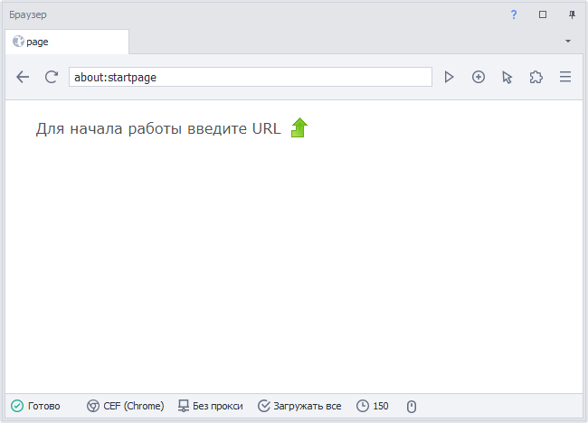

Визуально интерфейс делится на три основные части: верхнюю и нижнюю панели инструментов, а также центральную рабочую зону (область просмотра). Принципы взаимодействия с этим окном и его базовый функционал во многом аналогичны работе в любом привычном веб-браузере.  

## Инструменты
Далее рассмотрим каждый инструмент окна браузера по отдельности.

### Область открытых вкладок

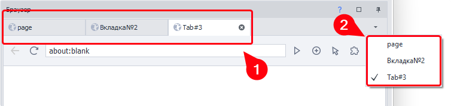

На **панели (1)** отображены все открытые в данный момент вкладки. С помощью кнопки в правой части **панели (2)** можно открыть список для быстрой навигации по открытым вкладкам.

> *Управлять созданием табов, а также их активацией и закрытием можно через экшен [Управление вкладкой браузера (табом браузера)](/zennoposter/ProjectMaker/Project-editor/Actions-in-ProjectMaker-Actions-Blocks/Browser/Browser_tab_management)*

### Кнопка «Назад»
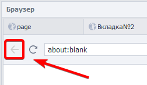

Служит для навигации по истории открытия веб-страниц и возвращает на предыдущую страницу сайта.  

> *Аналогичное действие можно выполнить и с помощью кода:*  
> *C#: `instance.ActiveTab.GoBack();`*  
> *JS: `history.back();`*  

### Кнопка «Обновить»
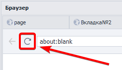

Перезагружает текущую страницу. В процессе получения данных иконка меняется на крестик: нажатие на него принудительно прерывает загрузку.

### Адресная строка
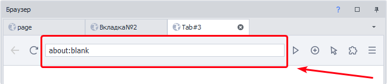

Поле для ввода, редактирования и отображения URL страницы. Аналогична адресной строке обычных браузеров. 

### Переход на страницу

Нажатие на эту кнопку отправляет браузер по адресу, который вы набрали в строке. Вы также можете просто нажать Enter, чтобы не тянуться к кнопке мышкой.

> *В логике самого проекта для открытия нужных сайтов используется одноименный экшен — [Переход на страницу](/zennoposter/ProjectMaker/Project-editor/Actions-in-ProjectMaker-Actions-Blocks/Tabs/Navigate_to_Page)* 

### Открытие новой вкладки
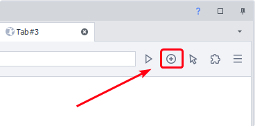

Открывает модальное окно в котором нужно ввести имя новой вкладки.  

> *То же самое действие можно выполнить и с помощью кубика [Управление вкладкой браузера (табом браузера)](/zennoposter/ProjectMaker/Project-editor/Actions-in-ProjectMaker-Actions-Blocks/Browser/Browser_tab_management)* 

### Режим ввода
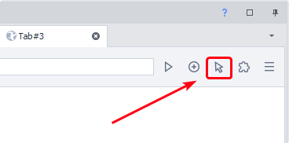

Позволяет выбрать, как именно вы будете взаимодействовать с браузером: с помощью классической мыши или имитации сенсорного дисплея.  

В первую очередь это влияет на запись вашего шаблона. Если активирован сенсорный режим, все ваши нажатия и свайпы автоматически превратятся в кубики с touch-событиями. В режиме мыши, соответственно, сохранятся обычные клики.

### Расширения
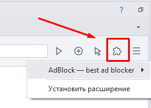

Позволяет взаимодействовать с установленными расширениями (их активация, настройки, детали и удаление). Новые расширения можно установить через crx-файлы.

> *Подробнее о [Работе с расширениями](/zennoposter/ProjectMaker/Project-editor/Actions-in-ProjectMaker-Actions-Blocks/Browser/Working_with_extensions)*

### Инструменты web-разработчика
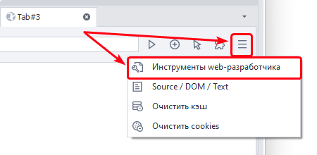

Открывает окно [Инструментов Web разработчика](/zennoposter/ProjectMaker/Browser_Window/Web_Developer_Tools_DevTools), которое аналогично такому же в браузере Chrome. Используется для более продвинутой работы с DOM, приложениями, а также трафиком страницы.

:::warning Действие этого окна распространяется только на активную вкладку
:::

### Просмотр исходного кода
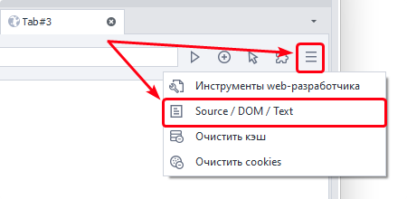

С помощью этой кнопки можно открыть окно просмотра [структуры сайта](/zennoposter/ProjectMaker/Browser_Window/View_Page_Text) для активной вкладки. В нем доступны три формата данных: исходный код, DOM-дерево и видимый текст страницы.

Извлечь эту информацию в процессе выполнения можно и без открытия окна. Для этого существуют специальные переменные окружения:  

`{ -Page.Dom- }`
`{ -Page.Source- }`
`{ -Page.Text- }`

### Очистить кэш
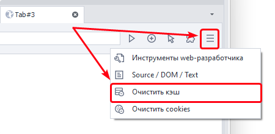

Предоставляет быстрый доступ к функционалу [аналогичного кубика](/zennoposter/ProjectMaker/Project-editor/Actions-in-ProjectMaker-Actions-Blocks/Browser/Browser_settings#очистить-кэш) — очищает весь браузерный кэш. 

### Очистить cookies
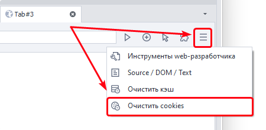

Очищает все куки инстанса.  

> *Также данное действие можно выполнить с помощью экшена [Очистить куки](/zennoposter/ProjectMaker/Project-editor/Actions-in-ProjectMaker-Actions-Blocks/Browser/Browser_settings#очистить-куки)*.

:::info [Новый экшен для работы с куки](/zennoposter/ProjectMaker/Project-editor/Actions-in-ProjectMaker-Actions-Blocks/Browser/Browser-cookies/Working_with_Cookies) 
Был добавлен в ZennoPoster 7.3.1.0. Он позволяет не только очищать, но и загружать, а также сохранять cookies в разных форматах.
:::

### Индикатор состояния загрузки страницы
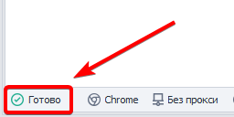

Имеет три состояния:
- **Готово** — при завершении;
- **Загрузка** — в процессе;
- **Дозагрузка** — подгрузка данных скриптами и плагинами.

### Текущий тип браузера
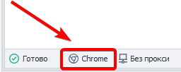

Отображает тип браузера, который установлен для инстанса. 

Вы можете сменить тип браузера разными способами:

- глобально для всех новых проектов через [настройки программы](/zennoposter/ZennoPoster/Settings_ZP_and_ProxyChecker/Instance_Settings);
- в [настройках текущего проекта](/zennoposter/ProjectMaker/Project-editor/Static_blocks/Project_Settings#тип-браузера);
- через действие [Запустить инстанс](/zennoposter/ProjectMaker/Project-editor/Actions-in-ProjectMaker-Actions-Blocks/Browser/Browser_settings#запустить-инстанс) смена происходит прямо во время выполнения проекта.

### Прокси браузера
Отображает текущий прокси.  

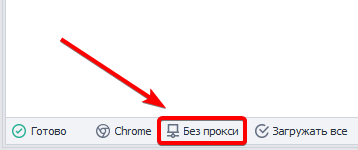

:::tip можно установить прокси по клику этой кнопки 
Начиная с версии 7.3.2.0
:::

> *Так же установить прокси можно через [Окно профиля](/zennoposter/ProjectMaker/Program-interface/Profile_Window),  
> либо кубиком [Установить прокси](/zennoposter/ProjectMaker/Project-editor/Actions-in-ProjectMaker-Actions-Blocks/Browser/Browser_settings#установить-прокси)*.

### Правила загрузки контента
Кнопка открывает меню, где с помощью чекбоксов можно выборочно разрешать или запрещать загрузку определенных элементов веб-страницы.  

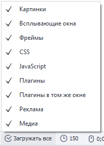

Это полезно для оптимизации работы: например, отключив картинки и CSS-стили, вы значительно ускорите загрузку сайтов и сэкономите ресурсы.

Управлять этими правилами можно не только из интерфейса окна, но и другими способами:  
- [глобально для всего шаблона](/zennoposter/ProjectMaker/Project-editor/Static_blocks/Project_Settings#не-использовать-браузер);  
- [программно через экшены](/zennoposter/ProjectMaker/Project-editor/Actions-in-ProjectMaker-Actions-Blocks/Browser/Browser_settings).

### Установить таймаут
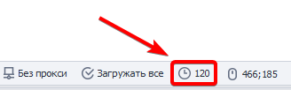  

Открывает окно, в котором можно ограничить максимальное время (в секундах), выделяемое на загрузку текущей страницы. Если страница загружается слишком долго и не укладывается в заданный лимит, процесс прерывается — это помогает избежать бесконечного зависания шаблона.    

> *Также можно [Настроить](/zennoposter/ProjectMaker/Project-editor/Actions-in-ProjectMaker-Actions-Blocks/Tabs/Web_Page_Settings) этот параметр внутри самого проекта.* 

### Координаты курсора мыши
Показывает точные координаты курсора (X и Y) в пикселях, где точка (**0;0**) — это левый верхний угол активной страницы. 

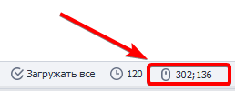

Функция используется для быстрого определения расположения нужных веб-элементов при разработке шаблона.
_______________________________________________ 
## Контекстное меню
Если вы кликнете правой кнопкой мыши внутри рабочей зоны ProjectMaker, то откроется контекстное меню, которое кардинально отличается от привычного вам (как, например, в Chrome или Firefox).  

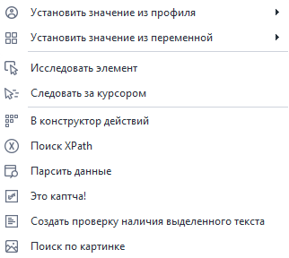

Вместо базовых пользовательских команд здесь собраны функции, адаптированные специально под задачи автоматизации и парсинга элементов страницы.  

### Установить значение из профиля/переменной
Эти пункты доступны, если вызвать контекстное меню кликом по текстовому полю. Они позволяют быстро заполнить его данными из профиля или подставить значение существующей переменной.  

### Исследовать элемент
Открывает панели дерева элементов и их свойств. Здесь можно детально изучить HTML-структуру страницы и атрибуты выбранного узла, а затем отправить его в конструктор действий для настройки клика, ввода текста или парсинга данных.  

### Следовать за курсором
В этом режиме при наведении курсора на любые элементы страницы они будут автоматически подсвечиваться рамкой (если это не отключено в настройках). Это позволяет быстро находить нужные блоки на сайте и отслеживать их свойства в окне параметров в реальном времени.  

### В конструктор действий
Передает выбранный HTML-элемент в окно [Конструктора действий](/zennoposter/ProjectMaker/Browser_Window/Action_Constructor_and_XPath_Search) для детальной настройки взаимодействия с ним (например, клика или ввода текста).  

### Поиск XPath
Открывает конструктор действий, в котором автоматически активирован режим поиска нужного элемента с помощью XPath-выражения.  

### Парсить данные
Создает экшен для быстрого извлечения нужной информации (текста или значений атрибутов) из выбранного элемента на странице.  

### Это капча!
Этот пункт доступен при вызове контекстного меню на изображении. Он помечает выбранную картинку как капчу и автоматически добавляет на холст [соответствующий экшен](/zennoposter/ProjectMaker/Project-editor/Actions-in-ProjectMaker-Actions-Blocks/Tabs/Captcha_Recognition) для ее распознавания.  

:::warning Работает только с простыми текстовыми капчами
:::

### Создать проверку наличия выделенного текста
Автоматически создает [экшен, который проверяет](/zennoposter/ProjectMaker/Project-editor/Actions-in-ProjectMaker-Actions-Blocks/Tabs/Text_Presence_Check), присутствует ли выделенный вами фрагмент текста на текущей веб-странице.  

> *Механика работы этого инструмента немного отличается в зависимости от версии программы (**обновлено в версии 7.3.1.0**).*  

### Поиск по картинке
Добавляет экшен для поиска нужного элемента на странице по его визуальному образцу (картинке). Это отличная альтернатива для ситуаций, когда привязаться к HTML-коду или XPath невозможно.  

## Полезные ссылки

- [❗→ Просмотр текста страницы](/zennoposter/ProjectMaker/Browser_Window/View_Page_Text)
 - [❗→ Конструктор действий и Поиск по XPath](/zennoposter/ProjectMaker/Browser_Window/Action_Constructor_and_XPath_Search)
 - [❗→ Парсить данные](/zennoposter/ProjectMaker/Browser_Window/Parse_Data)
 - [❗→ Создать проверку наличия выделенного текста](/zennoposter/ProjectMaker/Browser_Window/Create_Selected_Text_Check)
 - [❗→ Поиск по картинке](/zennoposter/ProjectMaker/Browser_Window/Image_Search)
 - [❗→ Инструменты web-разработчика (DevTools)](/zennoposter/ProjectMaker/Browser_Window/Web_Developer_Tools_DevTools)
 - [❗→ Эмуляция шрифтов](/zennoposter/ProjectMaker/Browser_Window/Font_Emulation)
