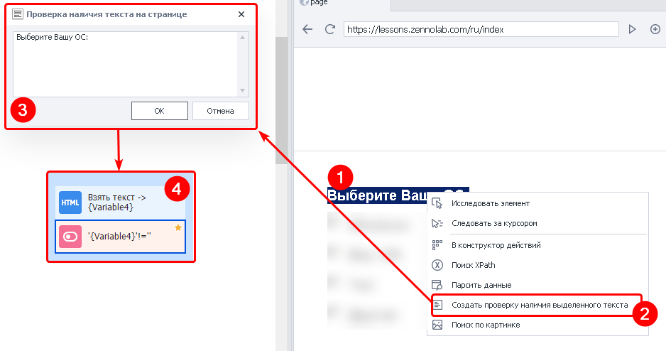
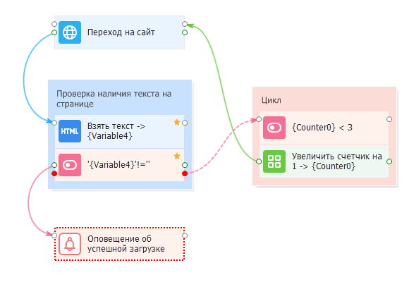

---
sidebar_position: 4
title: "Проверка наличия выделенного текста"
description: ""
date: "2025-08-18"
converted: true
originalFile: "Создать проверку наличия выделенного текста.txt"
targetUrl: "https://zennolab.atlassian.net/wiki/spaces/RU/pages/534053296"
---
import DisclaimerNotice from '@site/src/components/DisclaimerNotice';

<DisclaimerNotice />

> 🔗 **[Оригинальная страница](https://zennolab.atlassian.net/wiki/spaces/RU/pages/534053296)** — Источник данного материала

_______________________________________________  
## Описание
:::info Устаревшая функция
С ZennoPoster 7.3.1.0 мы добавили новый экшен — [Проверка наличия текста](/zennoposter/ProjectMaker/Project-editor/Actions-in-ProjectMaker-Actions-Blocks/Tabs/Text_Presence_Check)
:::

Используется для проверки наличия на странице определённого текста. Это не отдельный экшен, а группа действий:

1. Поиск выполняется через экшен [Данные](/zennoposter/ProjectMaker/Project-editor/Actions-in-ProjectMaker-Actions-Blocks/Tabs/Data_Tab_Operations)
2. А проверка с помощью [IF](/zennoposter/ProjectMaker/Project-editor/Actions-in-ProjectMaker-Actions-Blocks/Logic/IF_Condition)

### Как добавить действие в проект?
1. В браузере ProjectMaker выделите текст, который нужно проверить.
2. Нажмите по выделенному тексту ПКМ → **Создать проверку наличия выделенного текста**.
3. Откроется окно с выбранным текстом. Проверьте его и отредактируйте при необходимости, а затем нажмите **ОК**.
4. ProjectMaker автоматически добавит в проект два экшена:  
    - [Взять текст таба](/zennoposter/ProjectMaker/Project-editor/Actions-in-ProjectMaker-Actions-Blocks/Tabs/Data_Tab_Operations) — получает текст текущей вкладки;  
    - [IF](/zennoposter/ProjectMaker/Project-editor/Actions-in-ProjectMaker-Actions-Blocks/Logic/IF_Condition) — проверяет, содержится ли в нём выбранный текст.

Если текст найден, экшен **if** завершится успешно и выполнение продолжится *по зелёной ветке*. Если текст не найден, выполнение пойдёт *по красной ветке*.

:::warning Обязательно протестируйте две ситуации
Когда нужный текст есть на странице и когда его нет.  

Иногда текст скрыт от пользователя, но остаётся в коде страницы. В таком случае ProjectMaker может найти его и продолжить выполнение по зелёной ветке.  

Такое поведение зависит от вёрстки конкретного сайта.
:::

_______________________________________________
## Принцип работы
Проверка наличия текста помогает определить, успешно ли выполнилось действие или на странице появилась ошибка.

Её можно использовать, например:
- после регистрации;
- после публикации данных;
- после загрузки страницы;
- после решения капчи.

Если нужный текст найден, выполнение продолжается по зелёной ветке. Если текст не найден — по красной.

### Пример использования
Рассмотрим проверку успешной загрузки страницы.

Иногда сайт загружается некорректно. Особенно часто это происходит при использовании нестабильных прокси. В результате может появиться пустая страница или HTTP-ошибка, например 403, 404 или 503.  

Для проверки загрузки:  
1. Найдите на странице постоянный текст, который появляется при её успешной загрузке.  
2. После перехода на сайт проверьте наличие этого текста.  
3. Если текст найден, продолжите выполнение проекта.  
4. Если текст не найден, попробуйте загрузить страницу повторно.  

Повторные попытки можно настроить с помощью цикла и экшена [Переход на страницу](/zennoposter/ProjectMaker/Project-editor/Actions-in-ProjectMaker-Actions-Blocks/Tabs/Navigate_to_Page). После каждой загрузки снова проверяйте наличие выбранного текста.

:::tip Ограничьте количество повторных попыток
Чтобы проект не попал в бесконечный цикл, если сайт долгое время остаётся недоступным.
:::
## Полезные ссылки

- [❗→ Тестер регулярных выражений](https://zennolab.atlassian.net/wiki/spaces/RU/pages/534086111 "https://zennolab.atlassian.net/wiki/spaces/RU/pages/534086111")
- [❗→ IF (условие "Если ... то ...")](https://zennolab.atlassian.net/wiki/spaces/RU/pages/534315151 "https://zennolab.atlassian.net/wiki/spaces/RU/pages/534315151")
- [❗→ Данные (операции с табом)](https://zennolab.atlassian.net/wiki/spaces/RU/pages/534085840 "https://zennolab.atlassian.net/wiki/spaces/RU/pages/534085840")