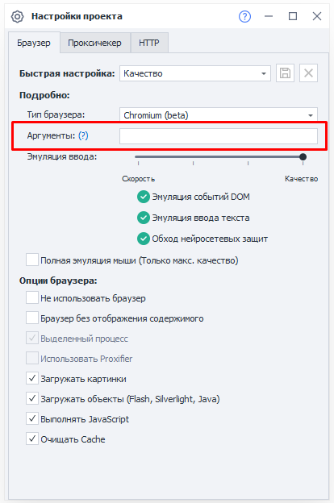
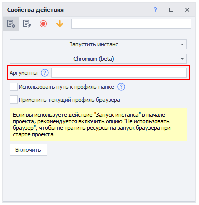

---
sidebar_position: 7
title: "Эмуляция шрифтов"
description: ""
date: "2025-08-18"
converted: true
originalFile: "Эмуляция шрифтов.txt"
targetUrl: "https://zennolab.atlassian.net/wiki/spaces/RU/pages/2131066881"
---
import DisclaimerNotice from '@site/src/components/DisclaimerNotice';

<DisclaimerNotice />

> 🔗 **[Оригинальная страница](https://zennolab.atlassian.net/wiki/spaces/RU/pages/2131066881)** — Источник данного материала

_______________________________________________  
## Описание
Эмуляция шрифтов позволяет указать, какие шрифты будут доступны браузеру. Это помогает точнее настроить браузерное окружение и улучшить качество его эмуляции.

:::info Если настройка не используется, браузер работает с *системными шрифтами*.
:::
_______________________________________________ 
## Принцип работы
### Настройка
Чтобы использовать собственный набор шрифтов, добавьте аргумент `--zl-fonts-dir` при запуске браузера. В нём нужно указать путь к папке со шрифтами.  

:::tip Например:
`--zl-fonts-dir=Z:\Fonts`

В этом случае браузер будет использовать шрифты, найденные в папке **Z:\Fonts**.
:::

В указанной папке должен находиться хотя бы один шрифт из списка:  
- *Sans*
- *Arial*
- *MS UI Gothic*
- *Microsoft Sans Serif*
- *Segoe UI*
- *Calibri*
- *Times New Roman*
- *Courier New*

Если аргумент `--zl-fonts-dir` не указан, будут использоваться шрифты, установленные в системе.

### Где указать аргумент запуска
Это можно сделать двумя способами:

#### Способ 1. В настройках проекта  
Откройте статический блок [Настройки проекта | Аргументы](/zennoposter/ProjectMaker/Project-editor/Static_blocks/Project_Settings#аргументы) и укажите аргумент в соответствующем поле:

#### Способ 2. В экшене запуска инстанса
Добавьте действие: **Настройки → Запустить инстанс**, и укажите аргумент в специальном разделе:  

_______________________________________________ 
## Наборы шрифтов
### Готовые наборы
Можно использовать готовые наборы шрифтов, которые соответствуют разным конфигурациям Windows 10:

- Чистый Windows 10 Pro - [ru.zip](https://www.dropbox.com/s/jzigwy17p0v9z34/ru.zip?dl=0) и [en.zip](https://www.dropbox.com/s/jw2jzyuxtqddzx2/en.zip?dl=0)
- Windows 10 Pro + Office - [ru.zip](https://www.dropbox.com/s/4fyudzexzp7pmpl/ru.zip?dl=0) и [en.zip](https://www.dropbox.com/s/5n46v94h2nweve1/en.zip?dl=0)
- Windows 10 Pro + VisualStudio 2022 - [ru.zip](https://www.dropbox.com/s/ertyj80yajtv333/ru.zip?dl=0) и [en.zip](https://www.dropbox.com/s/mhvb5pvqt0u0vqq/en.zip?dl=0)
- Windows 10 Pro + Office + VisualStudio 2022 - [ru.zip](https://www.dropbox.com/s/00pocd1edahsfrs/ru.zip?dl=0) и [en.zip](https://www.dropbox.com/s/foi7lb37cdt914u/en.zip?dl=0)

:::info Эти архивы содержат только наборы шрифтов для эмуляции соответствующего окружения.
Устанавливать Windows 10 Pro, Office или Visual Studio на компьютер с ZennoPoster не требуется.
:::

### Кастомные наборы
Вы также можете самостоятельно подготовить набор шрифтов для нужной конфигурации Windows:  
1. Установите Windows на виртуальную машину.
2. Установите программы, набор шрифтов которых нужно эмулировать. *Некоторые приложения во время установки добавляют в систему собственные шрифты.*
3. Откройте папку `C:\Windows\Fonts`. В ней находится большинство установленных шрифтов. Скопируйте нужные шрифты в отдельную папку.
4. Перенесите эту папку на компьютер с ZennoPoster. Укажите путь к ней в аргументе --zl-fonts-dir.  

:::tip Сохраняйте разные наборы шрифтов в отдельных папках.
Так вы сможете быстро переключаться между конфигурациями, меняя только путь в аргументе запуска.
:::