---
sidebar_position: 5
title: "Поиск по картинке"
description: ""
date: "2025-08-18"
converted: true
originalFile: "Поиск по картинке.txt"
targetUrl: "https://zennolab.atlassian.net/wiki/spaces/RU/pages/492044304"
---
import DisclaimerNotice from '@site/src/components/DisclaimerNotice';

<DisclaimerNotice />

> 🔗 **[Оригинальная страница](https://zennolab.atlassian.net/wiki/spaces/RU/pages/492044304)** — Источник данного материала

_______________________________________________  
## Описание
Позволяет выполнить нажатие, используя визуальный поиск. Рекомендуем использовать, когда не получается найти элемент другими способами. Также подходит для Flash и [Canvas](https://developer.mozilla.org/ru/docs/Web/API/Canvas_API).

:::warning требует много ресурсов компьютера
:::

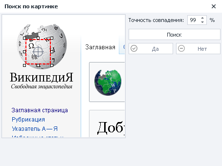

### Как добавить в проект?
Нужно навести курсор мыши на элемент и вызвать контекстное меню правой кнопкой:

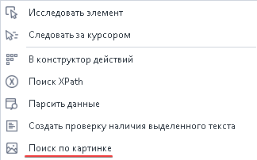

_______________________________________________ 
## Принцип работы

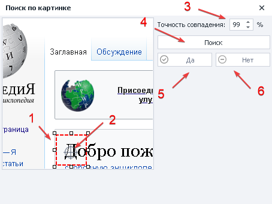

1. **Регулируемая область поиска** — нужно выделить уникальную часть элемента, которая отличает его от остальных.
2. **Прицел клика** — задаём место клика внутри области поиска (можно передвигать).
3. **Точность совпадения** — указываем в процентах, насколько сильно элемент должен быть похож на заданный.
4. **Поиск** — выполнить поиск в окне браузера.

:::info Найденный элемент будет выделен красной рамкой

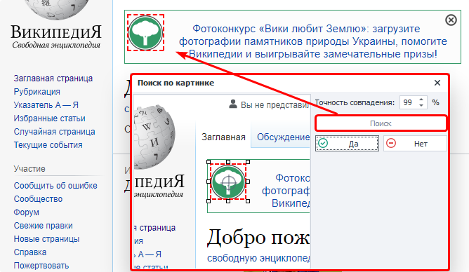
:::

5. **Да** — подтверждаем, что элемент найден согласно вашим критериям.

6. **Нет** — отклоняем результат, чтобы изменить параметры поиска.

### Настройки клика
Выполняются для успешно найденного элемента.

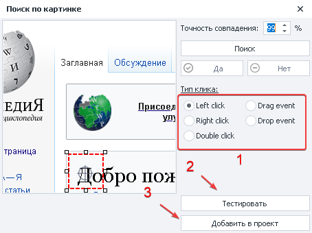

1. Выбираем **Тип клика**:
    - *Left click* — классическое нажатие левой кнопкой мыши;
    - *Right click* — нажатие ПКМ по элементу;
    - *Double click* — двойной клик ЛКМ;
    - *Drag event* — событие происходит, пока объект **тащат**;
    - *Drop event* — когда объект **отпустили** в допустимой зоне.
2. Проверить выполнение клика в окне браузера.
3. Добавить настроенный экшен в проект.
_______________________________________________ 
## Пример использования
### Пример поиска
Представим, что нам нужно найти определённую кнопку для клика на странице:  

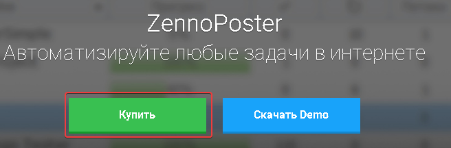

В окне браузера вызываем поиск и задаём уникальную область:

| Уникальная область    | Содержит много монотонного цвета |
| -------- | ------- |
| 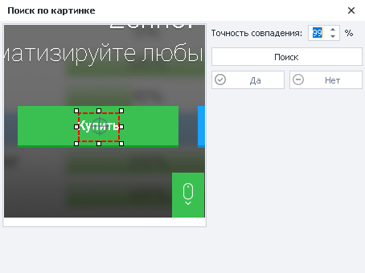  | 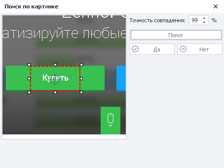    |

Теперь выбираем тип клика (в нашем случае — это **Left click**) и тестируем выполнение в окне браузера: 

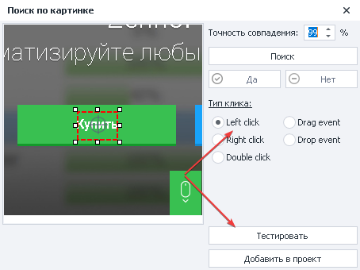

Клик был успешно выполнен, так что добавляем экшен на холст проекта:

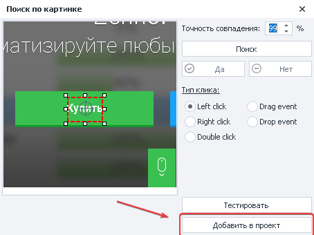

  
### Пример проекта
Функция может быть полезна во Flash играх или приложениях, где нет возможности получить доступ к конкретным элементам. Алгоритм будет таким:

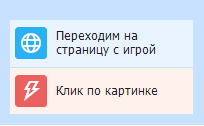

1. Переходим на страницу и ждём, когда она полностью загрузится.
2. Наводим курсор мыши на элемент, вызываем контекстное меню и выбираем **Поиск по картинке**.
3. Задаём уникальную область поиска и параметры нажатия.
4. Тестируем в окне браузера.
5. Добавляем экшен в проект

_______________________________________________ 
## Полезные ссылки

- [❗→ Эмуляция мыши](https://zennolab.atlassian.net/wiki/spaces/RU/pages/534315158 "https://zennolab.atlassian.net/wiki/spaces/RU/pages/534315158")
- [❗→ Окно браузера](https://zennolab.atlassian.net/wiki/spaces/RU/pages/534315373 "https://zennolab.atlassian.net/wiki/spaces/RU/pages/534315373")