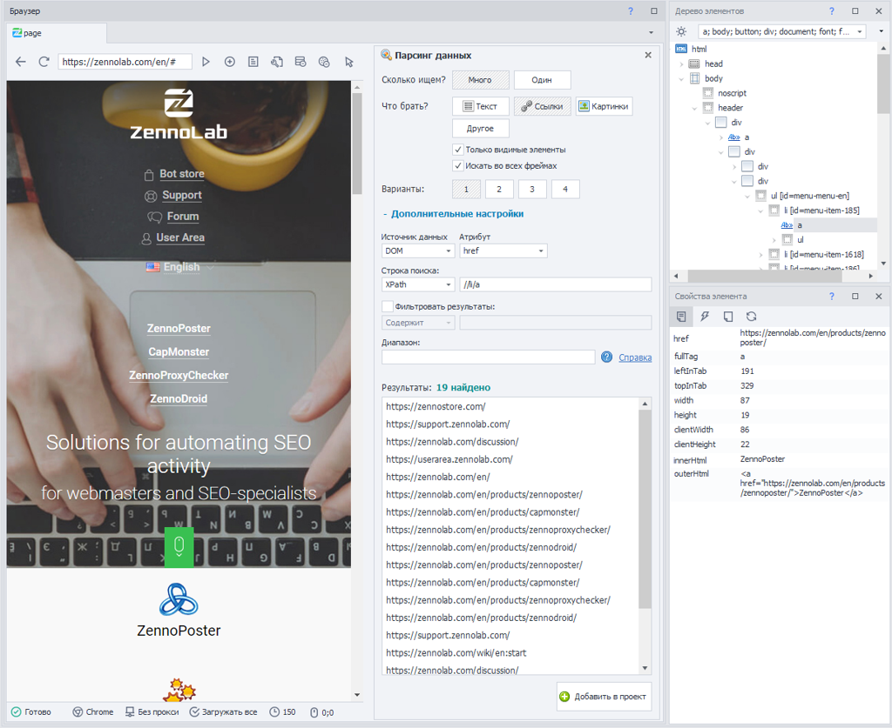
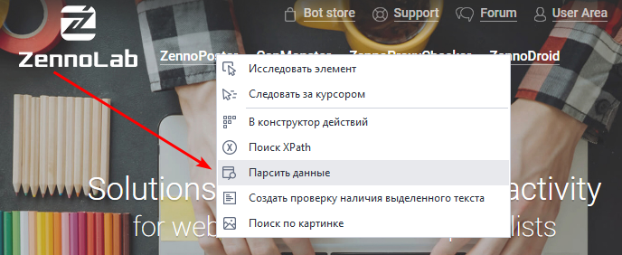
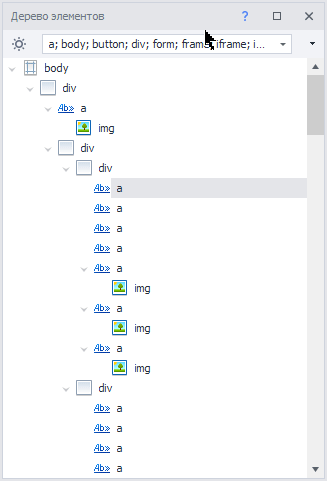
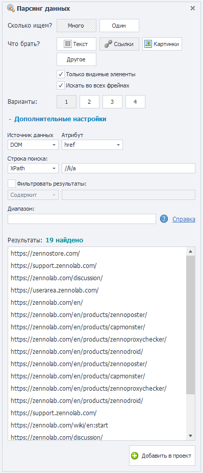
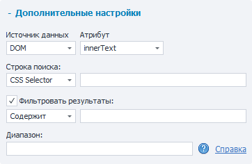
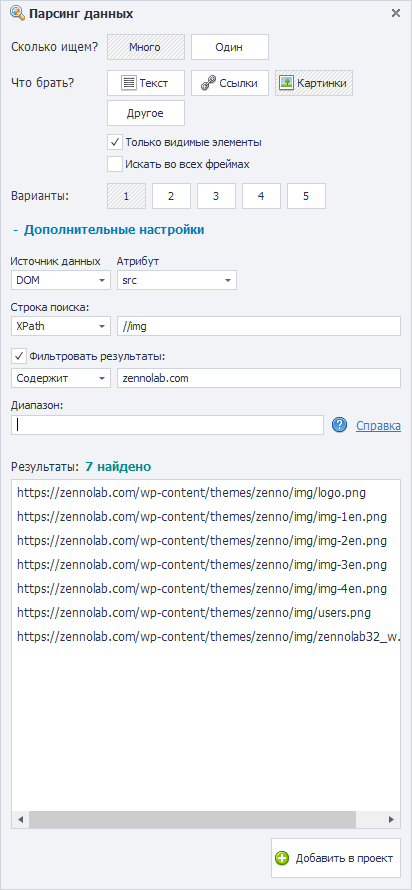

---
sidebar_position: 3
title: "Парсить данные"
description: ""
date: "2025-08-18"
converted: true
originalFile: "Парсить данные.txt"
targetUrl: "https://zennolab.atlassian.net/wiki/spaces/RU/pages/534053279"
---
import DisclaimerNotice from '@site/src/components/DisclaimerNotice';

<DisclaimerNotice />

> 🔗 **[Оригинальная страница](https://zennolab.atlassian.net/wiki/spaces/RU/pages/534053279)** — Источник данного материала

_______________________________________________  
## Описание
В ZennoPoster есть разные инструменты для поиска и сбора информации с веб-страниц. **Парсинг данных** — один из них. С его помощью можно без написания кода указать нужные элементы на текущей странице и настроить сбор данных всего за несколько кликов.

### Как открыть это окно?
Выберите «**Парсить данные**» в контекстном меню [Окна браузера](/zennoposter/ProjectMaker/Browser_Window/): 

Или из контекстного меню **Дерева элементов** → пункт «**Парсить данные**»:

## Принцип работы
Окно «**Парсинг данных**» логически разделяется на **Быстрый поиск** и более подробный с **Дополнительными настройками**:

### Сколько ищем?
Можно найти сразу **Много** элементов по заданным условиям или выбрать только **Один**.

### **Что брать?**
Выберите, какие данные нужно получить из найденных элементов:  
- **Текст** — видимый текст элемента.
- **Ссылки** — адреса, на которые ведут найденные ссылки.
- **Картинки** — пути к изображениям. Например: https://zennolab.com/wp-content/themes/zenno/img/logo.png.
- **Другое** — позволяет самостоятельно выбрать или указать нужные данные HTML-элемента.
- **Только видимые элементы** — учитывать только те элементы, которые сейчас отображаются на странице.
- **Искать во всех фреймах** — искать данные не только в основном документе, но и во встроенных фреймах.
- **Варианты** — автоматически созданные варианты условий поиска: [1], [2], [3] и другие. Выберите тот вариант, который точнее находит нужные данные.

:::tip *Фрейм (от англ. frame)*
*Это отдельный HTML-документ, загруженный внутри страницы.*
:::

### Дополнительные настройки
Применяются для более гибкого поиска. Позволяют точнее указать, где и какие данные нужно найти.

- **Источник данных** — код страницы, в котором будет выполняться поиск: DOM или исходный HTML.
- **Атрибут** — атрибут HTML-элемента, значение которого нужно получить.
- **Строка поиска** — запрос, по которому ZennoPoster найдёт нужные элементы. Можно использовать XPath или CSS-селектор.
- **Фильтровать результаты** — позволяет оставить только значения, которые соответствуют выбранному условию:  
    - *содержит*;
    - *не содержит*;
    - *regex* *— фильтрация с помощью регулярного выражения*.
- **Диапазон** — условие, которое позволяет выбрать только часть элементов из найденного массива.

### **Результаты**
В этом окне отображается предварительный результат поиска. Проверьте, что ZennoPoster нашёл именно те данные, которые вам нужны.

_______________________________________________   
## Добавить в проект
Когда все условия настроены, проверьте найденные данные в окне предварительного просмотра и нажмите **Добавить в проект**.  

В рабочей области появится действие Парсить данные. В его настройках **обязательно укажите, куда нужно сохранить** полученные данные.
  

## Пример использования
Предположим, нам нужно собрать адреса всех изображений с активной страницы сайта.  

> *В этом примере используется [официальный сайт ZennoLab](https://zennolab.com/ru/).*

1. Открываем нужную страницу.
2. Запускаем **Парсинг данных**.
3. В разделе **Сколько ищем?** выбираем *Много*.
4. В разделе **Что брать?** выбираем *Картинки*.
5. Проверяем найденные адреса в окне предварительного просмотра.

Готово — ZennoPoster собрал адреса изображений с текущей страницы. Теперь результат можно добавить в проект и сохранить в нужную переменную или список.
_______________________________________________ 
## Полезные ссылки

- [❗→ Конструктор действий и Поиск по XPath](https://zennolab.atlassian.net/wiki/spaces/RU/pages/483426337 "https://zennolab.atlassian.net/wiki/spaces/RU/pages/483426337")
- [❗→ Окно дерева элементов](https://zennolab.atlassian.net/wiki/spaces/RU/pages/727777355 "https://zennolab.atlassian.net/wiki/spaces/RU/pages/727777355")
- [❗→ Окно свойства элемента](https://zennolab.atlassian.net/wiki/spaces/RU/pages/735608879 "https://zennolab.atlassian.net/wiki/spaces/RU/pages/735608879")
- [❗→ XPath](https://zennolab.atlassian.net/wiki/spaces/RU/pages/862093419 "https://zennolab.atlassian.net/wiki/spaces/RU/pages/862093419")
