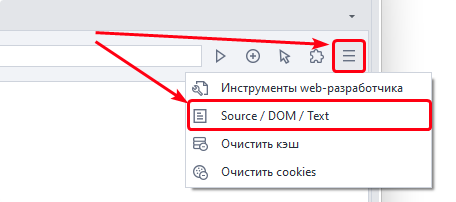
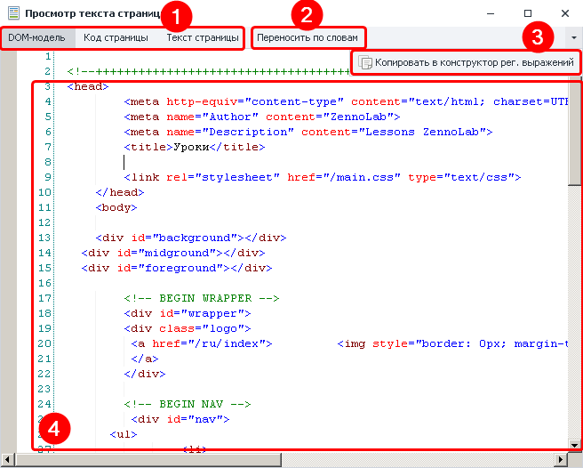
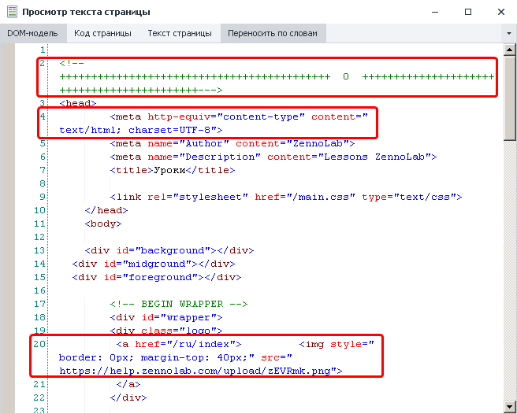
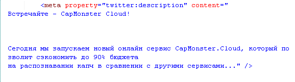
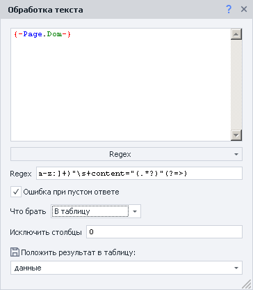
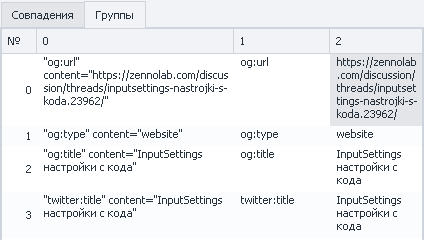

---
sidebar_position: 1
title: "Просмотр текста страницы"
description: ""
date: "2025-08-18"
converted: true
originalFile: "Просмотр текста страницы.txt"
targetUrl: "https://zennolab.atlassian.net/wiki/spaces/RU/pages/735903769"
---
import DisclaimerNotice from '@site/src/components/DisclaimerNotice';

<DisclaimerNotice />

> 🔗 **[Оригинальная страница](https://zennolab.atlassian.net/wiki/spaces/RU/pages/735903769)** — Источник данного материала

_______________________________________________  
## Описание
Этот инструмент позволяет просматривать исходный код (Source), DOM-модель и видимый текст веб-страницы, загруженной в браузере.  

:::tip При использовании в проекте движка *chrome*
В качестве альтернативы можно применять стандартные инструменты веб-разработчика (DevTools).
:::

### Для чего это используется?
Окно просмотра необходимо для глубокого анализа структуры страницы в следующих случаях:
- **Привязка к элементам:** поиск уникальных атрибутов или данных для точной настройки экшенов (клик, чтение или ввод значения).
- **Сложный парсинг:** извлечение информации, до которой не получается добраться через стандартный конструктор действий.  
- **Отладка:** быстрое копирование исходного кода, DOM или текста напрямую в [Тестер регулярных выражений](/zennoposter/ProjectMaker/Tools/Regular_Expression_Tester) для проверки логики.

### Как открыть окно?
Кнопка для вызова этого инструмента находится на панели управления, справа от адресной строки браузера.


_______________________________________________ 
## Принцип работы
При нажатии на иконку инструмента открывается следующее окно:



### Выбор содержимого (1)
Позволяет указать, в каком формате необходимо отобразить данные: **DOM** (выбрано по умолчанию), **исходный код** (Source) или **видимый текст** страницы.  

### Переносить по словам (2)
Включает автоматический перенос длинных строк текста. Если опция выключена, текст уходит за правую границу окна, и для его полного просмотра потребуется горизонтальная прокрутка.  

Пример окна с включенным переносом строк:  



### Копировать в конструктор регулярных выражений (3)
Автоматически открывает [Конструктор регулярных выражений](/zennoposter/ProjectMaker/Tools/Regular_Expression_Tester) и переносит в него всё текущее содержимое окна для дальнейшей работы и тестирования.
_______________________________________________ 
## Пример использования
Предположим, нам нужно получить все теги `<meta>` с атрибутом property со [страницы темы на форуме ZennoLab](https://zennolab.com/discussion/threads/capmonster-cloud-novyj-servis-avtomaticheskogo-raspoznavanija-kapch.59736/). Эти теги не отображаются на самой странице, поэтому найти их через **Конструктор действий** не получится. Вместо этого будем работать с кодом страницы.  

### Шаг 1. Найдите нужные теги в коде страницы  
Откройте нужную страницу и запустите окно просмотра кода.  

> В этом примере можно использовать как DOM, так и исходный код страницы — результат будет одинаковым.  

Найдите теги `<meta>` с атрибутом `property`. На скриншоте показан один из них:  



Нужные нам теги имеют похожую структуру:  
- тег начинается с `<meta property="`;  
- после `property` указано название свойства;  
- в атрибуте `content` находится его значение;  
- тег заканчивается символом `>`.

### Шаг 2. Создайте регулярное выражение  
Скопируйте содержимое страницы в [Конструктор регулярных выражений](/zennoposter/ProjectMaker/Tools/Regular_Expression_Tester). Для поиска нужных значений используйте следующее регулярное выражение:

```
(?<=<meta\ property=)"([a-z:]+)"\s+content="(.*?)"(?=>)
```
В нём используются две группы:  
1. `([a-z:]+)` — получает значение атрибута property  
2. `(.*?)` — получает содержимое атрибута content

### Шаг 3. Сохраните найденные значения  
Добавьте действие [Обработка текста](/zennoposter/ProjectMaker/Project-editor/Actions-in-ProjectMaker-Actions-Blocks/Data/Text_Processing) и выберите операцию **Regex**.  

Укажите созданное регулярное выражение, выполните поиск по коду страницы и сохраните найденные значения в таблицу:  



В примере регулярное выражение применяется к DOM текущей вкладки. Содержимое страницы доступно через специальные переменные:  
- `{-Page.Dom-}` — DOM текущей вкладки;  
- `{-Page.Source-}` — исходный код страницы;  
- `{-Page.Text-}` — видимый текст страницы.

> *Другие доступные переменные можно посмотреть в [Окне переменных](/zennoposter/ProjectMaker/Program-interface/Variables_Window).*

#### Почему нужно исключить столбец 0?
В регулярном выражении используются две группы:  
```
([a-z:]+)
(.*?)
```
Однако в результате вы увидите три столбца:  
- *столбец `0`* содержит всё совпадение целиком;  
- *столбец `1`* содержит значение атрибута `property`;
- *столбец `2`* содержит значение атрибута `content`.

То есть нумерация начинается с нуля. Поэтому, если полное совпадение вам не нужно, исключите столбец `0`.  

Посмотреть найденные группы можно на вкладке **Группы** в конструкторе регулярных выражений:




* * *

## Полезные ссылки

- [❗→ Тестер регулярных выражений](https://zennolab.atlassian.net/wiki/spaces/RU/pages/534086111 "https://zennolab.atlassian.net/wiki/spaces/RU/pages/534086111")
- [❗→ XPath](https://zennolab.atlassian.net/wiki/spaces/RU/pages/862093419 "https://zennolab.atlassian.net/wiki/spaces/RU/pages/862093419")
- [❗→ Обработка текста](https://zennolab.atlassian.net/wiki/spaces/RU/pages/488865793 "https://zennolab.atlassian.net/wiki/spaces/RU/pages/488865793")
- [❗→ 💻Окно браузера](https://zennolab.atlassian.net/wiki/spaces/RU/pages/534315373 "https://zennolab.atlassian.net/wiki/spaces/RU/pages/534315373")