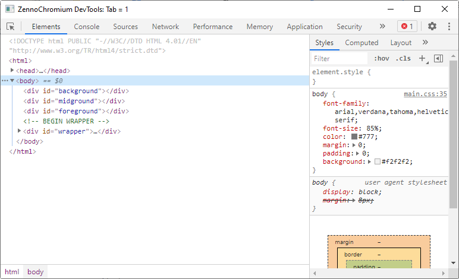
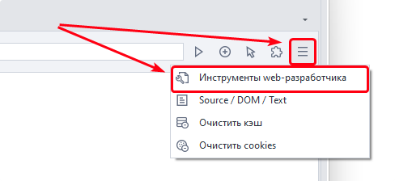

---
sidebar_position: 6
title: "Инструменты web-разработчика (DevTools)"
description: ""
date: "2025-08-18"
converted: true
originalFile: "Инструменты web-разработчика (DevTools).txt"
targetUrl: "https://zennolab.atlassian.net/wiki/spaces/RU/pages/1331134465/web-+DevTools"
---
import DisclaimerNotice from '@site/src/components/DisclaimerNotice';

<DisclaimerNotice />

> 🔗 **[Оригинальная страница](https://zennolab.atlassian.net/wiki/spaces/RU/pages/1331134465/web-+DevTools)** — Источник данного материала

_______________________________________________  
## Описание
**DevTools** — это встроенный набор инструментов браузера для просмотра и анализа веб-страниц. С его помощью можно:  
- посмотреть HTML-код и структуру страницы;
- проверить стили CSS;
- найти нужный элемент и его атрибуты;
- посмотреть сетевые запросы;
- увидеть ошибки JavaScript;
- временно изменить содержимое или оформление страницы.

:::warning Доступно только для движка Chrome
:::

### Как открыть окно?
Нужно кликнуть по соответствующей кнопке справа от адресной строки браузера ProjectMaker:

_______________________________________________ 
## Принцип работы
### Кнопка Inspect  
Позволяет быстро найти HTML-код нужного элемента.

Нажмите её, а затем наведите курсор на элемент страницы и кликните по нему. Выбранный элемент будет подсвечен во вкладке **Elements**.  

### Вкладка Elements
Тут отображается DOM текущей страницы.  

В данной вкладке можно:  
- изучить структуру HTML;
- посмотреть теги и их атрибуты;
- изменить текст или HTML-код элемента;
- добавить или удалить атрибут;
- временно скрыть или удалить элемент.  

:::info внесённые изменения действуют только в текущей вкладке
Они исчезают после обновления страницы.
:::

#### Поиск по XPath
Данное окно можно использовать для тестирования XPath запросов.  

  

Откройте вкладку Elements и нажмите **`Ctrl`** + **`F`**:  
1. В появившееся поле введите обычный текст, XPath-запрос или CSS-селектор.  
2. Подходящие элементы будут подсвечены в коде страницы.  

### Вкладка Console
Здесь можно запускать и проверять JavaScript-код.  

Он будет выполняться в контексте открытой страницы, поэтому ему доступны загруженные на ней объекты, функции и библиотеки.  

Готовый код можно перенести в ProjectMaker и выполнить с помощью экшена [Код JavaScript](/zennoposter/ProjectMaker/Project-editor/Actions-in-ProjectMaker-Actions-Blocks/Custom_code/JavaScript_Code).

### Вкладка Network
Во этой вкладке отображаются сетевые запросы, которые страница отправляет при загрузке и во время работы.  

:::tip Если список запросов пуст
Откройте вкладку Network заново и обновите страницу.
:::

Здесь можно посмотреть:
- адрес запроса;
- используемый HTTP-метод;
- заголовки и передаваемые данные;
- ответ сервера;
- код состояния, например 200, 403 или 404;
- время выполнения запроса.

Эта информация пригодится при создании собственных [HTTP-запросов](/zennoposter/ProjectMaker/Project-editor/Actions-in-ProjectMaker-Actions-Blocks/Http/HTTP-request).
_______________________________________________ 
## Полезные ссылки

- [Официальная документация](https://developer.chrome.com/docs/devtools/ "https://developer.chrome.com/docs/devtools/") (на английском)
- [Обзор всех инструментов разработчика Chrome DevTools](https://habr.com/ru/company/simbirsoft/blog/337116/ "https://habr.com/ru/company/simbirsoft/blog/337116/") (Хабр)
- [❗→ Окно траффика](https://zennolab.atlassian.net/wiki/spaces/RU/pages/735805465 "https://zennolab.atlassian.net/wiki/spaces/RU/pages/735805465")