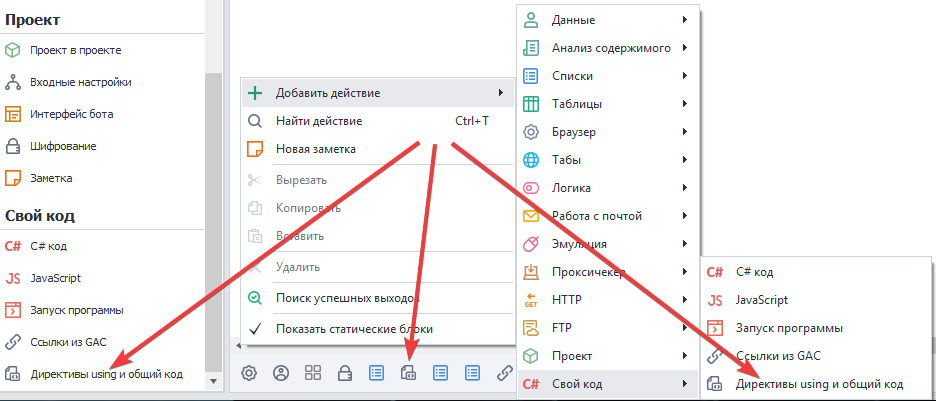
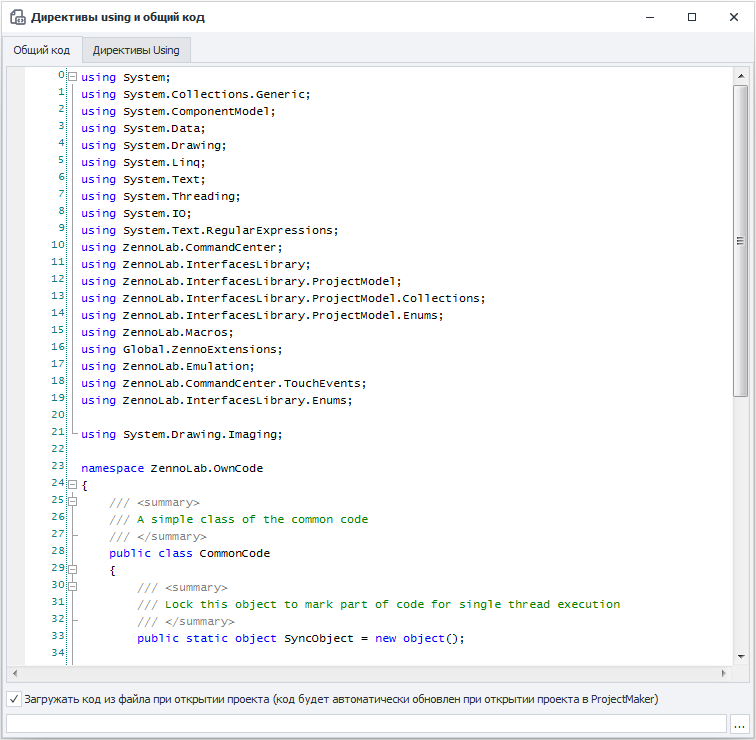
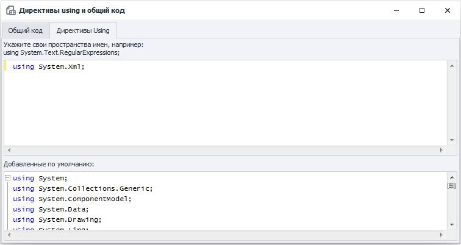

---
sidebar_position: 5
title: "Директивы using и общий код"
description: ""
date: "2025-08-04"
converted: true
originalFile: "Директивы using и общий код.txt"
targetUrl: "https://zennolab.atlassian.net/wiki/spaces/RU/pages/492109917/using"
---
import DisclaimerNotice from '@site/src/components/DisclaimerNotice';

<DisclaimerNotice />

> 🔗 **[Оригинальная страница](https://zennolab.atlassian.net/wiki/spaces/RU/pages/492109917/using)** — Источник данного материала

_______________________________________________  
## Описание
:::note На заметку
Начиная с версии ZennoPoster 7.3.2.0 появилась возможность подключить Visual Studio. Подробная инструкция приведена в статье [Проект Visual Studio](./Visual_Studio_Project.mdx).
:::

**Общий код** - это функционал, расширяющий возможности стандартных кубиков C#. Он используется для вставки дополнительных классов и функций.   

А **Using-директивы** нужны для доступа к функциям и классам, а также для создания пространства имён (*namespaсes*).  

#### Как можно использовать?  
- Более эффективная работа с C# кодом.  
- Создание новых пространств имен.  
- Организация работы с большим объемом кода.  
- Избежание конфликтов в пространстве имен.

:::warning **Работа с общим кодом подразумевает, что у вас уже есть базовые знания C#.**
:::  

### Как добавить действие в проект?
Через контекстное меню: **Добавить действие** → **Свой код** → **Директивы using и общий код**

  

> *При добавлении действия в [Панели статических блоков](/zennoposter/ProjectMaker/Project-editor/Static_blocks/General_Principles_of_Operation) появится соответствующий блок.*  
_______________________________________________
## Общий код
Это окно представляет собой редактор кода с подсветкой синтаксиса. В контекстном меню можно получить доступ к базовому функционалу для редактирования кода: копирование, вставка, комментирование, поиск, замена и т. д.  

В нижней части окна есть чекбокс, который позволяет загружать код из своего файла в форматах `.txt` или `.cs`.  



Самыми первыми в коде перечислены все **using**, используемые в проекте. А далее идет пример объявления `namespace ZennoLab.OwnCode`. Вы можете по аналогии создавать свои пространства имён и обращаться к ним в дальнейшем.  

Для доступа к функциям и методам общего кода их нужно объявлять с модификатором `public`. Если не нужно работать с объектами определенного класса, то его можно объявить статичным `public static`. А когда не понадобится наследование, то лучше сразу объявить как `public sealed`.  

:::warning В общем коде невозможно напрямую получить доступ к сущностям `instance` или `project`
В отличие от кубиков C#.  

Поэтому для работы с инстансом эти объекты необходимо инициировать через `new`:  
(`Instance instance = new Instance("127.0.0.1", 40500, "server");`)  
или передать их через аргументы функций.  

Аналогично с переменными проекта — их значения необходимо передавать посредством аргументов функций.
:::
_______________________________________________
## Директивы Using  
  

Перейдя на эту вкладку, вы увидите перед собой два поля:  
- **Верхнее**. Служит для добавления *namespaces*, которые используются при выполнении кода в экшенах C#. Например, для парсинга XML нужно написать `using System.Xml;`.  
- **Нижнее**. Здесь перечислены все *using*, которые используются проектом по умолчанию. Их нельзя редактировать.  
_______________________________________________
## Тонкая настройка внешнего вида редактора кода

:::info Информация
Добавлено в ZennoPoster 7.2.1.0.
:::

:::warning Внимание
Эти настройки влияют как на «Директивы using и общий код», так и на отображение кода в экшене [C# код](./CSharp_Code.mdx).
:::

Цвета оформления редактора кода можно настроить самостоятельно. Файл `SyntaxEditorColors.json` находится в директории `%AppData%\ZennoLab\ZennoPoster\7\ProjectMaker`. Цвета для светлой и тёмной темы настраиваются отдельно, в формате RGB или по именам.


_______________________________________________
## Пример работы.

### Передача instance в общий код: HtmlClick

В этом примере объект `instance` передаётся в функцию `HtmlClick` через аргумент. Функция ищет HTML-элемент по атрибутам и кликает по нему. Если элемент найден, возвращается строка `success`, иначе — `fail`.

```csharp
namespace ZennoLab.OwnCode
{
    public class CommonCode
    {
        public static string HtmlClick(Instance instance)
        {
            HtmlElement element = instance.ActiveTab.FindElementByAttribute("div", "class", "html", "regexp", 0);
            if (element.IsVoid)
            {
                return "fail";
            }

            element.Click();
            return "success";
        }
    }
}
```

Для вызова функции из [кубика C#](./CSharp_Code.mdx) используйте:

```csharp
return ZennoLab.OwnCode.CommonCode.HtmlClick(instance);
```

Такое использование удобно, если в проекте есть много мест, где требуется кликнуть по одному и тому же элементу.

### Изменение прозрачности изображения: SetImageOpacity

Подадим изображение и коэффициент прозрачности на вход метода `SetImageOpacity`. В результате мы получим картинку с эффектом полупрозрачности, которую можно сохранить на диск.  
```C
public static Image SetImageOpacity(Image image, float opacity)  
{  
    try  {  
		Bitmap bmp = new Bitmap(image.Width, image.Height);
        //создание графики из картинки
        using (Graphics gfx = Graphics.FromImage(bmp)) {
            //создание объекта color matrix  
            ColorMatrix matrix = new ColorMatrix();      
            //установка прозрачности 
            matrix.Matrix33 = opacity;  
            //создание новых атрибутов
            ImageAttributes attributes = new ImageAttributes();      
            //установка цвета прозрачности картинки
            attributes.SetColorMatrix(matrix, ColorMatrixFlag.Default, ColorAdjustType.Bitmap);    
            //отрисовываем картинку
            gfx.DrawImage(image, new Rectangle(0, 0, bmp.Width, bmp.Height), 0, 0, image.Width, image.Height, GraphicsUnit.Pixel, attributes);
        }
        return bmp;  
    }  
    catch (Exception ex) {  
        return null;  
    }  
} 
```  

А вот так эта функция вызывается из [**экшена C#**](./CSharp_Code):  
`Image img = OwnCode.CommonCode.SetImageOpacity(Image.FromFile(project.Directory + "//image.jpg"), .5f);`
_______________________________________________

## Полезные ссылки

- [Проект Visual Studio](./Visual_Studio_Project.mdx)
- [Ссылки из GAC](./References_from_GAC.mdx)
- [Директива using (справочник по C#)](https://learn.microsoft.com/ru-ru/dotnet/csharp/language-reference/keywords/using-directive)
- [C# код (Си шарп код .net)](./CSharp_Code.mdx)
