---
sidebar_position: 2
title: "Внешний вид"
description: ""
date: "2025-08-25"
converted: true
originalFile: "Внешний вид.txt"
targetUrl: "https://zennolab.atlassian.net/wiki/spaces/RU/pages/735576065"
---
import DisclaimerNotice from '@site/src/components/DisclaimerNotice';

<DisclaimerNotice />

> 🔗 **[Оригинальная страница](https://zennolab.atlassian.net/wiki/spaces/RU/pages/735576065)** — Источник данного материала

_______________________________________________  
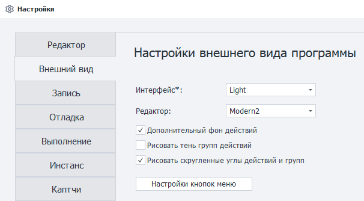

## Интерфейс
Позволяет выбрать светлую или тёмную тему интерфейса программы. Настройка изменяет оформление окон, меню и других элементов ProjectMaker.

### Light:

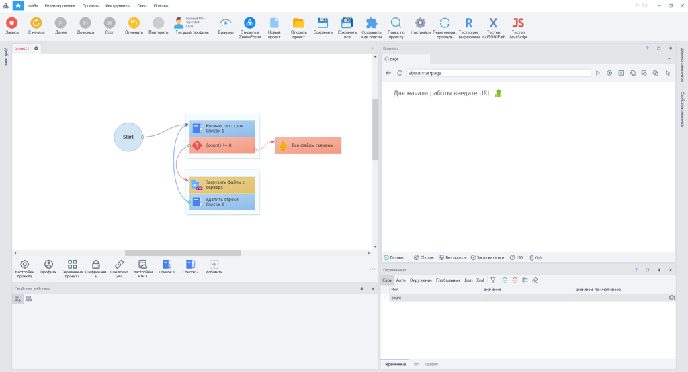

### Dark:

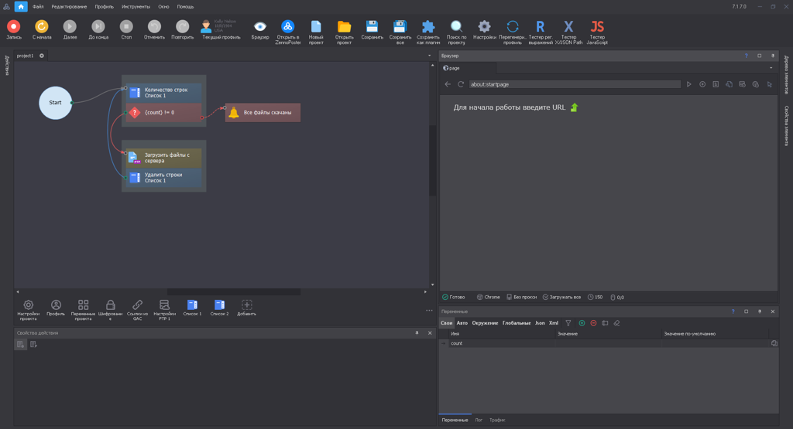

:::info Для изменения темы необходимо перезапустить программу
:::
_______________________________________________
## Редактор
Тут можно выбрать тему оформления для редактора, которая меняет внешний вид экшенов. 

На работу проекта эта настройка не влияет.

### Modern1
> **Cовременный вид, который выбран по умолчанию**

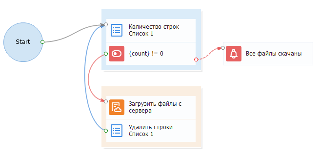

### Modern2
> **У некоторых значков меняется фон, в остальном всё также**

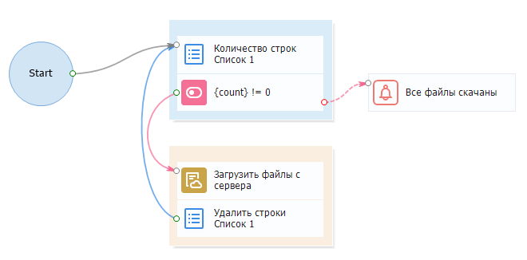

### Letter
> **Иконки заменяются на буквы и символы**

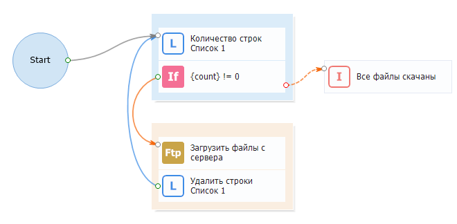

### Classic
> **Так выглядела программа раньше, значки станут совсем другими**  

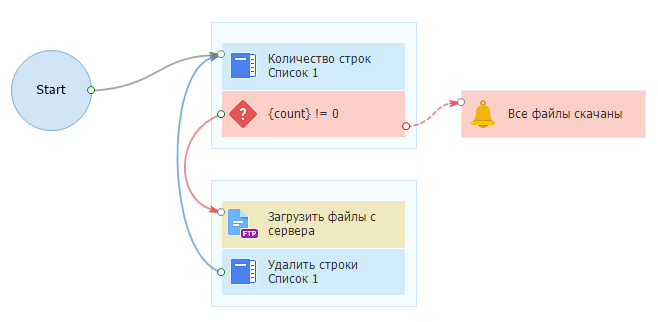

### Classic2
> **Фон экшенов станет более насыщенным**

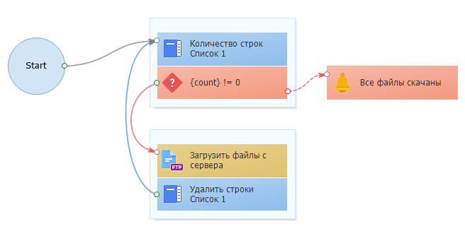

_______________________________________________
## Дополнительный фон действий
:::info ИЗМЕНЕНИЕ НЕДОСТУПНО ДЛЯ *CLASSIC* И *CLASSIC2*
:::

| С насыщенным фоном    | Без дополнительного фона |
| -------- | ------- |
| 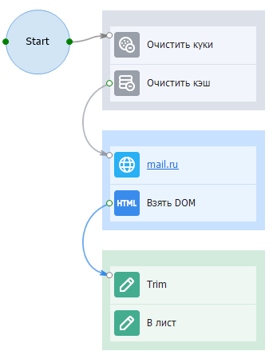  | 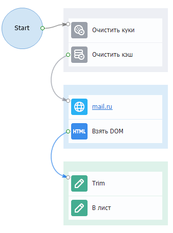    |

_______________________________________________ 
## Рисовать тень групп действий
Добавляет тень вокруг групп действий. Она помогает визуально отделить группы от остальных элементов проекта.  

:::warning Включение данной настройки может замедлить скорость отрисовки
:::

| Настройка включена    | Настройка выключена |
| -------- | ------- |
| 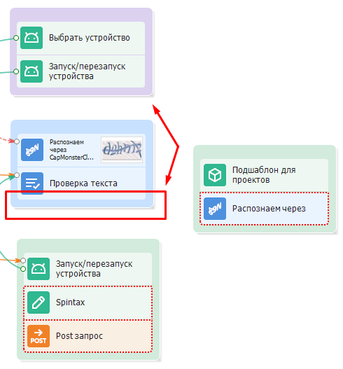  | 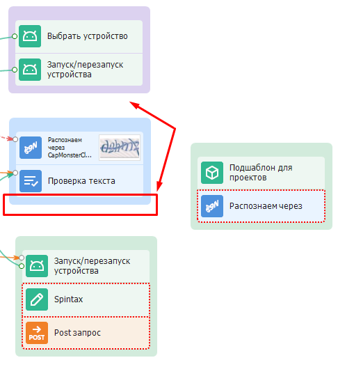    |

_______________________________________________ 
## Рисовать скруглённые углы у действий и групп
:::info *Добавлено в 7.4.0.0*
:::

При включении этой настройки блоки действий и их группы будут отображаться со скруглёнными углами.

| Настройка включена    | Настройка выключена |
| -------- | ------- |
| 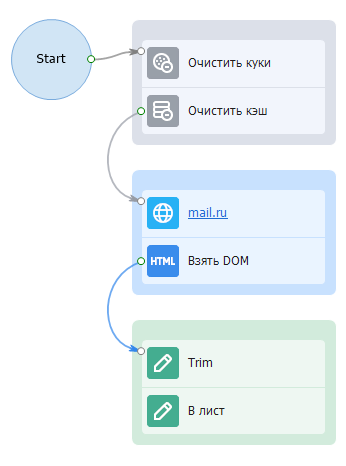  | 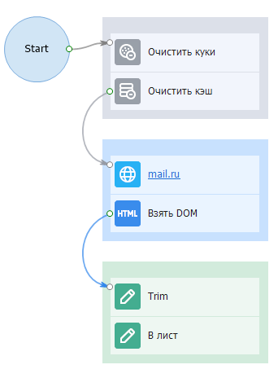    |

_______________________________________________ 
## Настройки кнопок меню
При нажатии на эту кнопку открывается дополнительное меню, в котором можно выбрать кнопки инструментов и разделов отображаемые в верхней панели программы. Так вы можете оставить на виду только часто используемые функции.

### Настройки кнопок инструментов
Здесь можно выбрать, для каких инструментов будут отображаться соответствующие кнопки в верхнем меню.

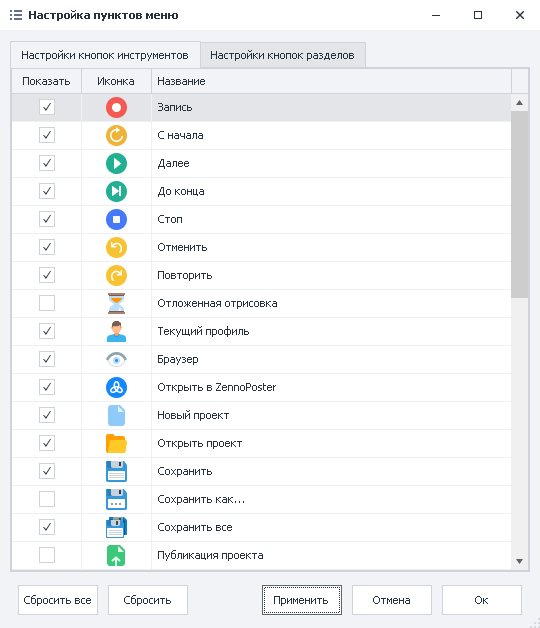

Когда определитесь с выбором и нажмёте **Применить**, кнопки сразу появятся на панели инструментов:

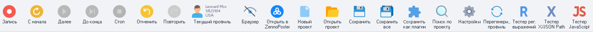

### Настройки кнопок разделов
Тут выбираем, какие разделы будут доступны в самом верху программы.

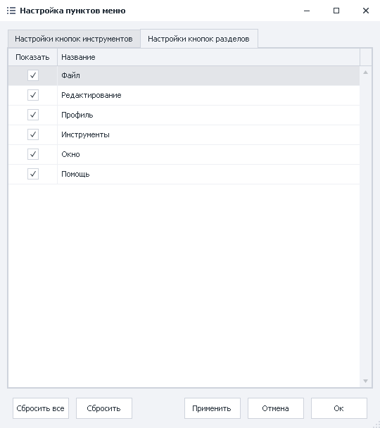

После выбора нужных разделов, они появятся в главном меню:

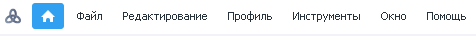

### Расстановка кнопок
Можно вручную расположить кнопки и разделы в том порядке, в котором вам будет удобно с ними работать. Для этого достаточно зажать ЛКМ по необходимому элементу и перетянуть его в желаемое место.

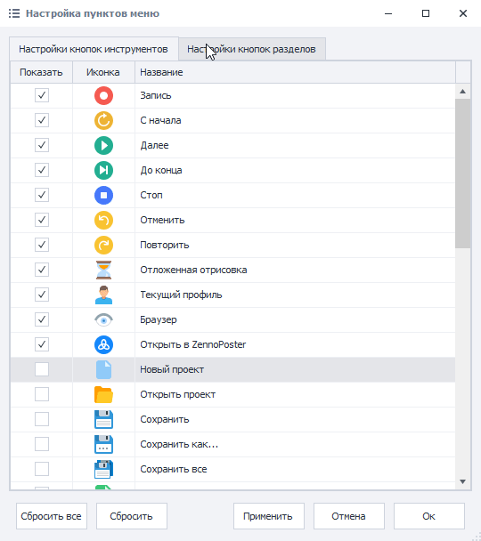

С помощью кнопки **Сбросить** всегда можно вернуть элементы из текущего окна настроек в их исходное положение.  

А **Сбросить Всё** вернёт в изначальное состояние кнопки сразу из обоих окон.