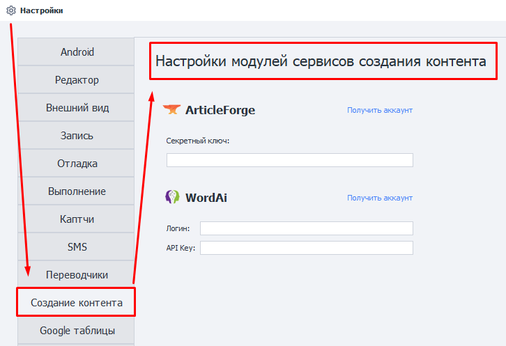

---
sidebar_position: 12
title: "Создание контента (PM)"
description: ""
date: "2025-08-25"
converted: true
originalFile: "Создание контента (PM).txt"
targetUrl: "https://zennolab.atlassian.net/wiki/spaces/RU/pages/724566056/PM"
---
import DisclaimerNotice from '@site/src/components/DisclaimerNotice';

<DisclaimerNotice />

> 🔗 **[Оригинальная страница](https://zennolab.atlassian.net/wiki/spaces/RU/pages/724566056/PM)** — Источник данного материала

_______________________________________________  
## Описание.  
Данные модули позволяют создавать контент на основе заданного текста через сторонние сервисы. Технологии на основе ИИ пишут текст, по качеству сравнимый с человеческим.  

Подходят для **рерайтинга текста** и **создания уникального контента**.

:::warning **Работают только с английским языком.**
:::  

### Внешний вид.  
  
_______________________________________________
### Настройка ArticleForge.  
  

#### 1. Создаём аккаунт, если его ещё нет.  
#### 2. Получаем свой ключ в разделе API Information.  
_______________________________________________
### Настройка WordAi.  
  

#### 1. Создаём аккаунт, если его ещё нет.  
#### 2. Вводим в настройки ZennoPoster свой логин и ключ из раздела API.  
_______________________________________________  