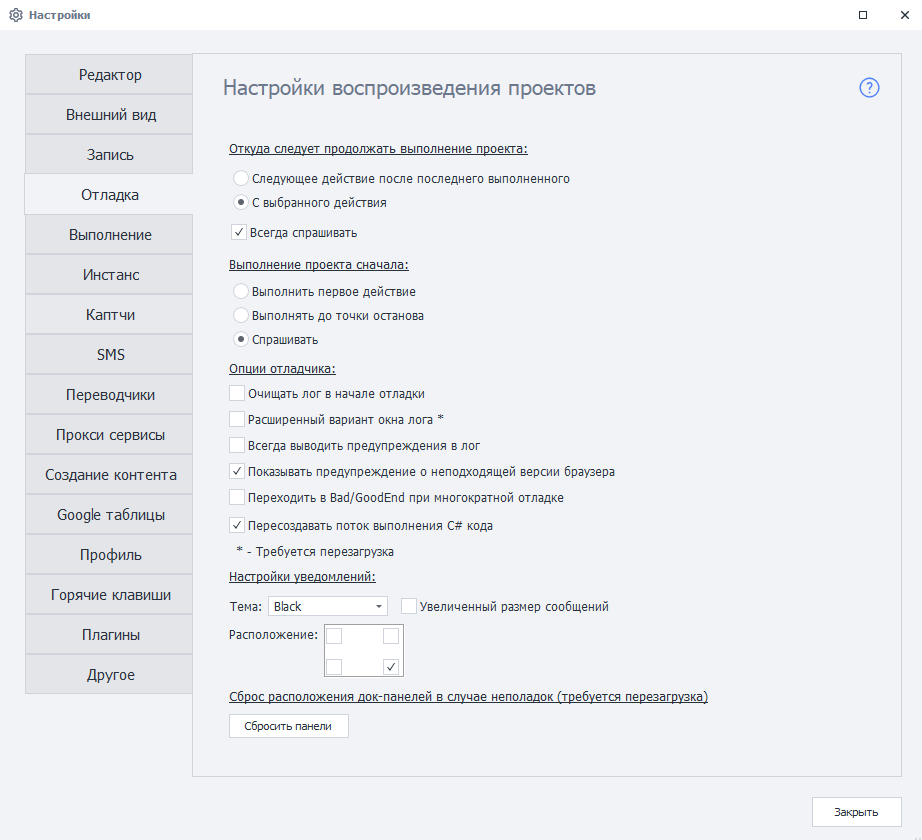
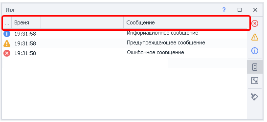
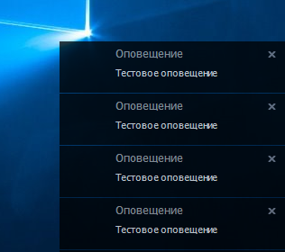
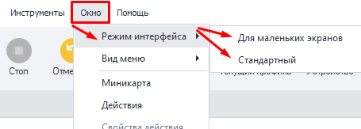

---
sidebar_position: 4
title: "Отладка"
description: ""
date: "2025-08-25"
converted: true
originalFile: "Отладка.txt"
targetUrl: "https://zennolab.atlassian.net/wiki/spaces/RU/pages/725352498"
---
import DisclaimerNotice from '@site/src/components/DisclaimerNotice';

<DisclaimerNotice />

> 🔗 **[Оригинальная страница](https://zennolab.atlassian.net/wiki/spaces/RU/pages/725352498)** — Источник данного материала

_______________________________________________  


## Откуда следует продолжать выполнение проекта
Данные настройки влияют на то, как будет вести себя проект при клике по кнопкам **Далее** или **До конца**.

### Следующее действие после последнего выполненного
Если включить, то проект продолжит выполняться со следующего действия, которое следует за последним выполненным.  

### С выбранного действия
А в этом случае выполнение продолжится с действия, которое пользователь в данный момент выделил в схеме проекта.

### Всегда спрашивать
Данный чекбокс отвечает за то, будет ли запрашиваться выбор из двух верхних вариантов у пользователя каждый раз перед продолжением.
_______________________________________________ 
## Выполнение проекта сначала
Эта настройка определяет поведение проекта при клике **С начала**.  

### Выполнить первое действие
При выборе данной опции фокус проекта будет смещаться на первый экшен после нажатия кнопки **С начала**.

### Выполнять до точки останова 
Действия будут выполняться до первой **Точки останова**, а если её нет, то сразу до конца проекта.

### Спрашивать 
В этом случае порядок выполнения будет каждый раз запрашиваться у пользователя.
_______________________________________________ 
## Опции отладчика
### *Отложенная отрисовка процесса выполнения*
:::warning *Удалена из программы начиная с версии 7.1.7.0*
:::

*Включает отрисовку выполнения действий в реальном времени. Полезно использовать эту настройку при отладке длинных проектов и проектов с циклами.*

### Очищать лог в начале отладки
При каждом запуске проекта **С начала** лог будет автоматически очищен.

### Расширенный вариант окна лога
Лог будет отображаться в окне с дополнительными опциями и возможностью копирования текста.

:::info НАСТРОЙКА ВКЛЮЧАЕТСЯ ОДНОВРЕМЕННО ДЛЯ ZENNODROID И PROJECTMAKER
:::

  

> **Для применения опции требуется перезапуск**

### Всегда выводить предупреждения в лог
В логе появятся дополнительные предупреждения. Например:  
- `Выполнение логического оператора If Результат: false`, если экшен [**IF**](../project-editor/Logic/IF) вышел по красной ветке.  

:::info Требуется перезагрузка
:::

### Показывать предупреждение о неподходящей версии браузера
Выводит предупреждение в лог, если основной и вложенный проекты используют разные версии браузерного движка.  

Такая ситуация может возникнуть при использовании действия [Проект в проекте](/zennoposter/ProjectMaker/Project-editor/Actions-in-ProjectMaker-Actions-Blocks/Project/Project_in_Project_Nested_Projects), если [в настройках](/zennoposter/ProjectMaker/Project-editor/Static_blocks/Project_Settings) вложенного проекта выбран другой тип браузера. Например, основной проект использует Firefox 52, а вложенный — Firefox 45.  

Если настройка включена, при запуске вложенного проекта в логе появится предупреждение:
```
Выполнение действия ProjectInProject. Текущий браузер Firefox52 не подходит для вложенного проекта, требуется Firefox45. Возможна некорректная работа вложенного проекта.
```

### Переходить в Bad/GoodEnd при многократной отладке
Позволяет многократно переходить в блоки [BadEnd](/zennoposter/ProjectMaker/Project-editor/Actions-in-ProjectMaker-Actions-Blocks/Logic/BadEnd_Exit_on_Error) и [GoodEnd](http://localhost:3000/zennoposter/ProjectMaker/Project-editor/Actions-in-ProjectMaker-Actions-Blocks/Logic/GoodEnd_Successful_Exit) во время отладки проекта.

Переход выполняется в зависимости от результата работы:
- в BadEnd — если возникла ошибка;
- в GoodEnd — если выполнение завершилось успешно.

:::info Если настройка выключена
То перейти в BadEnd или GoodEnd можно только один раз за одно выполнение проекта.  

Для повторного перехода потребуется перезапустить проект с помощью кнопки С начала.
:::

### Пересоздавать поток выполнения C# кода
Данная настройка помогает в некоторых случаях избежать утечек памяти в ProjectMaker на процессорах AMD при выполнении C# кода. Сам баг при этом находится в .NET Framework.  

:::warning Исключает использование ThreadStatic
Если вы используете в своих проектах С# вместе с [ThreadStatic](https://www.c-sharpcorner.com/article/overview-of-threadstatic-attribute-in-c-sharp), то эту настройку нужно выключить.
:::

_______________________________________________
## Настройки уведомлений.  
Эта настройка регулирует [**Оповещения**](../project-editor/Logic/Notification), выводящиеся на рабочем столе.  

  

### Тема.  
Выбор цвета фона для оповещений:  
- **Black**, чёрный;  
- **White**, белый;  
- **Blue**, синий;  
- **Green**, зелёный;  
- **Orange**, оранжевый;  
- **WhiteRed**, красно-белый; 

### Увеличенный размер сообщений.  
Уведомления будут отображаться в увеличенном виде.  

### Расположение.  
Выбор области отображения оповещения на рабочем пространстве:  
- *правый нижний угол (по умолчанию)*;  
- *левый нижний угол*;  
- *левый верхний угол*;  
- *правый верхний угол*.  
_______________________________________________
## Сброс расположения док-панелей в случае неполадок.  
Кнопка **Сбросить панели** восстанавливает изначальное отображение окон программы, если вдруг вы открепляли, перемещали или закрывали их.  

:::tip **Окна также сбрасываются при изменении *Режима интерфейса*.**  

:::
_______________________________________________  
