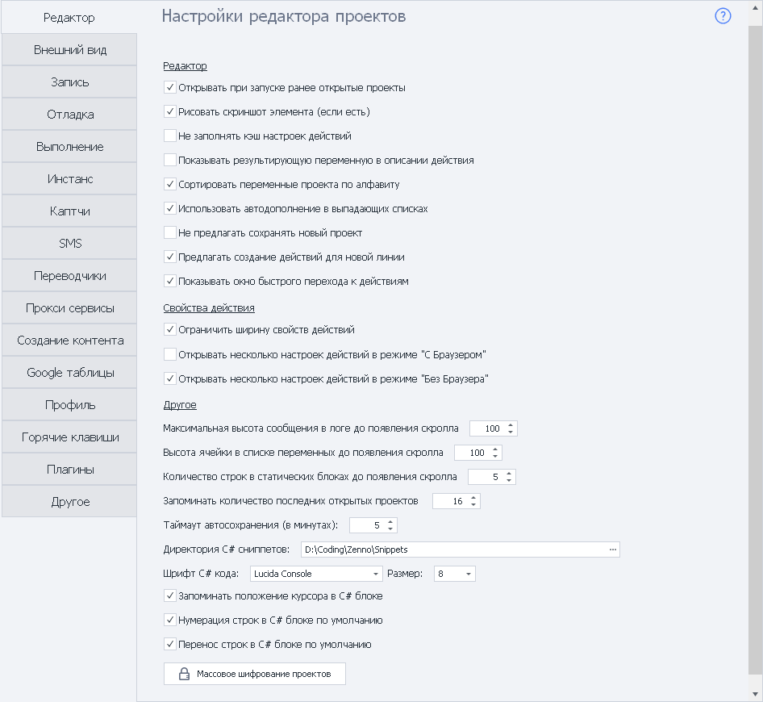
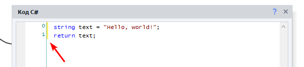
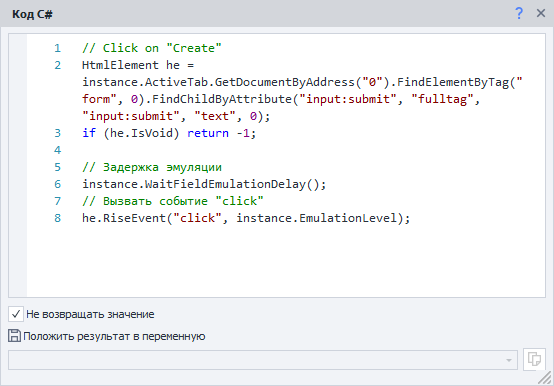

---
sidebar_position: 1
title: "Редактор"
description: ""
date: "2025-08-25"
converted: true
originalFile: "Редактор.txt"
targetUrl: "https://zennolab.atlassian.net/wiki/spaces/RU/pages/725385223"
---
import DisclaimerNotice from '@site/src/components/DisclaimerNotice';

<DisclaimerNotice />

> 🔗 **[Оригинальная страница](https://zennolab.atlassian.net/wiki/spaces/RU/pages/725385223)** — Источник данного материала

_______________________________________________  
## Настройки редактора проектов

### Открывать при запуске ранее открытые проекты
При запуске ProjectMaker автоматически откроет все проекты, с которыми вы работали перед последним закрытием программы.

### Рисовать скриншот элемента (если есть)
На блоке действия будет отображаться скриншот связанного с ним элемента страницы. 

> **Это помогает быстрее ориентироваться в проекте, но увеличивает размер файла шаблона.**

### Не заполнять кэш настроек действий
Отключает предварительное заполнение кэша настроек действий. Это позволяет ускорить запуск программы.

### Показывать результирующую переменную в описании действия
Если действие сохраняет результат в переменную, её название будет отображаться прямо в описании блока:  

`Название действия → {-Variable.ИмяПеременной-}`

Так можно сразу увидеть, куда сохраняется результат, не открывая настройки действия.

### Сортировать переменные проекта по алфавиту
Располагает переменные проекта в алфавитном порядке. Это упрощает поиск нужной переменной в больших проектах.

### Использовать автодополнение в выпадающих списках
При вводе названия переменной, списка или таблицы ProjectMaker предложит подходящие варианты. Вам не потребуется вводить название полностью — достаточно выбрать его из списка.  

:::info Чтобы применить эту настройку, перезапустите программу.
:::

### Не предлагать сохранять новый проект
Отключает предложение сохранить новый проект после нажатия **кнопки «С начала»**.  

### Предлагать создание действий для новой линии
При создании новой линии от блока автоматически открывается список доступных действий. Из него можно сразу выбрать следующее действие и добавить его в проект.

### Показывать окно быстрого перехода к действиям
При наведении курсора на точку соединения блока появляется окно быстрого перехода к другим действиям. Это упрощает работу со связями между блоками проекта.
_______________________________________________ 
## Свойства действия
### Ограничить ширину свойств действий
Определяет, как будет изменяться ширина сетки в окне **Свойства действия**:  
- при включённой настройке ширина будет фиксированной;
- при выключенной — содержимое будет подстраиваться под размер окна.

### Открывать несколько настроек действий в режиме «…»
Позволяет одновременно открывать настройки нескольких действий рядом с соответствующими блоками.

> **По умолчанию эта возможность включена только при работе в режиме *Без браузера*.**  
_______________________________________________
## Другие настройки
### Максимальная высота сообщения в логе до появления скролла
Задаёт максимальную высоту одной записи в логе.  

Если сообщение не помещается в указанную область, внутри неё появляется полоса прокрутки.

### Высота ячейки в списке переменных до появления скролла
Задаёт максимальную высоту ячейки в окне Переменные. Если содержимое не помещается, появляется полоса прокрутки.

### Количество строк в статических блоках до появления скролла
Определяет, сколько строк будет видно в статическом блоке. Если строк больше указанного значения, появляется полоса прокрутки.

### Запоминать количество последних открытых проектов
Определяет, сколько недавно открытых проектов будет отображаться на [стартовой странице](/zennoposter/ProjectMaker/Start_Page).  

### Таймаут автосохранения
Задаёт интервал автоматического сохранения проекта в минутах.

### Директория C# сниппетов
Указывает папку, из которой ProjectMaker будет загружать [C#-сниппеты](/zennoposter/ProjectMaker/Project-editor/Actions-in-ProjectMaker-Actions-Blocks/Custom_code/CSharp_Code).  

**По умолчанию используется следующая папка:**
`C:\Users\USERNAME\AppData\Roaming\ZennoLab\ZennoPoster\7\Snippets\` 

> *Вместо `USERNAME` будет указано имя пользователя Windows, под которым запущена программа.*

### Шрифт C# кода
Позволяет выбрать шрифт и его размер для редактора [C#-кода](/zennoposter/ProjectMaker/Project-editor/Actions-in-ProjectMaker-Actions-Blocks/Custom_code/CSharp_Code).  

> **По умолчанию используется шрифт *Lucida Console* размером *8*.**

### Запоминать положение курсора в C# блоке
Если настройка включена, редактор откроет код на той строке, где находился курсор при закрытии блока.  

А если настройка выключена, редактор вернётся к месту последнего изменения кода.

### Нумерация строк в C# блоке по умолчанию
Автоматически включает отображение номеров строк в новых C#-блоках.  

### Перенос строк в C# блоке по умолчанию
Автоматически переносит длинные строки кода, если они не помещаются по ширине окна. Код при этом не изменяется — меняется только его отображение в редакторе.

| При включённом переносе:    | Перенос выключен: |
| -------- | ------- |
|   |     |

### Массовое шифрование проектов
Позволяет зашифровать сразу все проекты, которые сейчас открыты в ProjectMaker.