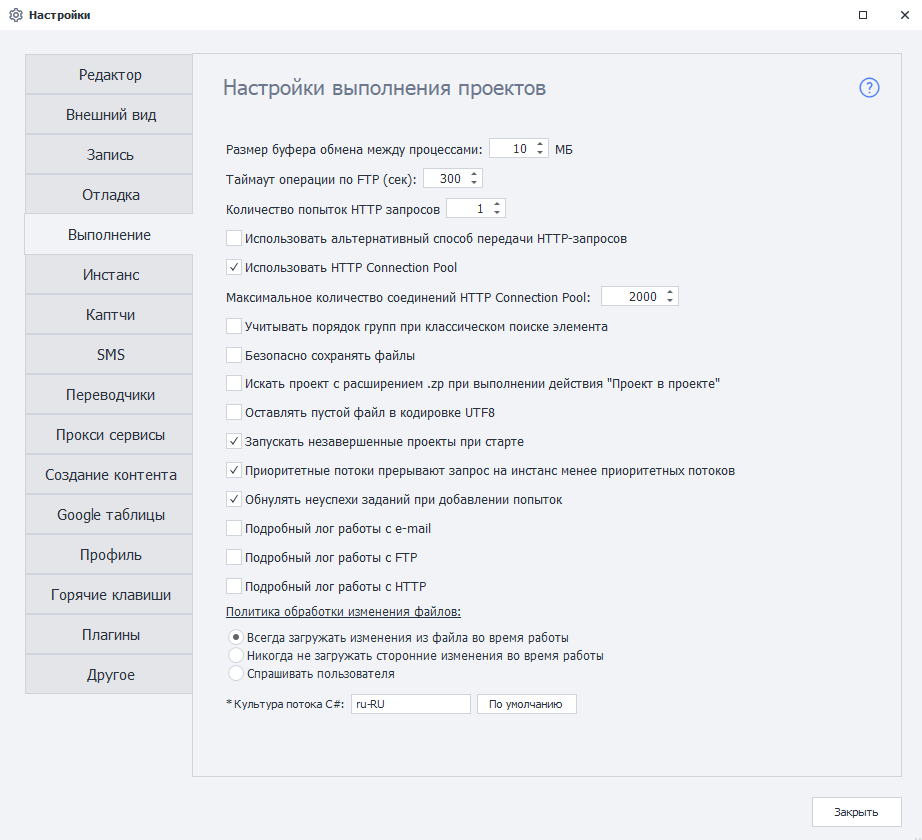

---
sidebar_position: 5
title: "Выполнение (PM)"
description: ""
date: "2025-08-25"
converted: true
originalFile: "Выполнение (PM).txt"
targetUrl: "https://zennolab.atlassian.net/wiki/spaces/RU/pages/727777297/PM"
---
import DisclaimerNotice from '@site/src/components/DisclaimerNotice';

<DisclaimerNotice />

> 🔗 **[Оригинальная страница](https://zennolab.atlassian.net/wiki/spaces/RU/pages/727777297/PM)** — Источник данного материала

_______________________________________________  

### Размер буфера обмена между процессами
Задаёт размер буфера для обмена данными между процессами. Допустимое значение — от **10** до **1000** МБ.  

По умолчанию используется значение **10** МБ. Изменять его без соответствующей рекомендации при устранении конкретной проблемы не требуется.

:::warning Эта настройка не ограничивает максимальный размер списков или таблиц
Которые используются в проекте.
:::

### Таймаут операции по FTP (сек)
Задаёт время в секундах, в течение которого программа будет ожидать завершения операции по FTP.

### Количество попыток HTTP-запросов
Задаёт количество попыток выполнения [HTTP-запроса](/zennoposter/ProjectMaker/Project-editor/Actions-in-ProjectMaker-Actions-Blocks/Http/HTTP-request).  

### Использовать альтернативный способ передачи HTTP-запросов
> Задаётся глобально для программы и применяется ко всем новым проектам.  

Включает альтернативный способ выполнения HTTP-запросов по умолчанию.

:::info Два способа выполнения HTTP-запросов:
- стандартный — с использованием сторонней библиотеки Chilkat;
- альтернативный — собственная реализация ZennoLab.
:::

Если при использовании стандартного способа HTTP-запросы работают некорректно, попробуйте переключиться на альтернативный.  

> *Это также можно сделать в настройках отдельного проекта.*

### Использовать HTTP Connection Pool
Включает оптимизированный механизм работы с HTTP-соединениями, повышающий стабильность выполнения запросов.

### Максимальное количество соединений HTTP Connection Pool
Ограничивает количество соединений, которые могут одновременно использовать ZennoPoster и ProjectMaker. Это помогает стабилизировать работу программы при выполнении большого количества HTTP-запросов.  

### Учитывать порядок групп при классическом поиске элемента
Если настройка включена, группы условий обрабатываются последовательно — в соответствии с их номерами в столбце **Группа**.

### Безопасно сохранять файлы
Помогает предотвратить повреждение файлов и списков при внезапной перегрузке сервера.

### Искать проект с расширением .zp при выполнении действия “Проект в проекте”
Если в действии [Проект в проекте](/zennoposter/ProjectMaker/Project-editor/Actions-in-ProjectMaker-Actions-Blocks/Project/Project_in_Project_Nested_Projects) указан проект старого формата с расширением `.xmlz`, но такой файл не найден, программа попытается найти проект с таким же именем и расширением `.zp`.

:::info Добавлено в версии 7.4.0.0
:::

### Оставлять пустой файл в кодировке UTF8
Сохраняет кодировку UTF-8, если связанный с файлом список остаётся пустым во время выполнения проекта.

### Запускать незавершенные проекты при старте
При запуске программы возобновляет проекты, которые не успели завершиться перед её предыдущим закрытием.  

Проекты будут запущены повторно, только если при закрытии программы вы выбрали соответствующую опцию.

### Приоритетные потоки прерывают запросы менее приоритетных потоков
Учитывает приоритет потоков при обработке запросов во время многопоточного выполнения проектов.  

Запросы приоритетных потоков могут прерывать запросы потоков с более низким приоритетом.

### Проверять соответствие введенных данных
:::warning Удалено из программы, начиная с 7.1.7.0
:::

В предыдущих версиях настройка проверяла данные, введённые в поля веб-элементов. Если поле на сайте заполнялось дважды, эту настройку рекомендовалось отключить.

### Обнулять неуспехи заданий при добавлении попыток
Сбрасывает счётчик неуспешных выполнений задания при добавлении новых попыток.

### Подробный лог работы с e-mail
Включает подробное логирование операций с электронной почтой.

### Подробный лог работы с FTP
Включает подробное логирование операций с FTP.

### Подробный лог работы с HTTP
Включает подробное логирование операций с HTTP-запросами.

### Политика обработки изменений файлов
Определяет, как программа будет обрабатывать внешние изменения файлов, связанных со списками и таблицами:

#### Всегда загружать изменения из файла во время работы
Программа будет автоматически загружать изменения, внесённые в связанный файл во время работы проекта.

#### Никогда не загружать сторонние изменения во время работы
Программа загрузит содержимое файла при запуске проекта, но не будет учитывать последующие внешние изменения.

#### Спрашивать пользователя
При обнаружении внешних изменений программа запросит подтверждение перед их загрузкой.

### Культура потока C#
Определяет региональные параметры, используемые при выполнении и отладке проектов, включая [C#-блоки](/zennoposter/ProjectMaker/Project-editor/Actions-in-ProjectMaker-Actions-Blocks/Custom_code/CSharp_Code).

> **Для применения изменений требуется перезагрузка**

Выбранная культура может влиять на обработку:
- дат и времени;
- чисел;
- десятичных разделителей;
- других регионально-зависимых форматов.  

> В русской версии программы по умолчанию используется культура `ru-RU`.

:::info Для использования `InvariantCulture`  
Полностью очистите поле ввода и оставьте его пустым.
:::