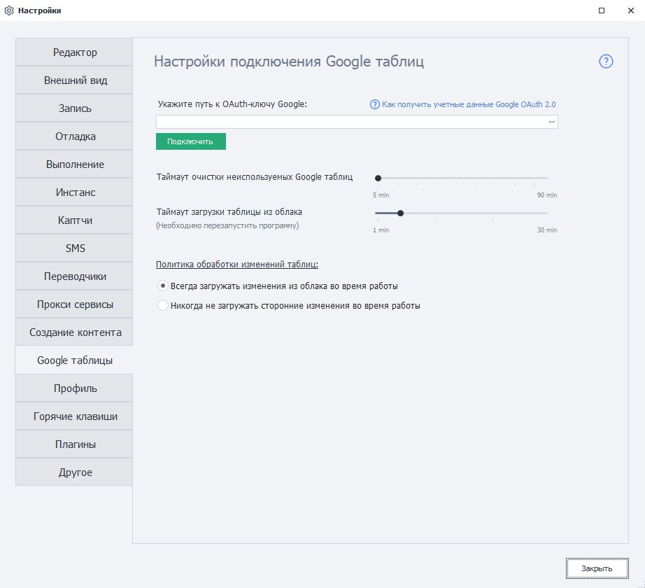

---
sidebar_position: 13
title: "Google таблицы (PM)"
description: ""
date: "2025-08-25"
converted: true
originalFile: "Google таблицы (PM).txt"
targetUrl: "https://zennolab.atlassian.net/wiki/spaces/RU/pages/735576090/Google+PM"
---
import DisclaimerNotice from '@site/src/components/DisclaimerNotice';

<DisclaimerNotice />

> 🔗 **[Оригинальная страница](https://zennolab.atlassian.net/wiki/spaces/RU/pages/735576090/Google+PM)** — Источник данного материала

_______________________________________________  
## Настраиваем Google таблицы.  
В данной статье мы рассказываем **только** о *настройке Google Таблиц* в программе. [Процесс подключения описан здесь](/zennoposter/ProjectMaker/Recording-and-creating-projects/Setting_Up_Google_Sheets_Connection).  

### Внешний вид.

### Путь к OAuth-ключу Google.  
Здесь необходимо выбрать путь к файлу с [настройками подключения к Google API](/zennoposter/ProjectMaker/Recording-and-creating-projects/Setting_Up_Google_Sheets_Connection).  

:::warning **Файл обязательно должен иметь расширение `.json`.**
:::  

### Таймаут очистки неиспользуемых Google таблиц.  
Эта настройка определяет время хранения таблицы в памяти.  

Если ни один проект в ZennoPoster не использует Google таблицу в течение указанного в этой настройке количества минут, то эта таблица будет выгружена из памяти для экономии ресурсов компьютера.  

**Большой таймаут** может быть полезен, когда между запуском определенного проекта есть пауза (например по расписанию, каждый час). Тогда не надо будет каждый раз скачивать таблицу из облака.  

**Малый таймаут** пригодится, если во время каждого выполнения проекта формируется отчёт о работе, который сохраняется в новую таблицу. При этом нет необходимости хранить эти таблицы в памяти после выгрузки данных.  

### Таймаут загрузки таблицы из облака.  
Тут указываем время, отведённое на загрузку таблицы из облака.

Если таблица большая, то синхронизация иногда занимает длительное время. Это может привести к ошибке загрузки, так как запрос выполняется слишком долго.  

### Политика обработки изменений таблиц.  
В этой настройке можно выбрать, должен ли ZennoPoster загружать сторонние изменения таблицы во время работы с ней.  

При выборе режима **Никогда не загружать сторонние изменения во время работы** программа будет *только отсылать* локальные данные, не сопоставляя их с теми, что находятся в облаке. То есть программа не будет тратить ваше время и ресурсы компьютера на это. Полезно, если таблица большая.  

Отключение синхронизации также пригодится при парсинге данных, когда не нужны актуальные данные из облака.
_______________________________________________ 
## Полезные ссылки:

- [❗→ Настройка подключения Google Таблиц](https://zennolab.atlassian.net/wiki/spaces/RU/pages/1667727363 "https://zennolab.atlassian.net/wiki/spaces/RU/pages/1667727363")
- [❗→ Операции над Google-таблицами](https://zennolab.atlassian.net/wiki/spaces/RU/pages/509411347 "https://zennolab.atlassian.net/wiki/spaces/RU/pages/509411347")
- [❗→ Google таблица](https://zennolab.atlassian.net/wiki/spaces/RU/pages/724566092 "https://zennolab.atlassian.net/wiki/spaces/RU/pages/724566092")
- [❗→ Многопоточная работа с Google-таблицами (Версия 7.1.7.0 и выше)](https://zennolab.atlassian.net/wiki/spaces/RU/pages/851673094 "https://zennolab.atlassian.net/wiki/spaces/RU/pages/851673094")