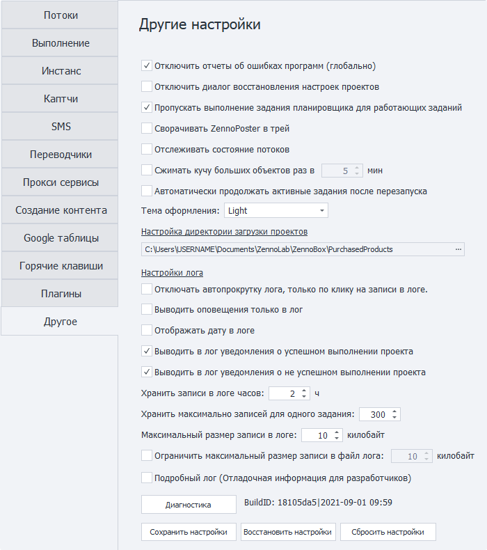
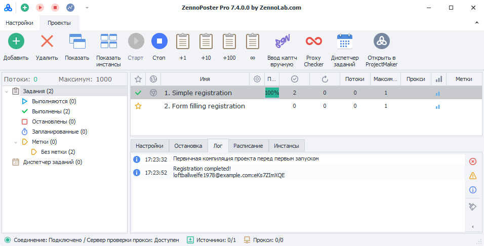

---
sidebar_position: 17
title: "Другие настройки (PM)"
description: ""
date: "2025-08-25"
converted: true
originalFile: "Другие настройки (PM).txt"
targetUrl: "https://zennolab.atlassian.net/wiki/spaces/RU/pages/735608855/PM"
---
import DisclaimerNotice from '@site/src/components/DisclaimerNotice';

<DisclaimerNotice />

> 🔗 **[Оригинальная страница](https://zennolab.atlassian.net/wiki/spaces/RU/pages/735608855/PM)** — Источник данного материала

_______________________________________________  

## Общие настройки
### Отключить отчёты об ошибках программ (глобально)
Иногда из-за ошибки браузера инстанс аварийно завершает работу. ZennoPoster обнаруживает сбой и автоматически перезапускает инстанс. Однако окно с сообщением об ошибке может помешать перезапуску.

Включите эту настройку, чтобы такие окна не появлялись.
### Отключить диалог восстановления настроек проектов
После аварийного завершения ZennoPoster может предложить восстановить настройки проектов. Эта опция отключает окно восстановления.

:::info Рекомендуем оставить окно восстановления включённым
Отключайте его только в том случае, если оно мешает автоматическому запуску ZennoPoster
:::

### Пропускать выполнение задания планировщика для работающих заданий
Если к моменту запуска по расписанию проект ещё выполняется, планировщик дождётся завершения текущего выполнения и только после этого запустит задание.  

### Сворачивать ZennoPoster в трей
При сворачивании окна программы она будет выгружаться в трей.  

:::tip **Что такое трей?**
***Трей** — элемент панели задач в Windows, который открывается нажатием на стрелочку в правом крае панели. Используется для длительно запущенных, но при этом не постоянно используемых программ.* 
::: 

### Отслеживать состояние потоков
Включает сбор статистики о состоянии потоков. Эта информация помогает [службе поддержки](https://helpdesk.zennolab.com/ru/conversation/new) разбираться в работе программы.

> **Включайте настройку только по просьбе службы поддержки.**  

### Сжимать кучу больших объектов
Задаёт интервал сжатия кучи больших объектов — области памяти, в которой хранятся крупные объекты, например длинные строки.  

### Автоматически продолжать активные задания после перезапуска
После перезапуска ZennoPoster автоматически продолжит задания, которые были активны перед закрытием программы.
_______________________________________________ 
## Тема оформления
### Light

### Dark

_______________________________________________ 
## Настройка директории загрузки проектов
В данную папку будут сохраняться проекты, которые вы получили от других пользователей. В качестве имени папок будут использоваться email разработчиков проекта, либо их ZennoLab ID.  

:::warning Вручную копировать проекты в эту папку нельзя!
:::

_______________________________________________ 
## Настройки лога
Лог — это журнал событий, в котором ZennoPoster сохраняет сообщения о работе проектов.  

### Отключать автопрокрутку лога, только по клику на записи в логе
При появлении новых записей лог автоматически прокручивается вниз.  

Если настройка включена, остановить автопрокрутку можно только щелчком по записи.

### Выводить оповещение только в лог
Сообщения экшена «[Оповещение](/zennoposter/ProjectMaker/Project-editor/Actions-in-ProjectMaker-Actions-Blocks/Logic/Notification_Log_Entry)» будут появляться только в логе, без всплывающих окон.  

> *Настройка действует независимо от параметров самого действия.*  

### Отображать дату в логе
Добавляет дату к записям в логе.

### Выводить в лог уведомления об успешном выполнении проекта
Добавляет запись в лог, когда проект завершается успешно.

### Выводить в лог уведомления о неуспешном выполнении проекта
Добавляет запись в лог, когда проект завершается с ошибкой.

### Хранить записи в логе часов
Задаёт максимальное время хранения записей в логе, в часах.

### Хранить максимально записей для одного задания
Задаёт максимальное количество записей, которые хранятся в логе для одного задания.

:::info Максимальное значение — `9999`
:::

### Максимальный размер записи в логе
Ограничение на максимальный размер записи в килобайтах, которая может быть *отображена* в **Окне лога**. 

### Ограничить максимальный размер записи в файл лога
:::tip **Рекомендуем включить**
*Пользователям, которые работают с большими данными, и которым не нужен полный лог, **рекомендуется включить ограничение**. Это повысит производительность и снизит потребление памяти.*  
:::   
Данная настройка ограничивает размер записи, которая может быть *сохранена* в файл лога.  
:::info **Logs**
Файлы логов хранятся в директории с установленным ZennoDroid в папке - **Logs**.  
Возможный путь - `C:\Program Files\ZennoLab\RU\ZennoDroid Pro\2.3.8.0\Progs\Logs\`  
:::   

:::warning **Для вступления изменений требуется перезагрузка программы**
:::  
  
_______________________________________________ 
## Разное
### Подробный лог (Отладочная информация для разработчиков)

Записывает подробную информацию о работе, которая может потребоваться при обращении в **Службу поддержки**.

### BuildID  
Комбинация букв и цифр в данной строке отображает текущую версию программы, а также дату релиза.  
:::tip **Значение в этом поле можно выделить и скопировать с помощью контекстного меню**
:::  

### Доступные кнопки  
#### Диагностика  
Открывает утилиту для диагностики `diagnostic.exe`, которая отображает информацию при возникновении проблем. После выполнения в директории установленного ZennoDroid будет создан файл `report.zip`  

#### Сохранить настройки  
Сохраняет текущие настройки программы. Для использования нужно сначала нажать на кнопку, а затем закрыть программу.  

#### Восстановить настройки  
Позволяет восстановить настройки, которые были сохранены последними. Опять же нужно сначала нажать на эту кнопку, а затем перезапустить программу.  

#### Сбросить настройки  
Сброс текущих настроек на значения по умолчанию.  
