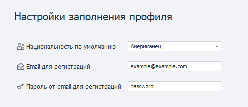
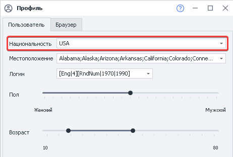
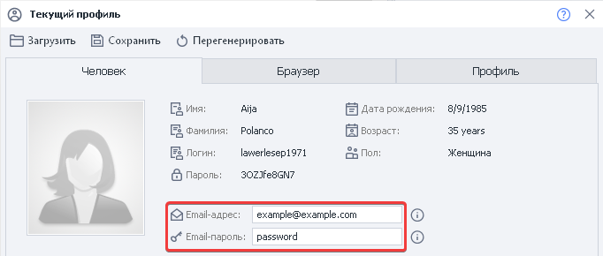

---
sidebar_position: 15
title: "Профиль (PM)"
description: ""
date: "2025-08-25"
converted: true
originalFile: "Профиль (PM).txt"
targetUrl: "https://zennolab.atlassian.net/wiki/spaces/RU/pages/735608848/PM"
---
import DisclaimerNotice from '@site/src/components/DisclaimerNotice';

<DisclaimerNotice />

> 🔗 **[Оригинальная страница](https://zennolab.atlassian.net/wiki/spaces/RU/pages/735608848/PM)** — Источник данного материала

_______________________________________________  
## Настройки заполнения профиля.  
 

Позволяют указать характеристики, который будет генерироваться по умолчанию при старте проекта.  
_______________________________________________
### Национальность по умолчанию.  

   
Национальность для генерации профиля. Её также можно изменить и на уровне шаблона, в настройках профиля проекта.  
_______________________________________________
### E-mail для регистраций.  
Указанный в этой настройке *e-mail* будет использоваться для всех новых профилей.  
Его также можно изменить через переназначение полей в **Операциях над профилем**.  
Значение хранится в переменной окружения `{-Profile.Email-}`.  

  
_______________________________________________
### Пароль от e-mail для регистраций.  
Этот *пароль от e-mail* будет использоваться для всех новых профилей. Его также можно изменить в  
**Операциях над профилем**. Значение хранится в переменной окружения `{-Profile.EmailPassword-}`.
_______________________________________________  
