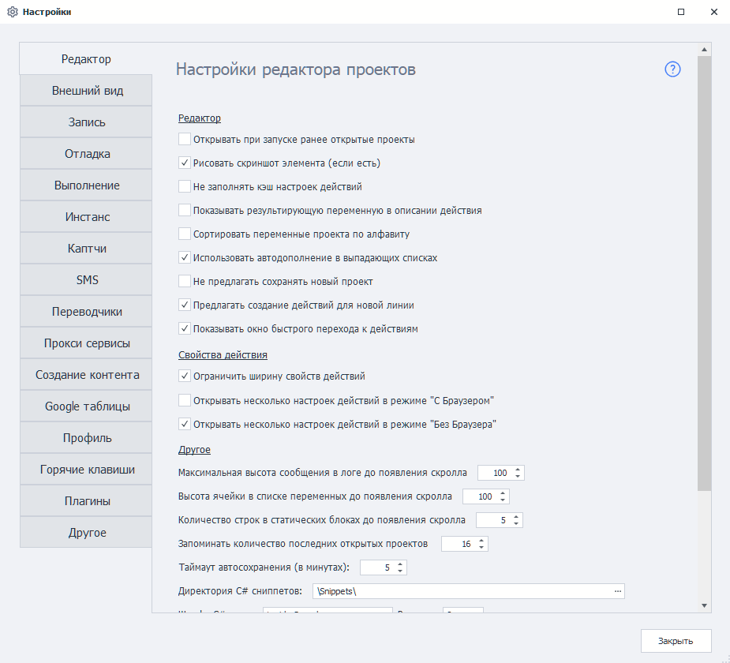

---
sidebar_position: 0
title: "Настройки ProjectMaker"
description: ""
date: "2025-08-25"
converted: true
originalFile: "Настройки ProjectMaker.txt"
targetUrl: "https://zennolab.atlassian.net/wiki/spaces/RU/pages/475300064/ProjectMaker"
---
import DisclaimerNotice from '@site/src/components/DisclaimerNotice';

<DisclaimerNotice />

> 🔗 **[Оригинальная страница](https://zennolab.atlassian.net/wiki/spaces/RU/pages/475300064/ProjectMaker)** — Источник данного материала

_______________________________________________  
## Описание
Настройки ProjectMaker позволяют оптимизировать процесс записи проекта, настроить логи, отладить выполнение проекта, и многое другое.

### Разделы
Мы подробно описали каждую настройку в соответствующих разделах:  
- [Редактор](./Editor)
- [Внешний вид](./Appearance)
- [Запись](./Recording)
- [Отладка](./Debugging)
- [❗→ Выполнение (PM)](./Execution_PM)
- [❗→ Инстанс (PM)](./Instance_PM)
- [❗→ Капчи (PM)](./Captchas_PM)
- [❗→ SMS-сервисы (PM)](./SMS_Services_PM)
- [❗→ Переводчики (PM)](./Translators_PM)
- [❗→ Прокси-сервисы (PM)](./Proxy_Services_PM)
- [❗→ Создание контента (PM)](./Content_Creation_PM)
- [❗→ Google таблицы (PM)](./Google_Sheets_PM)
- [❗→ Почта (PM)](./Mail_PM)
- [❗→ Профиль (PM)](./Profile_PM)
- [❗→ Горячие клавиши](./Hotkeys)
- [❗→ Настройки. Плагины](./Settings_Plugins)
- [❗→ Другие настройки (PM)](./Other_Settings_PM)

Настройки **Выполнения**, **Инстанса**, **Каптч**, **Spintax** и **Другие** дублируют [❗→ настройки ZennoPoster](https://zennolab.atlassian.net/wiki/spaces/RU/pages/494764084/ZennoPoster "https://zennolab.atlassian.net/wiki/spaces/RU/pages/494764084/ZennoPoster").
