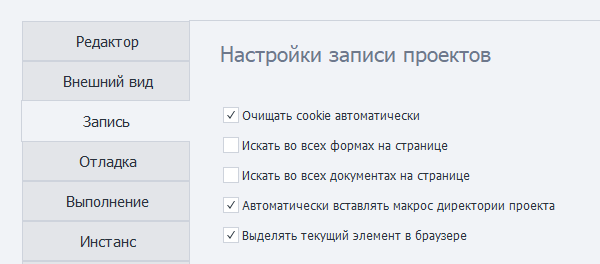
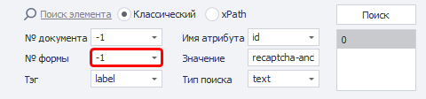
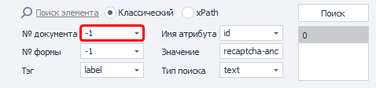
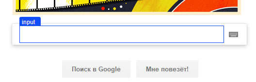

---
sidebar_position: 3
title: "Запись проекта"
description: ""
date: "2025-08-25"
converted: true
originalFile: "Запись.txt"
targetUrl: "https://zennolab.atlassian.net/wiki/spaces/RU/pages/727777290"
---
import DisclaimerNotice from '@site/src/components/DisclaimerNotice';

<DisclaimerNotice />

> 🔗 **[Оригинальная страница](https://zennolab.atlassian.net/wiki/spaces/RU/pages/727777290)** — Источник данного материала

_______________________________________________  
## Настройки записи проектов
Данная вкладка содержит настройки, которые активируются при включенной записи проекта.



### Очищать cookie автоматически
Автоматически очищает файлы cookie при запуске проекта.  

> *Настройка выполняет то же действие, что и [Очистить Cookie](/zennoposter/ProjectMaker/Project-editor/Actions-in-ProjectMaker-Actions-Blocks/Browser/Browser_settings#очистить-куки)*

### Искать во всех формах на странице
Позволяет искать элементы во всех формах, расположенных на странице.  



> *Настройка используется при работе с [Конструктором действий](/zennoposter/ProjectMaker/Browser_Window/Action_Constructor_and_XPath_Search).*

### Искать во всех документах на странице
Позволяет искать элементы во всех документах, расположенных на странице.  



> *Настройка используется при работе с [Конструктором действий](/zennoposter/ProjectMaker/Browser_Window/Action_Constructor_and_XPath_Search).*

### Автоматически вставлять макрос директории проекта
Автоматически заменяет часть пути к файлу на макрос директории проекта `{-Project.Directory-}`. 

Это происходит, если выбранный файл находится в папке проекта или в одной из её вложенных папок. Настройка применяется, например, при указании файлов в свойствах списков и таблиц.

### Выделять текущий элемент в браузере
Выделяет выбранный HTML-элемент синей рамкой в окне браузера.  

:::info Для применения настройки необходимо перезапустить программу
:::



Для отображения рамки ProjectMaker изменяет DOM страницы, добавляя в его конец следующие элементы:

```html
<div id="zp_fr_hl_top_hl" style="visiblity:hidden"></div>
<div id="zp_fr_hl_left_hl" style="visiblity:hidden"></div>
<div id="zp_fr_hl_right_hl" style="visiblity:hidden"></div>
<div id="zp_fr_hl_bottom_hl" style="visiblity:hidden"></div>
<font id="zp_fr_hl_label" style="visiblity:hidden"></font>
```

:::tip Отключите эту настройку
Если изменение DOM может повлиять на анонимность или работу сайта
:::