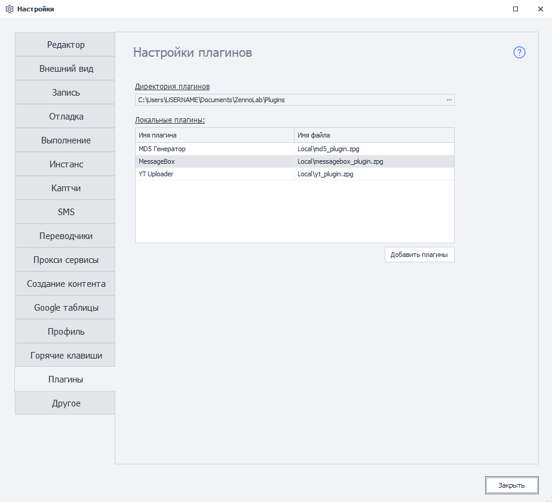
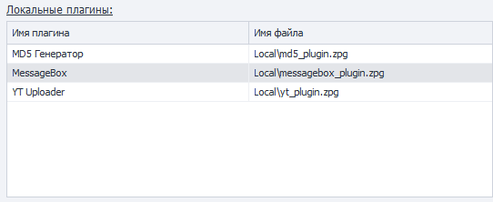
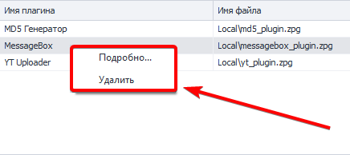
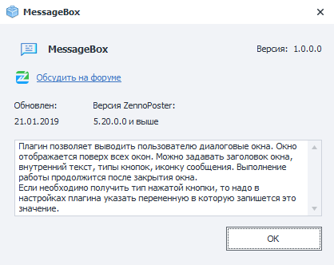

---
sidebar_position: 16
title: "Настройки плагинов"
description: ""
date: "2025-08-25"
converted: true
originalFile: "Настройки. Плагины.txt"
targetUrl: "https://zennolab.atlassian.net/wiki/spaces/RU/pages/735379481"
---
import DisclaimerNotice from '@site/src/components/DisclaimerNotice';

<DisclaimerNotice />

> 🔗 **[Оригинальная страница](https://zennolab.atlassian.net/wiki/spaces/RU/pages/735379481)** — Источник данного материала

_______________________________________________  
:::info На этой странице описаны настройки плагинов
Подробнее о самих плагинах читайте в [статье](/zennoposter/ProjectMaker/Project-editor/Actions-in-ProjectMaker-Actions-Blocks/Plugins).
:::

## Директория плагинов
Задаёт папку, в которой будут храниться установленные плагины.

:::warning При смене директории после установки плагинов
Перенести ранее установленные плагины в новую папку нужно **вручную**.
:::

_______________________________________________
## Локальные плагины
В данной таблице отображаются все плагины, установленные в ProjectMaker.

Здесь можно посмотреть их названия, открыть подробную информацию или удалить ненужный плагин.

### Имя плагина
Название плагина, которое используется в интерфейсе ProjectMaker.

### Имя файла
Название файла, под которым плагин хранится на компьютере. Оно может отличаться от имени плагина в программе.

### Контекстное меню плагина
Чтобы открыть доступные действия, нажмите правой кнопкой мыши на нужный плагин в таблице.

#### Подробно
Открывает окно с подробной информацией о выбранном плагине.  

> Содержимое этого окна зависит от того, какие сведения указал разработчик.  
> Если информация не была заполнена, подробное описание будет отсутствовать.

#### Удалить
Удаляет выбранный плагин из программы. Используйте этот пункт, если плагин больше не нужен.
_______________________________________________
## Добавить плагин
Чтобы установить плагин, нажмите кнопку **Добавить плагин**. Откроется стандартное окно выбора файлов — найдите файл нужного плагина и подтвердите выбор.  

:::tip Множественное добавление
Если требуется установить несколько плагинов, выделите их файлы в этом же окне. Программа добавит их за один раз.
:::

При установке ProjectMaker проверяет имена файлов. Если файл с таким именем уже есть среди установленных плагинов, то новый не будет добавлен. Программа покажет окно со списком плагинов, которые не удалось установить.

Успешно добавленные плагины сразу готовы к работе — перезапускать ProjectMaker после установки не требуется.
_______________________________________________