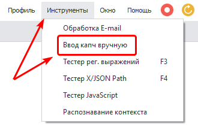
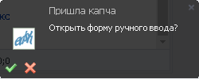
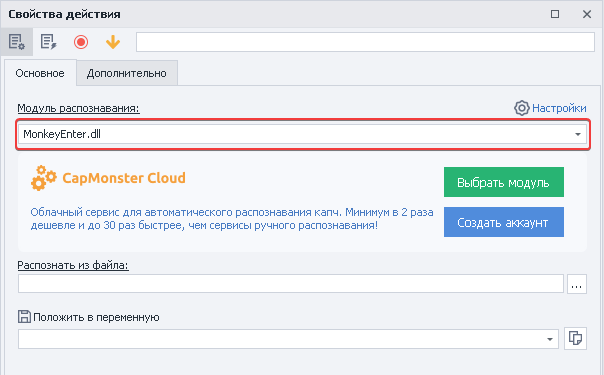
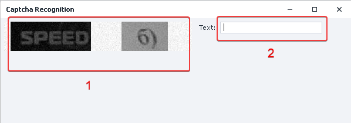
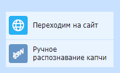

---
sidebar_position: 2
title: "Ввод капч вручную"
description: ""
date: "2025-08-25"
converted: true
originalFile: "Ввод капч вручную.txt"
targetUrl: "https://zennolab.atlassian.net/wiki/spaces/RU/pages/534053215"
---
import DisclaimerNotice from '@site/src/components/DisclaimerNotice';

<DisclaimerNotice />

> 🔗 **[Оригинальная страница](https://zennolab.atlassian.net/wiki/spaces/RU/pages/534053215)** — Источник данного материала

_______________________________________________  
## Описание  
С каждым днём защита сайтов и приложений в виде капч усложняет массовое выполнение проектов. Если у вас нет подходящего сервиса для их решения, либо планируемые объемы совсем не большие, то вы можете разгадывать капчи вручную.  

:::tip **[CapMonster Cloud](https://capmonster.cloud/Dashboard)**
Поможет вам с решением **FunCaptcha**, **Cloudflare**, **ReCaptcha Enterprise** и других сложных капч. Потому что этот экшен работает только с простыми текстовыми задачами.
:::

### Как открыть?  
Есть два способа  
#### Через Панель инструментов  
  

#### Через всплывающее окно в правом нижнем углу  
 

*Оно появляется при отправке картинки из экшена [**Распознать капчу**](/zennoposter/ProjectMaker/Project-editor/Actions-in-ProjectMaker-Actions-Blocks/Tabs/Captcha_Recognition)*.  
_______________________________________________
## Как работать с инструментом?  
### Подготовка  
Добавляем в проект экшен [**Распознать капчу**](/zennoposter/ProjectMaker/Project-editor/Actions-in-ProjectMaker-Actions-Blocks/Tabs/Captcha_Recognition) и выбираем из списка модуль распознавания **`MonkeyEnter.dll`**.  

  

### Разгадывание капчи  
 

**1.** Отправляем капчу, которую необходимо разгадать.  
**2.** Вводим результат.  

После этого нажимаем **Enter**, подтверждая результат. Ответ при этом внесётся в переменную, которая задаётся при настройке экшена [**Распознать капчу**](/zennoposter/ProjectMaker/Project-editor/Actions-in-ProjectMaker-Actions-Blocks/Tabs/Captcha_Recognition).  

:::tip **Данный способ подходит только для текстовых капч**
:::  
_______________________________________________
## Пример использования  
Подведём итог. Представим, что нужно отправить сообщение на форуме, где установлена текстовая капча.  

  

1. Добавляем в проект экшен [**Распознать капчу**](/zennoposter/ProjectMaker/Project-editor/Actions-in-ProjectMaker-Actions-Blocks/Tabs/Captcha_Recognition).  
2. Выбираем модуль распознавания **`MonkeyEnter.dll`**.  
3. Открываем окно ввода капчи.  
4. Вводим ответ на задачу.  
5. Подтверждаем результат и отправляем сообщение.  

Таким образом, если вам во время работы попадётся текстовая капча, то вы сможете решить её таким способом.
_______________________________________________  
