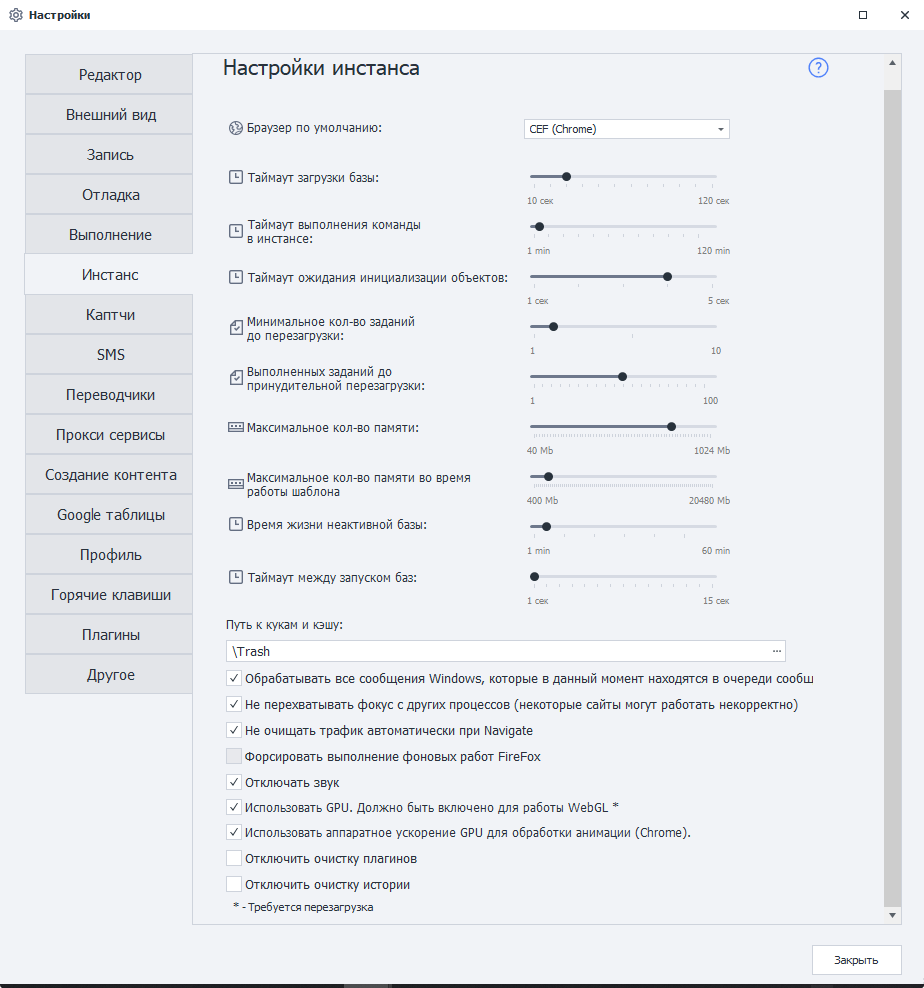

---
sidebar_position: 3
title: "Настройки инстанса"
description: ""
date: "2025-09-10"
converted: true
originalFile: "Настройки инстанса.txt"
targetUrl: "https://zennolab.atlassian.net/wiki/spaces/RU/pages/808845378"
---
import DisclaimerNotice from '@site/src/components/DisclaimerNotice';

<DisclaimerNotice />

> 🔗 **[Оригинальная страница](https://zennolab.atlassian.net/wiki/spaces/RU/pages/808845378)** — Источник данного материала

_______________________________________________  



### Браузер по умолчанию
Определяет браузер, который будет запускаться по умолчанию.  

Выбрать другой браузер для отдельного шаблона можно:  
- в [Настройках проекта](/zennoposter/ProjectMaker/Project-editor/Static_blocks/Project_Settings);
- с помощью действия [Запустить инстанс](/zennoposter/ProjectMaker/Project-editor/Actions-in-ProjectMaker-Actions-Blocks/Browser/Browser_settings).

:::warning Настройка доступна только в ProjectMaker
:::

### Тайм-аут загрузки базы
Задаёт время, отведённое на запуск нового потока внутри уже запущенного процесса.

### Тайм-аут выполнения команды в инстансе
Задаёт максимальное время ожидания выполнения команды в инстансе, включая любой экшен.  

### Тайм-аут ожидания инициализации объектов 
Задаёт дополнительное время на загрузку веб-страницы и её элементов. Это может потребоваться, например, для отображения капчи или динамического содержимого.  

Если страница не успевает загрузиться и в логе появляется сообщение **«Не найден HTML-элемент»**, попробуйте увеличить это значение.  

:::info Увеличение тайм-аута может увеличить общее время выполнения проекта
:::

### Минимальное кол-во заданий до перезагрузки
Задаёт минимальное количество заданий, которое должно быть выполнено до перезагрузки базы инстансов.  

### Выполненных заданий до принудительной перезагрузки
Задаёт количество выполненных заданий, после которого база инстансов будет принудительно перезагружена независимо от результатов их выполнения.  

> Перезапустить инстанс вручную можно с помощью действия [Перезагрузить инстанс](/zennoposter/ProjectMaker/Project-editor/Actions-in-ProjectMaker-Actions-Blocks/Browser/Browser_settings) внутри шаблона.  

### Максимальное кол-во памяти 
Задаёт максимальный объём памяти, который может использовать один инстанс. При превышении указанного значения база инстансов будет помечена для принудительной перезагрузки.  

### Максимальное кол-во памяти во время работы шаблона
Ограничивает объём оперативной памяти, доступный одному потоку.  

Если поток превысит установленный лимит, его выполнение будет принудительно завершено. В логе появится сообщение:  
```
Проект остановлен из-за превышения лимита занимаемой памяти
```

:::info Добавлено в 7.4.0.0
:::

### Время жизни неактивной базы
Задаёт время, в течение которого неактивная база продолжает работать перед завершением.

### Тайм-аут между запуском баз 
Задаёт задержку между запусками баз. Это помогает избежать пиковой нагрузки на процессор, особенно на маломощных компьютерах.

### Путь к cookie и кэшу
Указывает папку для хранения временных файлов браузера. Рекомендуем использовать папку внутри директории программы.

В эту же папку сохраняются файлы, загруженные через браузер ProjectMaker.

По умолчанию используется папка **`Trash`** в директории установленной программы. Путь к ней может выглядеть так:
```
C:\Program Files\ZennoLab\RU\ZennoPoster Pro V7\7.4.0.0\Progs\Trash\
```

### Обрабатывать все сообщения Windows, находящиеся в очереди
Позволяет программе обрабатывать все события Windows, возникающие во время работы инстанса.

### Не перехватывать фокус у других процессов 
Не позволяет ZennoPoster перехватывать фокус у других приложений. Это помогает избежать мерцания экрана и неожиданного переключения активного окна.  

:::warning После включения настройки проверьте работу своих проектов  
Некоторым сайтам, например **VK**, для корректной работы требуется переключение фокуса на браузер.
:::  

### Не очищать трафик автоматически при Navigate 
Отключает автоматическую очистку лога запросов в [Окне трафика](/zennoposter/ProjectMaker/Program-interface/Traffic_Window) при каждом переходе на новую страницу.  

Управлять этой настройкой для отдельного проекта можно с помощью [C#-кода](/zennoposter/ProjectMaker/Project-editor/Actions-in-ProjectMaker-Actions-Blocks/Custom_code/CSharp_Code):

```csharp
instance.ClearTrafficWhenNavigate = false; // Отключить очистку
instance.ClearTrafficWhenNavigate = true; // Включить очистку
```

### Форсировать выполнение фоновых работ FireFox
Принудительно продолжает выполнение фоновых операций Firefox при зависании инстанса.  

:::info Не рекомендуем включать эту настройку 
Если при работе проектов не возникает необъяснимых зависаний.
:::  

### Отключить звук
Отключает воспроизведение звука в инстансе.

### Использовать GPU  
Использует видеокарту для ускорения отрисовки содержимого в инстансе.  

:::warning Должно быть включено для работы WEBGL
:::  

### Использовать аппаратное ускорение GPU для обработки анимации в Chrome
Включает растеризацию анимации с помощью графического процессора в Chrome.

:::warning Включение настройки может привести к нестабильной работе
Если поддерживаемый графический ускоритель отсутствует.
:::

### Отключить очистку плагинов 
Запрещает автоматическую очистку плагинов Firefox.

### Отключить очистку истории
Запрещает автоматическую очистку истории Firefox.

