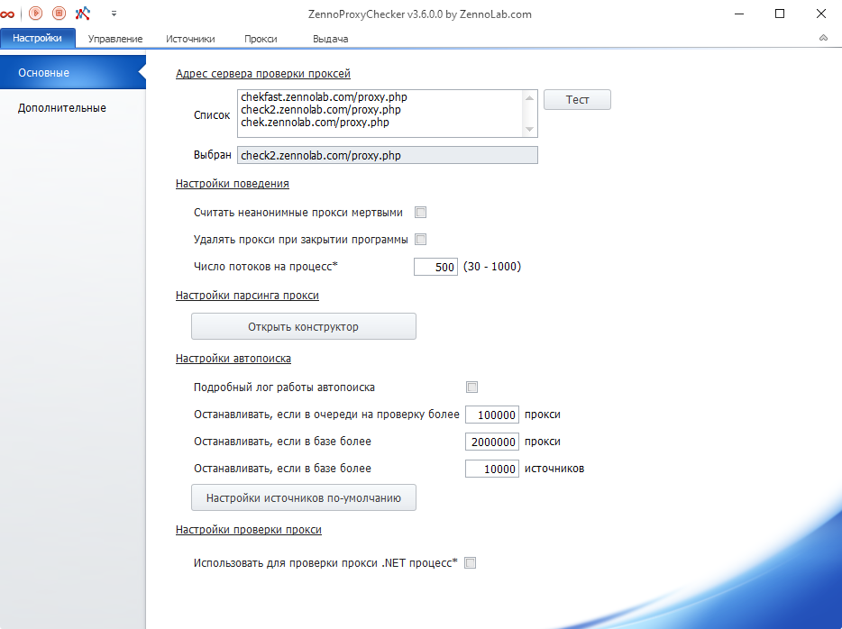
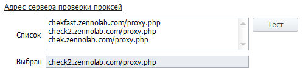
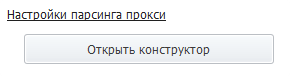
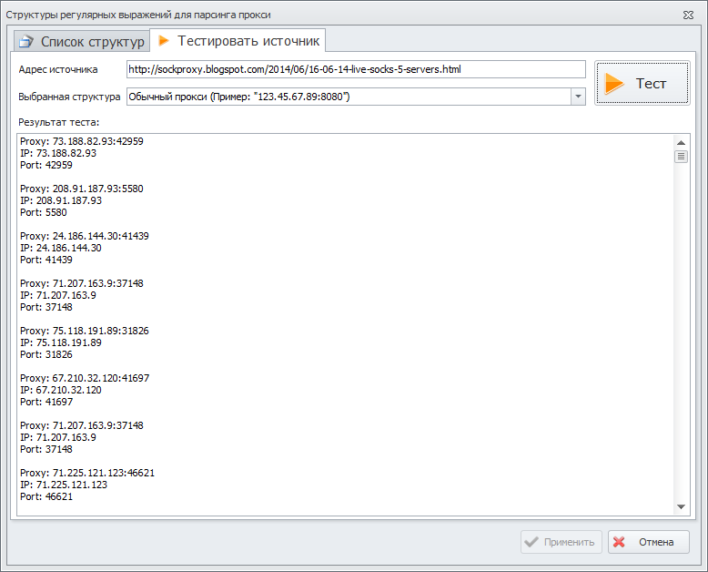
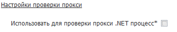

---
sidebar_position: 2
title: "Настройки ProxyChecker"
description: ""
date: "2025-09-10"
converted: true
originalFile: "Настройки ProxyChecker.txt"
targetUrl: "https://zennolab.atlassian.net/wiki/spaces/RU/pages/848560318/ProxyChecker"
---
import DisclaimerNotice from '@site/src/components/DisclaimerNotice';

<DisclaimerNotice />

> 🔗 **[Оригинальная страница](https://zennolab.atlassian.net/wiki/spaces/RU/pages/848560318/ProxyChecker)** — Источник данного материала

_______________________________________________  

_______________________________________________ 
## Адрес сервера проверки проксей
В этом разделе можно выбрать сервер, который программа будет использовать для проверки работоспособности прокси.  

### Список
Содержит URL-адреса серверов проверки прокси.  

По умолчанию в списке указаны три адреса. При необходимости вы можете добавить собственные.

### Кнопка «Тест»
Последовательно проверяет адреса из списка.  

Проверка завершится:
- когда программа найдёт первый работающий сервер;
- когда будут проверены все адреса, если ни один из них не работает.

### Выбран
Отображает адрес сервера, который будет использоваться для проверки работоспособности всех прокси.

В это поле автоматически подставляется первый работающий адрес из списка.
_______________________________________________ 
## Настройки поведения

### Считать неанонимные прокси мёртвыми
Исключает неанонимные прокси из выдачи. Программа будет считать их неработоспособными и использовать только анонимные прокси.

### Удалить прокси при закрытии программы
Очищает список прокси при закрытии программы.

### Число потоков на процесс
Задаёт количество потоков, используемых одним процессом для проверки прокси.

:::warning Для применения изменений перезапустите программу
:::
_______________________________________________ 
## Настройки парсинга прокси
В этом разделе можно добавлять новые и редактировать существующие структуры парсинга прокси. Каждая структура представляет собой набор регулярных выражений.  

Чтобы перейти к настройке структур, нажмите кнопку **Открыть конструктор**.

### Конструктор структур парсинга прокси

#### Вкладка «Список структур»
По умолчанию в список добавлены две структуры с регулярными выражениями.

На этой вкладке можно:
- создать собственную структуру с помощью кнопки **Добавить (1)**;
- удалить существующую структуру с помощью кнопки **Удалить (2)**;
- открыть описание доступных полей с помощью кнопки **Справка по полям структур (3)**.  

Формат представления прокси может отличаться на разных сайтах. При необходимости вы можете создать структуру практически для любого формата, а затем проверить её на конкретном источнике.

#### Вкладка «Тестировать источник»
На этой вкладке можно проверить созданную структуру парсинга.  

**Адрес источника** — укажите адрес сайта, с которого программа должна получить прокси.

**Выбранная структура** — выберите структуру парсинга, ранее добавленную на вкладке **Список структур**.

После заполнения полей нажмите кнопку **Тест**. Прокси, найденные в соответствии с выбранной структурой, появятся в окне **Результат теста**.

:::warning Результаты парсинга не сохраняются
При закрытии конструктора или нажатии кнопки **Отмена**
:::
_______________________________________________ 
## Настройки автопоиска

### Подробный лог работы автопоиска
Включает подробное логирование работы ZennoProxyChecker в режиме автопоиска.

### Останавливать, если в очереди на проверку более XXX прокси
Останавливает автопоиск, когда количество прокси в очереди на проверку превышает указанное значение.

### Останавливать, если в базе более XXX прокси
Останавливает автопоиск, когда количество прокси в базе превышает указанное значение.

### Останавливать, если в базе более XXX источников
Останавливает автопоиск, когда количество источников в базе превышает указанное значение.

### Настройки источников по-умолчанию
Задаёт параметры, которые будут автоматически применяться ко всем новым источникам.  

Подробнее о доступных параметрах читайте в статье [Настройки источников](/zennoproxychecker/Program%20interface/Sources/Source_settings).  
_______________________________________________ 
## Настройки проверки прокси

### Использовать для проверки прокси .NET процесс
Использует реализацию `CheckingProcessor` на платформе .NET для проверки прокси.
  
:::warning Для применения настройки перезапустите программу
:::  
_______________________________________________ 
## Полезные ссылки

- [❗→ Работа с прокси](https://zennolab.atlassian.net/wiki/spaces/RU/pages/534086266 "https://zennolab.atlassian.net/wiki/spaces/RU/pages/534086266")
- [❗→ Настройки источников](https://zennolab.atlassian.net/wiki/spaces/RU/pages/1892876309 "https://zennolab.atlassian.net/wiki/spaces/RU/pages/1892876309")
