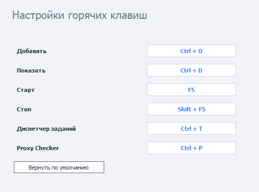

---
sidebar_position: 10
title: "Горячие клавиши ZennoPoster"
description: ""
date: "2025-09-10"
converted: true
originalFile: "Горячие клавиши ZennoPoster.txt"
targetUrl: "https://zennolab.atlassian.net/wiki/spaces/RU/pages/809107528/ZennoPoster"
---
import DisclaimerNotice from '@site/src/components/DisclaimerNotice';

<DisclaimerNotice />

> 🔗 **[Оригинальная страница](https://zennolab.atlassian.net/wiki/spaces/RU/pages/809107528/ZennoPoster)** — Источник данного материала

_______________________________________________  
## Описание
Здесь мы рассмотрим клавиши, которые заданы по умолчанию, но вы также можете изменить их на произвольные комбинации.  

 
- **Добавить — `Ctrl + O`**. Открывает окно добавления нового проекта в программу.  
- **Показать — `Ctrl + D`**. Переход во вкладку **Инстансы** для выделенного проекта. 
- **Старт — `F5`**. Запуск выделенного проекта.  
- **Стоп — `Shift + F5`**. Остановка выделенного проекта. 
- **Диспетчер заданий — `Ctrl + T`**. Показывает окно Диспетчера заданий.  
- **Proxy Checker — `Ctrl + P`**. Открывает окно управления Proxy Checker'ом.  
_______________________________________________
## Переназначение клавиш.  
Для изменения комбинации достаточно кликнуть по интересующему вас полю и зажать желаемое сочетание клавиш на клавиатуре.  

  

Если захотите вернуть изначальные варианты, то достаточно нажать на кнопку **Вернуть по умолчанию**.
_______________________________________________
