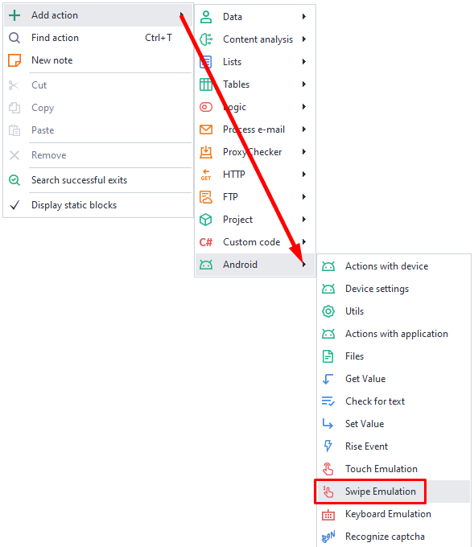
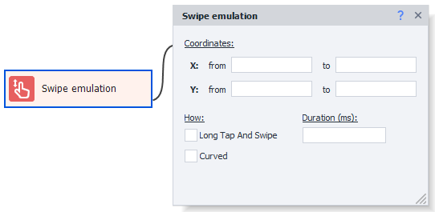

import DisclaimerNotice from '@site/src/components/DisclaimerNotice';

# Swipe Emulation
<DisclaimerNotice />

## Swipe emulation in ZD
This action lets you perform a swipe. It's used for vertical scrolling in the browser and other apps, moving through horizontal menus, or swiping diagonally across the screen.
### How do you add it to your project?
*Right-click → Add action → Android → Swipe emulation*

_______________________________________________
### Available options

#### Coordinates
Set the coordinates for the starting ***(X from and Y from)*** and ending ***(X to and Y to)*** points of the swipe.
***X*** stands for the horizontal coordinate, and ***Y*** is for the vertical.
The starting point must be on the screen, otherwise the action ends with an error, for example *Point (1200, 300) is outside the device screen 1080x2400*. The end point may go past the edge of the screen.
#### Coordinates in percent
:::info **Available starting from ZennoDroid 2.6.3.0.**
:::

The coordinates can also be set in percent of the screen, by the same rules as in [**Touch Emulation**](./Touch_Emulation#coordinates-in-percent): `0%` is the first pixel, `100%` is the last one. Such a swipe works the same way on screens with different resolutions. For example, to scroll down: **X from** `50%`, **Y from** `80%`, **X to** `50%`, **Y to** `20%`. On a 1080x2400 screen this is a swipe from (540, 1919) to (540, 480), and on a 720x1280 screen from (360, 1023) to (360, 256).
#### Long Tap And Swipe
If you check this box, it will simulate a long press before the swipe.
#### Duration (ms)
This setting controls the speed of the swipe in milliseconds.
#### Curved
Lets you perform a more realistic swipe that follows a curved line instead of a straight one.