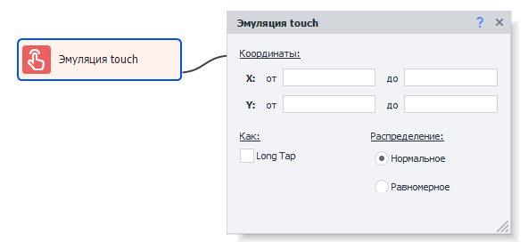
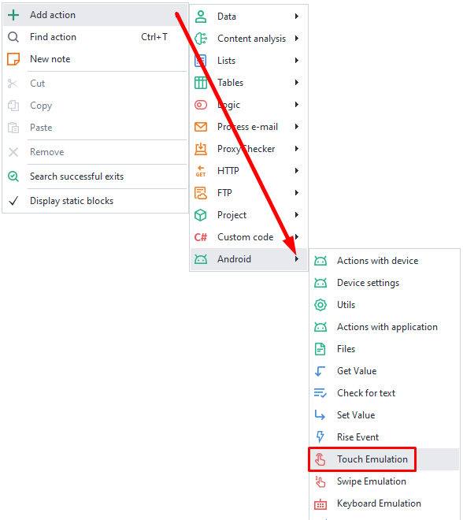
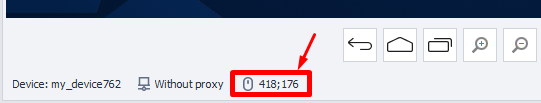

import DisclaimerNotice from '@site/src/components/DisclaimerNotice';

# Touch Emulation
<DisclaimerNotice />
_______________________________________________  
## Description  
This action lets you emulate a screen tap (touch event) within the specified coordinates.

:::warning **The emulator's resolution must stay the same.**
Both during development and when running the project. If you change the resolution, the coordinates of the elements change too. This applies to coordinates in pixels: coordinates [**in percent of the screen**](#coordinates-in-percent) are recalculated for the device's resolution.
:::

### Why use this?  
Simulating a finger tap is helpful when it's difficult or impossible to trigger a click with the **Perform Event** action.

### How do you add it to your project?  
***Right-click → Add Action → Android → Touch emulation***

_______________________________________________  
## How to work with the action  
### Coordinates  
Here you enter the coordinates of the element you're interested in. You can find them in the [**Device Window**](../../pm/Interface/DeviceWindowEmulator); the current cursor position is shown at the bottom when the cursor is inside that window.

**X (from, to)** — horizontal coordinates  
**Y (from, to)** — vertical coordinates

*A Touch tap* will be performed at these coordinates.
If the area partly goes past the edge of the screen, the tap lands in its part that is on the screen. If the whole area is outside the screen, the action ends with an error, for example *Point (1200, 300) is outside the device screen 1080x2400*.

### Coordinates in percent
:::info **Available starting from ZennoDroid 2.6.3.0.**
:::

Any coordinate can be set in percent of the screen instead of pixels: X as a percent of the width, Y as a percent of the height. A percent is a number from 0 to 100 followed by `%`, and its fractional part can be separated by a dot or a comma: `50%`, `12.5%`, `12,5%`. The hint on the fields shows the format: *Pixels or percent of the screen: 540 or 12.5%*.

Before the tap, the percent is converted into pixels by the device's screen resolution: `0%` is the first pixel, `100%` is the last one, and the values in between are proportional, rounded to a whole pixel. For example, on a 1080x2400 screen `50%` on X is 540, and `100%` on Y is 2399. So the same action taps the same part of the screen on devices with different resolutions.

- Pixels and percent can be mixed: for example, X in percent and Y in pixels.
- A percent can come from a variable: `{-Variable.x-}%` if the variable holds a number, or `{-Variable.x-}` if it already has the `%` sign.
- If a percent is below 0, above 100 or not a number, the action ends with an error, for example *Invalid value of Xmin: "101%". Use pixels or a percentage of the screen from 0% to 100%, for example 540 or 50%.* ProjectMaker checks a value without variables before the run and outlines such an action on the canvas with a red dashed line.

The [**Device window**](../../pm/Interface/DeviceWindowEmulator#mouse-coordinates) shows percent next to pixels, and [**project recording**](../../Settings/Record_and_InputMethods#coordinates-in-percent-of-the-screen) can record taps in percent right away.

:::warning **Limitations.**
- Percent is counted from the resolution that ZennoDroid remembers the first time it reads the screen. If the screen turns after that, the width and height do not swap.
- Percent moves the point to the same part of the screen, but it does not make a tap on a particular button portable: on a screen with a different aspect ratio, the app may place the button elsewhere. For buttons, [**Perform Event**](./RunEvent) or [**image search**](../../pm/Creating/SearchByPic) are more reliable.
:::

### Long Tap  
This does a long press, as if you're holding your finger on the screen.

### Distribution  
Sets how precisely the tap happens on the screen:
- **Normal**: More likely to tap closer to the center of the object
- **Equally**: Taps will be distributed evenly within the set coordinates
_______________________________________________