import DisclaimerNotice from '@site/src/components/DisclaimerNotice';

# LSPosed Setup
<DisclaimerNotice />

export const VideoSample = ({source}) => (
  <video controls playsInline muted preload="auto" className='docsVideo'>
    <source src={source} type="video/mp4" />
</video>
);

## Description
The ZennoDroid module is needed to spoof key device parameters: IMEI, Android ID, mobile operator, model, WiFi, Bluetooth, and others.
:::info **Root access is required for the module to work**
Supported phones: Android 9-16
:::

Starting with ZennoDroid 2.5.0.0, installing the module needs [**Magisk**](https://github.com/topjohnwu/Magisk/releases/latest) with **Zygisk** active and **LSPosed v.2**.
_________________
## Enabling Zygisk
### Enabling the built-in Zygisk
Open the Magisk settings, turn **Zygisk** on and reboot the device.

**The Magisk settings.**

<!--All you need is a blank line-->

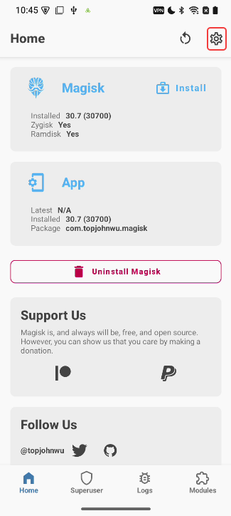 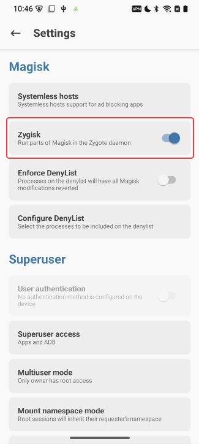

### Enabling a third-party Zygisk
For better anti-detection of Magisk, we recommend a third-party Zygisk (for example, [**Zygisk Next**](https://github.com/LSPosed/ZygiskNext/releases/latest)) instead of the one built into Magisk.

1. Download the Zygisk Next module. In the device window's [**actions menu**](../pm/Interface/DeviceWindow#actions-menu), choose **Magisk / LSPosed** → **Install module...**, pick the downloaded file and click **Install**.
2. Open the Magisk settings and turn the built-in **Zygisk** off.
3. Reboot the device.

**The Install Magisk module window and the Magisk settings.**

<!--All you need is a blank line-->

 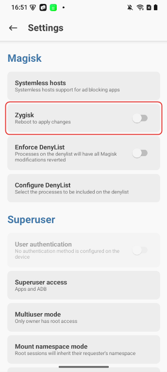 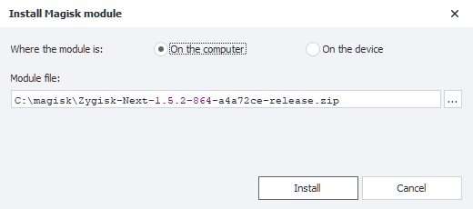

_________________
## Installing the LSPosed Framework
### Installing from the actions menu (ZennoDroid 2.6.2+)
**LSPosed v.2** comes with ZennoDroid, and you can install it right from ProjectMaker through the actions menu:

1. In the device window's [**actions menu**](../pm/Interface/DeviceWindow#actions-menu), choose **Magisk / LSPosed** → **Modules...**: the [**Magisk modules**](../pm/Interface/DeviceWindow#magisk-modules) window opens.
2. Click **Install...** → **Install LSPosed**.
3. When *Module installed* appears at the bottom of the window, reboot the device, for example with the [**Device** → **Reboot**](../pm/Interface/DeviceWindow#device) menu item.

**The Magisk / LSPosed menu and the Magisk modules window.**

<!--All you need is a blank line-->

 

### Manual installation
The current official version of **LSPosed** is distributed through the official [**Telegram channel**](https://t.me/LSPosed). You can also download the latest version of LSPosed via [**this link**](https://www.dropbox.com/scl/fo/bve4et0ilt6bocnbi7ba9/AI0JuEpsjOHkKKlYMgx9aM0?rlkey=je4fi8u0np6267i0e5iblsyu3&st=rlrsg76a&dl=0). Download this build to your phone in the **sdcard/Download/** folder and install it using the standard menu.

**Installing the module in Magisk.**

<!--All you need is a blank line-->

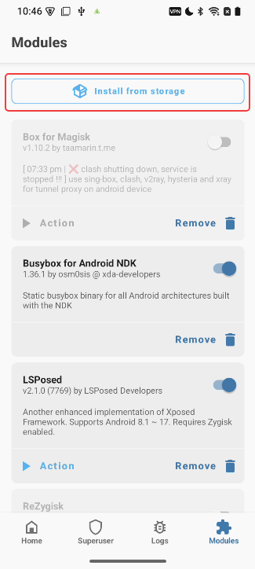 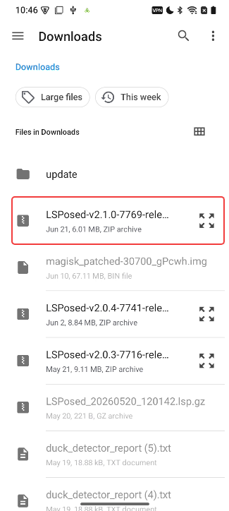

_________________
## Installing the ZennoDroid Module
### Installing from the actions menu (ZennoDroid 2.6.2+)
The easiest way to install the ZennoDroid module is right from ProjectMaker:

1. In the device window's [**actions menu**](../pm/Interface/DeviceWindow#actions-menu), choose **Magisk / LSPosed** → **Module settings...**: the [**LSPosed module settings**](../pm/Interface/DeviceWindow#lsposed-module-settings) window opens.
2. Leave `com.zennolab.zennodroid` in the **Module** field, check **Enable the module** and check the apps whose device parameters will be spoofed.
3. Click **Apply**.

ZennoDroid installs the module by itself and turns it on for the checked apps.

**The Magisk / LSPosed menu and the LSPosed module settings window.**

<!--All you need is a blank line-->

 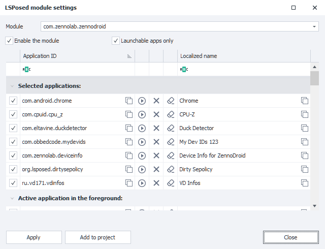

### Manual installation
The ZennoDroid module is installed automatically when you first try to change device parameters or when you run any action from the [LSPosed Management](./LSPosed_Control) group.

On the first launch, your device will ask for superuser rights. You'll need to tap the **"Allow"** button (when using Magisk, permission is granted automatically).

**The superuser rights request.**

<!--All you need is a blank line-->

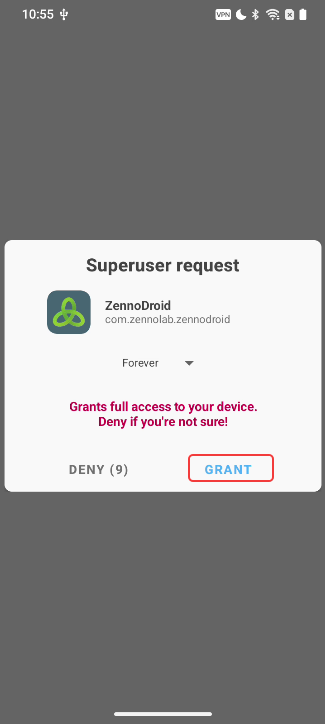

If you missed this or accidentally tapped **"Deny"**, just open **Magisk**, go to the **Superuser** tab, and turn on *automatic superuser rights for ZennoDroid*.

**The Superuser tab in Magisk.**

<!--All you need is a blank line-->

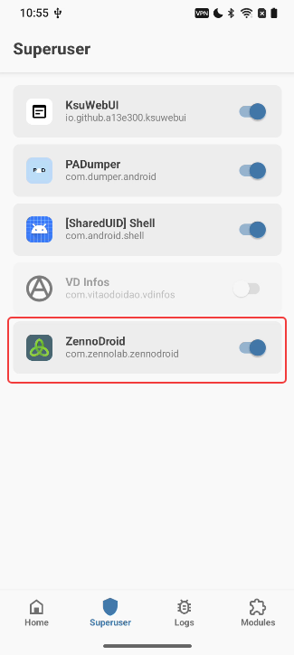

After you launch the module, a notification will appear on your device screen saying it's turned off.

**The ZennoDroid module is off.**

<!--All you need is a blank line-->

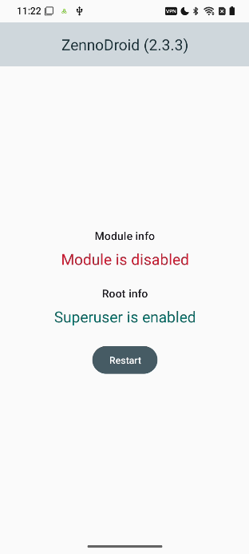

To fix this, open LSPosed from the notification panel, switch to the **Modules** tab, and turn on the *ZennoDroid module*.

**Turning the module on in LSPosed.**

<!--All you need is a blank line-->

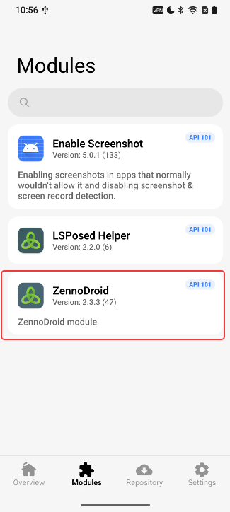 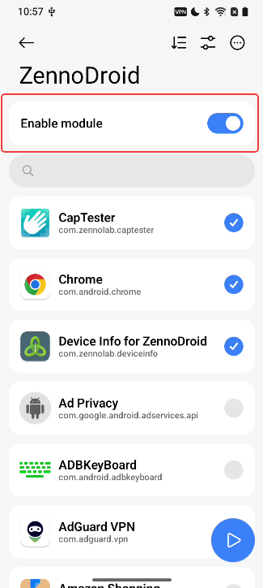

Now you can pick which apps will get spoofed device parameters.
_________________
### Important Information
- You should only add the apps to the spoof list that actually need their data changed. **There's no need to add the system framework.**
- If you delete an app after activating it, then reinstall it, you must re-activate it in the spoof list **(uncheck and check the box)**.

:::tip **LSPosed has a visual bug.**
When you remove an app, it disappears from the spoof list. If you reinstall it, it won't show up in the list automatically (the box might be checked, but spoofing won't work).
:::

- Not all apps appear in the list by default. If you don't see the app you need (like Google Chrome), go to the **Settings** menu and select the right group.

**Choosing a group of apps.**

<!--All you need is a blank line-->

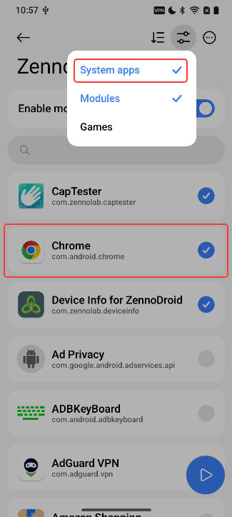

- After picking the apps for spoofing, go back to ZennoDroid and tap **"Restart"**. Once it restarts, a notification will show that the module is ready to use. Now you can change device parameters with actions.

**The module is ready.**

<!--All you need is a blank line-->

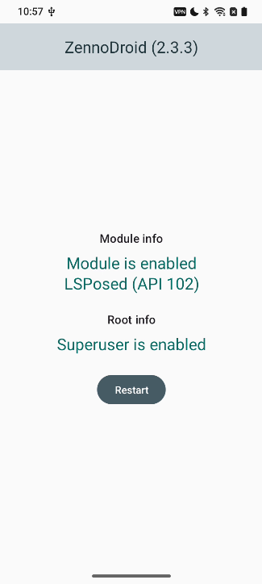

- After spoofing device parameters, close the necessary apps. It's best to do this with the **"Close app"** action.

:::tip **You can close apps before spoofing.**
But some system apps will restart themselves right after, so they might see the old parameters.
:::
_________________
## Managing LSPosed using actions (ZennoDroid 2.4.6+)
In **ZennoDroid 2.4.6**, a convenient way [**to manage LSPosed**](./LSPosed_Control) was added through a group of actions.

_________________
## API for managing LSPosed (ZennoDroid 2.4.0+)
In **ZennoDroid 2.4.0**, we added an API for managing LSPosed.

Main functions:
- enable and disable the required module;
- select apps in the spoof list of the required module, and also add or remove them from the list;
- create and restore a settings backup (saving to both the phone and a computer is supported);
- get information about LSPosed.

### Video tutorial (an example of working with the API)
> Setting up the ZennoDroid module and the [DisableFlagSecure](https://github.com/LSPosed/DisableFlagSecure/releases/latest) (`io.github.lsposed.disableflagsecure`) module, which allows viewing secured pages.

<VideoSample source={require("@site/static/video/LSPosedAPI.mp4").default}/>

Examples of working with the API are also included in the archive [LSPosedAPI.zip](https://www.dropbox.com/scl/fi/xsw5q8ej1wtmhpg5695we/LSPosedAPI.zip?rlkey=menqd2q7a0g6qnmc1l3omq4fr&st=0byf2hwb&dl=0&roistat_visit=1429674).

_________________
## Useful Links
- Template for spoofing device parameters via actions and API: [**fakeDeviceBrief.droid**](https://www.dropbox.com/scl/fi/xkyhg4e72l9su4xvqsdn9/fakeDeviceBrief.droid?rlkey=583ltzuficlyh0kxrma83qodb&dl=0)
- [**Latest version of LSPosed Framework v.2**](https://www.dropbox.com/scl/fo/bve4et0ilt6bocnbi7ba9/AI0JuEpsjOHkKKlYMgx9aM0?rlkey=je4fi8u0np6267i0e5iblsyu3&st=rlrsg76a&dl=0)
- [**Connecting a real device to ZennoDroid**](./Connection)
- [**Device settings**](../Settings/Settings_for_Enterprise)
