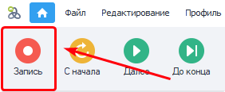
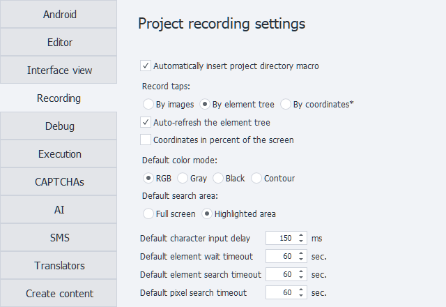

import DisclaimerNotice from '@site/src/components/DisclaimerNotice';

# Project recording
<DisclaimerNotice />

## Project Recording

This tab contains the settings that get activated when project recording is turned on.

_______________________________________________
## Automatically insert project directory macro
:::tip This setting works even *when project recording is off*.
:::

ZennoDroid has [**environment variables**](../pm/Creating/Variables). For example, `{-Project.Directory-}`, which stores the path to the directory where your project file is saved.
:::info If the project isn't saved to disk, the variable contains an empty string.
:::

When you turn on this setting, ProjectMaker will automatically insert the **project directory macro** wherever possible while creating a project. For example, in other settings or actions. The chosen path should either be in the same folder as the project file, or in one of its subfolders.
_______________________________________________
## Record actions by coordinates
This setting controls whether all clicks inside the [**Emulator Window**](../pm/Interface/DeviceWindow) get recorded along with their coordinates when recording your project. The project will include [**touch emulation actions**](../Android/pro-lite/Touch_Emulation) with the click coordinates filled in automatically.
:::warning If coordinates are recorded in pixels, the emulator's resolution must be the same when creating and running your project!
To make the project work on devices with different resolutions, turn on [**coordinates in percent of the screen**](#coordinates-in-percent-of-the-screen).
:::
_______________________________________________
## Coordinates in percent of the screen
:::info **Available starting from ZennoDroid 2.6.3.0.**
:::

With this setting, recording saves coordinates in percent of the screen width and height instead of pixels, to two decimal places: for example, `27.99%` instead of `302`. All the actions that recording creates with coordinates get percent:
- [**touch emulation**](../Android/pro-lite/Touch_Emulation#coordinates-in-percent) for taps by coordinates;
- [**swipe emulation**](../Android/pro-lite/Swipe) for swipes;
- [**scaling**](../Android/pro-lite/Utilities#scaling) for zoom gestures.

The setting does not depend on **Record actions by coordinates**: that one decides whether taps are recorded by coordinates, and this one decides what the coordinates are recorded in. Swipes and scaling are always recorded with coordinates, so for them percent works even when recording by coordinates is off.

A project recorded this way runs on devices with a different resolution without editing the coordinates. The limitations are the same as for [**coordinates in percent**](../Android/pro-lite/Touch_Emulation#coordinates-in-percent) in the actions: screen rotation is not taken into account, and a button may be in a different place on a screen with a different aspect ratio.
_______________________________________________
## Click recording through search
When you turn on this option, every click inside the [**Emulator Window**](../pm/Interface/DeviceWindow) will be saved to your project as a [**touch action**](../Android/pro-lite/RunEvent) using [**Image Search**](../pm/Creating/SearchByPic).
### Color mode
Image search will use one of the following modes by default:
- **RGB**. Search by colored image.
- **Gray**. Grayscale only.
- **Black**. Black and white only.

| RGB              | Gray | Black (Threshold 140) |
| :----------------: | :------: | :----: |
|         |      |  |
  
:::tip Our advice
*To speed up the search, use either **Gray** or **Black** mode*
:::

### Search area
Choose the default area for image search:
- Entire screen
- Selected area of the screen

:::info To reduce CPU load, it's better to search only in a designated screen area.
:::
_______________________________________________
## Character Input Delay
Used in [**Keyboard Emulation**](../Android/pro-lite/Keyboard) and [**Set Value**](../Android/pro-lite/SetValue) actions as the *default* setting.
_______________________________________________
## Element Wait Timeout
Used in [**Set Value**](../Android/pro-lite/SetValue), [**Get Value**](../Android/pro-lite/GetValue), and [**Run Event**](../Android/pro-lite/RunEvent) as the *default* for the field ***"Wait for element no more than (sec)"***.
_______________________________________________
## Element Search Timeout
Used in the [**Image Search**](../pm/Creating/SearchByPic) action as the *default* value for  
***"Wait for element no more than (sec)"***.  
_______________________________________________  
## Pixel Search Timeout
Used in the [**Pixel Search**](../pm/Creating/SearchByPix) action as the *default* value for  
***"Wait for element no more than (sec)"***.  
_______________________________________________
