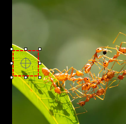
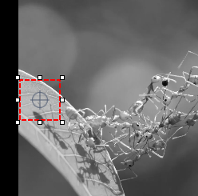
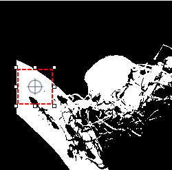

import DisclaimerNotice from '@site/src/components/DisclaimerNotice';

# Project recording
<DisclaimerNotice />

## Project Recording

This tab contains the settings that get activated when project recording is turned on.

_______________________________________________
## Automatically insert project directory macro
:::tip This setting works even *when project recording is off*.
:::

ZennoDroid has [**environment variables**](../pm/Creating/Variables). For example, `{-Project.Directory-}`, which stores the path to the directory where your project file is saved.
:::info If the project isn't saved to disk, the variable contains an empty string.
:::

When you turn on this setting, ProjectMaker will automatically insert the **project directory macro** wherever possible while creating a project. For example, in other settings or actions. The chosen path should either be in the same folder as the project file, or in one of its subfolders.
_______________________________________________
## Record taps
:::info **Choosing the mode in one group is available starting from ZennoDroid 2.6.3.0.**
Before that, the mode was set by two checkboxes, **Click recording through search** and **Record actions by coordinates**, and taps were recorded by the element tree when both were cleared.
:::

The mode decides which action a tap inside the [**Device Window**](../pm/Interface/DeviceWindow) is recorded as:
- **By images**: a click on the piece of the screen around the tapped point, an image click action as in [**Image Search**](../pm/Creating/SearchByPic). Its color mode and search area are set [**below**](#image-search).
- **By element tree**: an action on the element from the [**Element Tree**](../pm/Interface/ElementTree), a [**Rise Event**](../Android/pro-lite/RunEvent) action with the *touch* event or, if the mouse button was held, *long touch*. If there is no element at the tapped point, a tap by coordinates is recorded.
- **By coordinates**: a tap at the point, a [**touch emulation**](../Android/pro-lite/Touch_Emulation) action with the tap's coordinates.

Swipes, scaling and text input are recorded the same way in any mode.

While recording, the mode can also be switched with the buttons in the [**device window header**](../pm/Interface/DeviceWindow#recording-mode). It is the same setting: a change in the header shows on this tab at once, and the other way round. The new mode applies from the next tap.

:::warning If coordinates are recorded in pixels, the emulator's resolution must be the same when creating and running your project!
The asterisk next to **By coordinates** is a reminder of that. To make the project work on devices with different resolutions, turn on [**coordinates in percent of the screen**](#coordinates-in-percent-of-the-screen), and the asterisk goes away.
:::
_______________________________________________
## Auto-refresh the element tree
:::info **Available starting from ZennoDroid 2.6.3.0. On by default.**
:::

While recording in the **By element tree** mode, ZennoDroid reads the [**element tree**](../pm/Interface/ElementTree) again before every tap in the device window, so that the elements of the current screen are recorded. Without auto-refresh the tree stays from the screen it was loaded on: after you move to another screen, the elements of the previous one are recorded until the tree is refreshed on its panel.

That is why, while recording like this, a tap goes to the device when you release the mouse button: ZennoDroid has time to read the tree and tells a tap from a long tap and a swipe. Outside recording, taps and swipes go to the device at once.

The same switch is in the [**device window header**](../pm/Interface/DeviceWindow#recording-mode).
_______________________________________________
## Coordinates in percent of the screen
:::info **Available starting from ZennoDroid 2.6.3.0.**
:::

With this setting, recording saves coordinates in percent of the screen width and height instead of pixels, to two decimal places: for example, `27.99%` instead of `302`. All the actions that recording creates with coordinates get percent:
- [**touch emulation**](../Android/pro-lite/Touch_Emulation#coordinates-in-percent) for taps by coordinates;
- [**swipe emulation**](../Android/pro-lite/Swipe) for swipes;
- [**scaling**](../Android/pro-lite/Utilities#scaling) for zoom gestures.

The setting does not depend on the [**tap recording**](#record-taps) mode: the mode decides whether taps are recorded by coordinates, and this setting decides what the coordinates are recorded in. Swipes and scaling are always recorded with coordinates, so for them percent works in any mode. While recording, percent can also be turned on with the **%** button in the [**device window header**](../pm/Interface/DeviceWindow#recording-mode).

A project recorded this way runs on devices with a different resolution without editing the coordinates. The limitations are the same as for [**coordinates in percent**](../Android/pro-lite/Touch_Emulation#coordinates-in-percent) in the actions: screen rotation is not taken into account, and a button may be in a different place on a screen with a different aspect ratio.
_______________________________________________
## Image search
Default values for [**Image Search**](../pm/Creating/SearchByPic), including the recording of taps in the **By images** mode.
### Color mode
Image search will use one of the following modes by default:
- **RGB**. Search by colored image.
- **Gray**. Grayscale only.
- **Black**. Black and white only.

| RGB              | Gray | Black (Threshold 140) |
| :----------------: | :------: | :----: |
|         |      |  |
  
:::tip Our advice
*To speed up the search, use either **Gray** or **Black** mode*
:::

### Search area
Choose the default area for image search:
- Entire screen
- Selected area of the screen

:::info To reduce CPU load, it's better to search only in a designated screen area.
:::
_______________________________________________
## Character Input Delay
Used in [**Keyboard Emulation**](../Android/pro-lite/Keyboard) and [**Set Value**](../Android/pro-lite/SetValue) actions as the *default* setting.
_______________________________________________
## Element Wait Timeout
Used in [**Set Value**](../Android/pro-lite/SetValue), [**Get Value**](../Android/pro-lite/GetValue), and [**Run Event**](../Android/pro-lite/RunEvent) as the *default* for the field ***"Wait for element no more than (sec)"***.
_______________________________________________
## Element Search Timeout
Used in the [**Image Search**](../pm/Creating/SearchByPic) action as the *default* value for  
***"Wait for element no more than (sec)"***.  
_______________________________________________  
## Pixel Search Timeout
Used in the [**Pixel Search**](../pm/Creating/SearchByPix) action as the *default* value for  
***"Wait for element no more than (sec)"***.  
_______________________________________________
