import DisclaimerNotice from '@site/src/components/DisclaimerNotice';

# Device Window (Emulators)
<DisclaimerNotice />

## Getting started.
The device window is where you work with a MEmu, LDPlayer or MuMu emulator: it shows the emulator screen, you can click and swipe on it with the mouse, and with **Recording** on everything you do is added to the project as actions. The menus and windows are the same for all emulators.

Working with a real phone in ZennoDroid Enterprise is described in [**Device Window**](./DeviceWindow).

Before the device is started, the window looks like this:

**The device window before the start.**

<!--All you need is a blank line-->

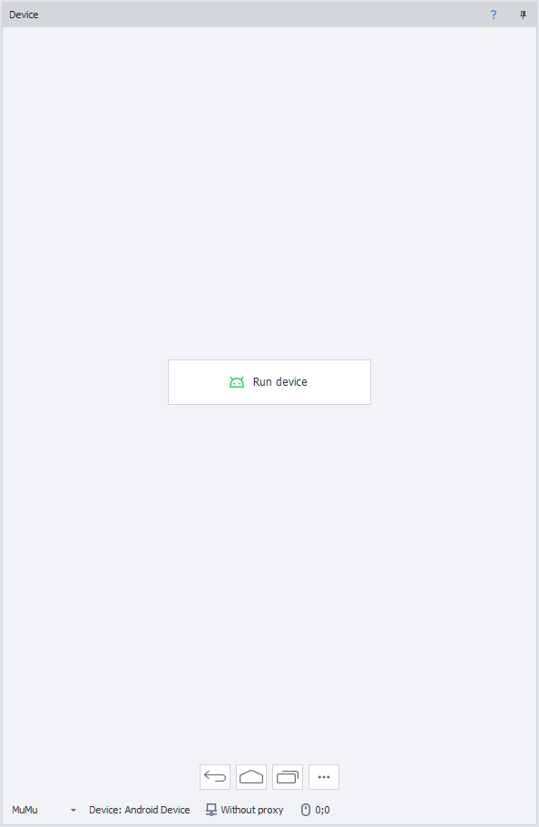

To get started, click **Run device**. If the project's **Recording** is on, two actions are added to the canvas: **Select device** and **Run/restart device**.

If the device fails to start, the reason appears under the button. Fix it and click the button again.

{/* SCREENSHOT 2: the reason for a failed start under the Run device button. */}

:::info **The reason for a failed start is shown starting with ZennoDroid 2.6.2.0.**
:::
_______________________________________________
## Window components.
This is the window you see once the device has started:

**The window of a running device.**

<!--All you need is a blank line-->

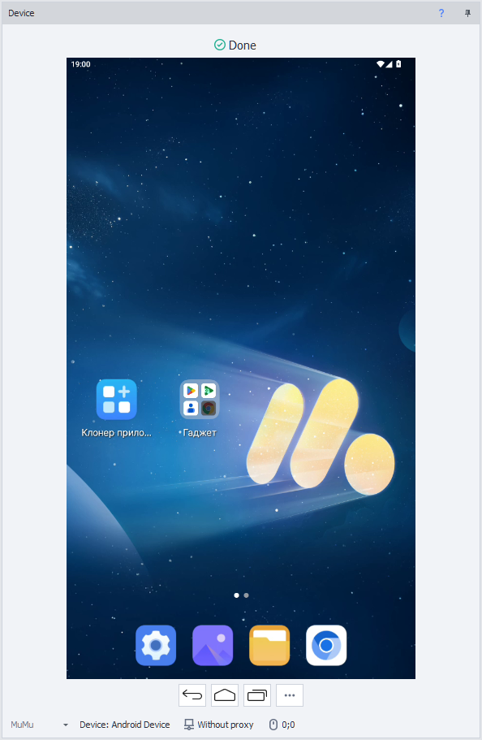

You can work with the screen directly: click, swipe, open apps — everything is passed on to the device. And if recording is on, your actions are also added to the canvas as the matching actions.
_______________________________________________
### Control buttons.
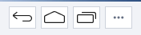

| Button | Description |
| ----------- | ----------- |
| **Back** | Go to the previous screen. |
| **Home** | Return to the home screen. |
| **Recent applications** | Open the list of recent apps. |
| **Refresh screen** | Refresh the screen picture. The button is shown only when the [**Manually**](../../Settings/Settings_for_Android#image-capture-method) image capture method is chosen. |
| **Actions** (three dots) | Open the [**actions menu**](#actions-menu). |

The **Cover part of image**, **Zoom in**, **Zoom out** and **Mouse movements record** buttons have moved to the actions menu, under [**Other actions**](#other-actions).
_______________________________________________
### Emulator type.
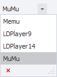

The list on the left of the status bar picks the emulator ZennoDroid works with: **Memu**, **LDPlayer9**, **LDPlayer14** or **MuMu**. Only the emulators installed on the computer are listed, and with just one installed there is no list.

It is the same choice as [**Emulator type**](../../Settings/Settings_for_Android#emulator-type) in the Android settings: after you change the type, the window switches to the device of the chosen emulator. While the device is running, the list is unavailable.

:::info **MuMu is supported starting with ZennoDroid 2.6.2.0.**
How to install MuMu and what it can do in ZennoDroid is described in [**Installing MuMu**](../../pro-lite/MuMu_Install).
:::
_______________________________________________
### Current device.
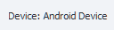

A button with the name of the current device. Clicking it opens the [**Device Manager**](../../Tools/Device_Manager), where you can pick another device.
_______________________________________________
### Proxy.

The button shows the proxy set on the device, or **Without proxy**. Clicking it opens the **Set proxy** window:

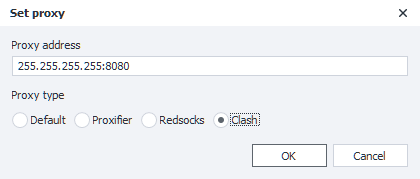

- **Proxy address** — the proxy string, for example `255.255.255.255:8080` or `protocol://login:pass@IP:port`.
- **Proxy type** — the proxying method: **Default** (as set in the [**settings**](../../Settings/Settings_for_Android#the-method-of-traffic-proxying)), **Proxifier**, **Redsocks** or **Clash**. How they differ is described in [**Traffic Proxying**](../../Settings/Proxy_Traffic).

The **OK** button applies the proxy to the device.

:::info **Choosing the proxy type in this window is available starting with ZennoDroid 2.6.2.0.**
:::
_______________________________________________
### Mouse coordinates.

While the cursor is over the device screen, its current coordinates (X, Y) are shown here.  
You can use them in the [**Swipe Emulation**](../../Android/pro-lite/Swipe) and [**Touch Emulation**](../../Android/pro-lite/Touch_Emulation) actions.
_______________________________________________
## Actions menu.
:::info **The actions menu appeared in ZennoDroid 2.6.2.0.**
:::

The **Actions** button with three dots opens a menu of frequently used device actions:

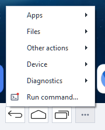

Items with a **red dot** on their icon are recorded into the project: if **Recording** is on, the action you perform is added to the canvas as the matching action. What exactly is added is shown in the table [**below**](#what-is-recorded-in-the-project).

Most items are available only while the device is running. **Unlock the screen**, **Clear logcat**, **Run diagnostics...** and **Run command...** also work with a device that is not started, as long as it is reachable over adb.

The menu's windows open one at a time: while one of them is open, the **Actions** button is unavailable. The device screen keeps working meanwhile.
_______________________________________________
### Apps.
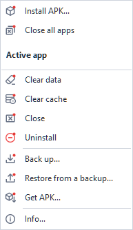

- **Install APK...** — opens the [**app installation**](#installing-an-apk) window.
- **Close all apps** — removes every app from the recent apps.

The items under the **Active app** header work with the app open on the screen:
- **Clear data** — clears the app's data. ZennoDroid asks for confirmation first.
- **Clear cache** — clears only the app's cache.
- **Close** — closes the app.
- **Uninstall** — removes the app from the device, also after a confirmation.
- **Back up...** — saves the app's data to a file.
- **Restore from a backup...** — restores the app's data from a backup file.
- **Get APK...** — saves the app's APK to the computer: [**more**](#get-apk).
- **Info...** — shows the app's ID, name and version.

#### Installing an APK.
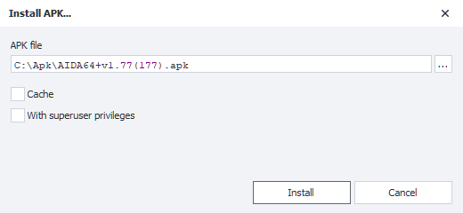

- **APK file** — the app file on the computer: `.apk`, `.apks`, `.apkm` or `.xapk`.
- **Cache** — keep the file on the device: installing the same APK again won't copy it over again.
- **With superuser privileges** — install as root.

#### Backup and restore.
Both windows work with the app open on the screen: its ID is shown in the **App** line.

**The Back up and Restore from a backup windows.**

<!--All you need is a blank line-->

- **Where the backup is kept** — **On the computer** or **On the device**.
- **Backup file** — the path to the file.
- When backing up: **Save the permissions**, **Save the linked account** and **Account type**.
- When restoring: **Restore the permissions**, **Restore the linked account** and **Use the ZennoBackup module**.

These options repeat the options of the [**Actions with Application**](../../Android/pro-lite/App#saving-of-applications-data) action.

:::info **The ZennoBackup module works on real phones only: on an emulator, a restore with the Use the ZennoBackup module checkbox ends in an error.**
:::

#### Get APK.

**The Get APK window.**

<!--All you need is a blank line-->

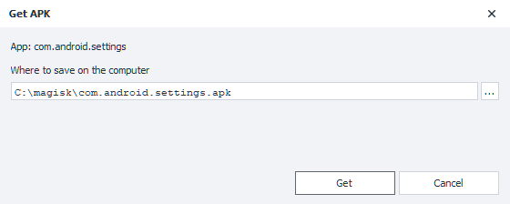

The window saves the APK of the app open on the screen to the computer: its ID is shown in the **App** line. The **Where to save on the computer** field sets the file. At first it holds a file named after the app ID, in the folder the last APK was saved to, or in the Documents folder the first time.

If the app is installed from several APKs (split APK), they are saved as one `.apks` file, which can be installed back with [**Install APK...**](#installing-an-apk). The **Get** button saves the file, and a long transfer can be stopped with **Stop**.
_______________________________________________
### Files.
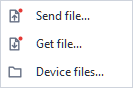

- **Send file...** — copies files from the computer to the device. The window takes the **File on the computer** and **Where to put the file on the device**.
- **Get file...** — copies a file from the device to the computer. The window takes **Which file to take from the device** and **Where to save on the computer**.
- **Device files...** — opens the device's [**file manager**](#device-files).

Both transfer windows have a **With superuser privileges** checkbox. A long transfer can be stopped with **Stop**.

**The Send file and Get file windows.**

<!--All you need is a blank line-->

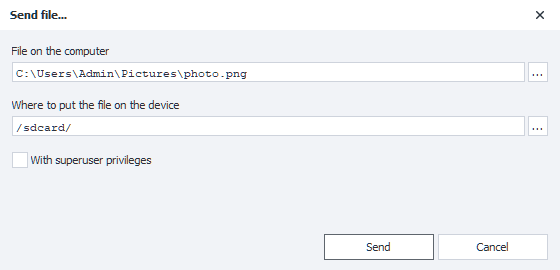

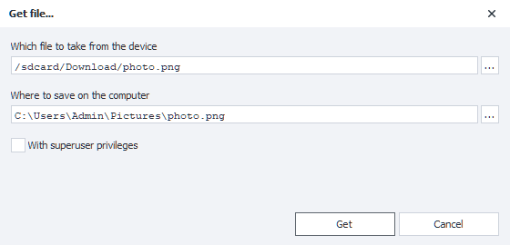

#### Device files.

**The Device files window.**

<!--All you need is a blank line-->

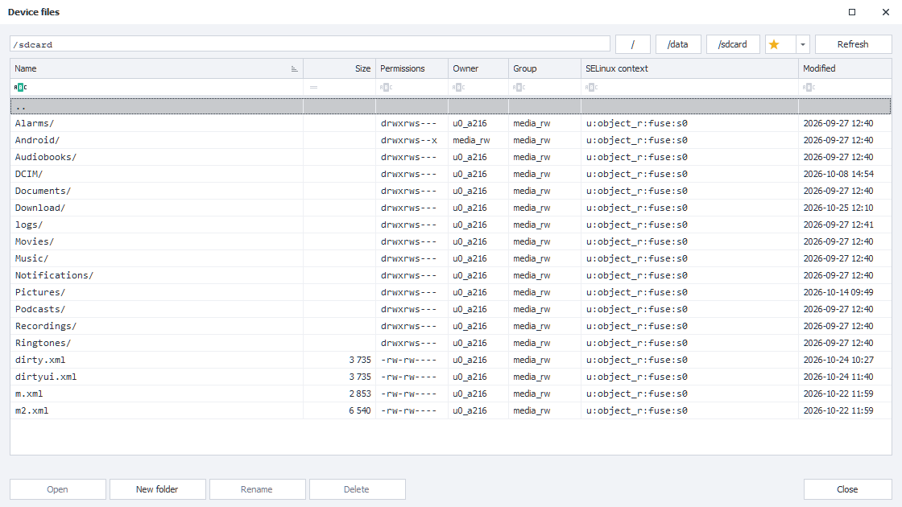

The file manager shows the device's folders and files with their size, permissions, owner, group, SELinux context and modification date. The buttons above the list open the root `/` and the `/data` and `/sdcard` folders. The star button adds the open folder to the favorites or removes it from them, and the arrow next to it opens the list of favorite folders.

Everything you can do with a file or folder is in its right-click menu:

- **Open** — open a folder. A file is handed to the device's apps: the app for this file type opens it, or the device screen offers a choice of apps.
- **Get...** — copy the file to the computer.
- **New folder**, **Rename**, **Delete**.
- **Owner and group...**, **Permissions...**, **SELinux context...** — change the owner and group, the permissions and the SELinux context.

The most frequent of these actions also have buttons at the bottom of the window. To send files to the device, drag them from Explorer into the window: they land in the open folder.

In the **Permissions** window the permissions are set with checkboxes or as a number:

_______________________________________________
### Other actions.
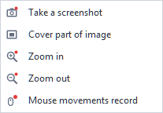

- **Take a screenshot** — saves a picture of the device screen as PNG. ZennoDroid asks where to save the file and remembers the folder.
- **Cover part of image** — covers part of the screen picture. Used to test image search. The checkmark at the item shows whether a part is covered right now.
- **Zoom in** and **Zoom out** — zoom the picture in and out in the app open on the device.
- **Mouse movements record** — records the mouse movements over the device screen. While recording, the window shows a recording icon with the tooltip *Recording mouse movements. Click to stop*: clicking it stops the recording.
_______________________________________________
### Device.
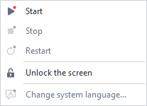

- **Start** and **Stop** — start and stop the device.
- **Restart** — start the device again, as the **Start** action does: the emulator restarts.
- **Unlock the screen** — wakes the device and puts the lock screen away. A PIN, password or pattern on it is entered by hand.
- **Change system language...** — changes the emulator's language without a restart: [**more**](#system-language).

#### System language.
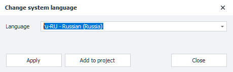

The **Language** field lists the languages in the emulator's firmware, with their codes, for example `ru-RU` or `en-US`. On Android 10 and earlier the firmware doesn't give such a list, and the field has all languages. To find the one you need, start typing its code or name. When the window opens, the field holds the emulator's current language.

The **Apply** button changes the language right away, and the line above the buttons tells whether it is applied. The **Add to project** button adds the [**Device Settings → System language selection**](../../Android/pro-lite/setting#system-language-selection) action with the chosen language to the canvas, even if recording is off.
_______________________________________________
### Diagnostics.
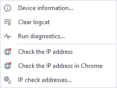

- **Device information...** — the emulator type, the device's state, name, title and index, its folder on the computer and its address. The text can be copied with **Copy to the clipboard**.
- **Clear logcat** — clears the logcat log on the device.
- **Run diagnostics...** — collects logcat, dmesg and the latest tombstone into one ZIP archive. dmesg and the tombstone need root.
- **Check the IP address** — shows the device's external IP address and, for comparison, the computer's. The request doesn't come from an app, so a proxy turned on only for chosen apps may not apply to it. Best used when the proxy has no [**whitelist**](../../Android/pro-lite/setting#whitelist).
- **Check the IP address in Chrome** — opens the check address in Chrome and reads the page's answer: the IP address as apps see it. Then it closes the tab, and Chrome too if it wasn't running before the check. If Chrome isn't installed on the device, the message *Chrome is not installed* appears above the screen.
- **IP check addresses...** — the services both checks ask.

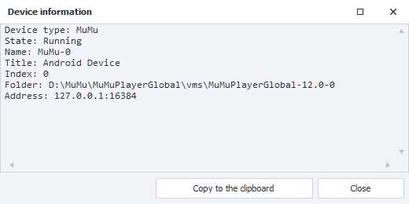

Besides the addresses themselves, the IP check shows what the check service reports about them: country, region, city, coordinates, provider, postal code and time zone, and sometimes the host name. If the computer's IP address is the same as the checked one, its data reads *the same*.

**The IP check results (the data on the screenshots is hidden).**

<!--All you need is a blank line-->

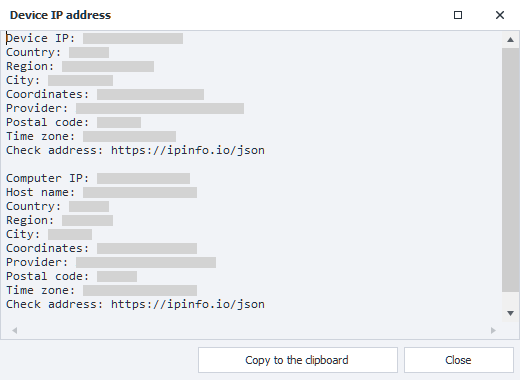

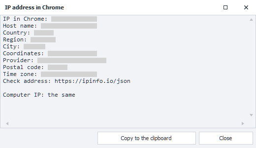

**The IP check addresses window.**

<!--All you need is a blank line-->

The addresses go one per line, `http` or `https`. The check asks them from the top down and shows the first answer with an IP address in it: JSON, as ipinfo.io gives, or plain text. An empty list means ipinfo.io. The **Default** button brings back the original list.

In project code the [**GetExternalIp**](../../API/Proxy#getexternalip) and [**GetExternalIpInBrowser**](../../API/Proxy#getexternalipinbrowser) methods do the same.
_______________________________________________
### Run command.

**The Run command window.**

<!--All you need is a blank line-->

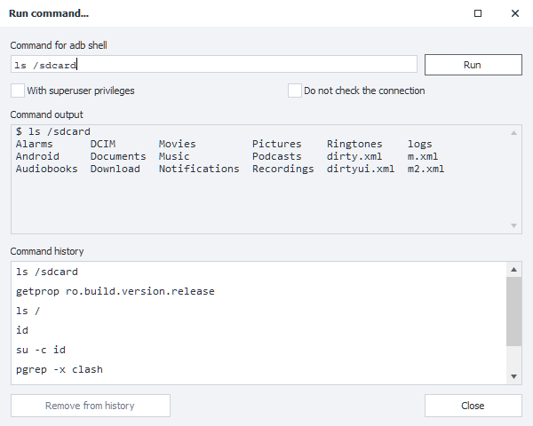

The **Run command...** item opens a window for adb shell commands. The device's answer appears in the **Command output** field, and the commands you run are kept in the **Command history**. Clicking a command in the history puts it into the field, double-clicking runs it at once, and the **Remove from history** button removes the ones you don't need.
- **With superuser privileges** — run the command as root.
- **Do not check the connection** — don't check the connection to the device before running the command.
_______________________________________________
### Drag and drop.
You can drag files onto the device window straight from Explorer. If all the files are apps (`.apk`, `.apks`, `.apkm`, `.xapk`), the [**APK installation**](#installing-an-apk) window opens, otherwise the window for [**sending files**](#files) to the device.

{/* SCREENSHOT 29 (GIF): dragging an APK from Explorer onto the device window and the installation window that opens. */}
_______________________________________________
### What is recorded in the project.
| Menu item | Action in the project |
| ----------- | ----------- |
| **Install APK...** | [**Actions with Application**](../../Android/pro-lite/App#install-application) → Install application |
| **Close all apps** | [**Actions with Application**](../../Android/pro-lite/App#close-application) → Close application with an empty **App name** field |
| **Clear data**, **Clear cache** | [**Actions with Application**](../../Android/pro-lite/App#application-cleanup) → Application cleanup |
| **Close** | [**Actions with Application**](../../Android/pro-lite/App#close-application) → Close application |
| **Uninstall** | [**Actions with Application**](../../Android/pro-lite/App#uninstall-application) → Uninstall application |
| **Back up...** | [**Actions with Application**](../../Android/pro-lite/App#saving-of-applications-data) → Save application's data |
| **Restore from a backup...** | [**Actions with Application**](../../Android/pro-lite/App#restoring-of-applications-data) → Restore application's data |
| **Get APK...** | [**Actions with Application**](../../Android/pro-lite/App#get-apk-of-the-application) → Get APK of the application |
| **Send file...**, **Get file...** | [**Working with Files**](../../Android/pro-lite/Files) → Push file or Pull file |
| **Take a screenshot** | [**Image Processing**](../../Data/Images): the screenshot is saved to the chosen file |
| **Zoom in**, **Zoom out** | [**Utils**](../../Android/pro-lite/Utilities#scaling) → Scaling |
| **Start**, **Restart** | [**Actions with Device**](../../Android/pro-lite/action#how-do-i-start-or-restart-a-device) → Run/restart device |
| **Stop** | [**Actions with Device**](../../Android/pro-lite/action#how-do-i-stop-a-device) → Stop device |
| **Check the IP address** | [**C# Code**](../../project-editor/custom-code/С): `return instance.DroidInstance.Proxy.GetExternalIp();`, the answer goes to the `ExternalIp` variable |
| **Check the IP address in Chrome** | [**C# Code**](../../project-editor/custom-code/С): `return instance.DroidInstance.Proxy.GetExternalIpInBrowser();`, the answer goes to the `ExternalIp` variable |
| **Run command...** | [**Utils**](../../Android/pro-lite/Utilities#console-command-adb-shell) → Console command (ADB Shell), the answer goes to the `AdbResult` variable |
| **Change system language...** → **Add to project** | [**Device Settings**](../../Android/pro-lite/setting#system-language-selection) → System language selection |

The last item adds the action with the **Add to project** button in its window, even if recording is off. The others are recorded only while **Recording** is on.
_______________________________________________
## Context menu.
Right-click an element on the device screen to open the context menu. Its items depend on the element. For example, this is the menu on an input field:

#### Items for input fields:
- **Remove text**.  
Clears the input field.  
If recording is on, the [**Keyboard Emulation**](../../Android/pro-lite/Keyboard) action with this content is added to the project: `{AndroidKeys.CLEAR}`.
- **Paste text from the Windows Clipboard**.  
Pastes the text from the computer's clipboard into the field. If the clipboard is empty, nothing happens.  
If recording is on, the [**Keyboard Emulation**](../../Android/pro-lite/Keyboard) action with this text is added to the project. If the action right before it is a keyboard emulation too, the text is appended to that one: for example, **Remove text** followed by **Paste text from the Windows Clipboard** give one action with the content `{AndroidKeys.CLEAR}text`.
- **Set the value from profile**.  
Puts a value from the project's **Profile** into the field.  
If recording is on, the [**Set Value**](../../Android/pro-lite/SetValue) action with the macro of the chosen profile field is added to the project.
- **Set Variable Value**.  
Puts the value of a project variable into the field. The item appears only if the project has at least one variable.  
If recording is on, the [**Set Value**](../../Android/pro-lite/SetValue) action with the macro of the chosen variable is added to the project.

#### Items for any element:
- **Inspect element**.  
Opens the [**Element Properties**](./ElementProp) window for a closer look. The chosen element is also highlighted in the [**Element Tree**](./ElementTree) window.
- **Follow the cursor**.  
While the item is on, the element under the cursor is highlighted and its properties go to the [**Element Properties**](./ElementProp) window. To turn the highlighting off, choose the item again.

**Example.**

<!--All you need is a blank line-->

- **To the action designer**.  
Sends the element to the [**Action Designer**](./ActionBuilder).
- **XPath search**.  
Opens the [**Action Designer**](./ActionBuilder) in xPath mode: it already holds the XPath of the chosen element, and the element itself is outlined on the device screen.

**The XPath search result in the Action Designer.**

<!--All you need is a blank line-->

- **This is a CAPTCHA!**.  
Marks the element as a captcha and at once adds its recognition action to the project, even if recording is off. The action puts the answer into a new numbered `RecognitionResult` variable, for example `RecognitionResult0`. By default the captcha is entered by hand: a window with the element's picture opens, where you type the answer and press Enter. The recognition module can be changed in the action itself (for example, to [**CapMonster.Cloud**](https://capmonster.cloud/)).

**The manual captcha input window.**

<!--All you need is a blank line-->

- **Stick to the CAPTCHA**.  
Appears when the project already has a captcha marked with **This is a CAPTCHA!**. Adds one more picture to it: several separate pictures are joined into one and recognized together.
- **CAPTCHA recognition result**.  
Also appears only when the project has a captcha. Enters the captcha answer into the chosen element and, if **Recording** is on, adds the [**Set Value**](../../Android/pro-lite/SetValue) action with the answer variable.
- **Create text presence check**.  
Opens the **Checking for text presence** window with the element's text. The **OK** button adds an action checking this text to the project, even if recording is off. The action puts the check result into a new variable.

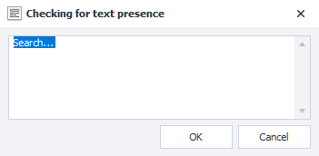

- **Search by picture**.  
Opens the **Search by picture** window with a screenshot: in it you select the picture and set the match accuracy, the color mode and the search area. If the picture is found, click **Yes** and then **Add to project**: an action clicking the picture is added to the project. If recording is off, ZennoDroid asks whether to add the action anyway. More in [**Search by picture**](../Creating/SearchByPic).

**The Search by picture window.**

<!--All you need is a blank line-->

- **Search by the pixel color**.  
Opens the **Pixel search** window, already with the color of the pixel under the cursor. Here you set the allowed color deviation and the search area, and the found pixel is outlined on the screen. If the pixel is found, click **Yes**: the tap settings, the offset and the **Test** and **Add to project** buttons appear. The action clicking the pixel is added to the project even if recording is off.

**The Pixel search window.**

<!--All you need is a blank line-->

- **Get the pixel color**.  
Copies the color of the pixel under the cursor to the clipboard as `#RRGGBB`. Nothing is added to the project.
_______________________________________________
## Useful links.
- [**Action Designer**](./ActionBuilder).
- [**Device Manager**](../../Tools/Device_Manager).
- [**Android Settings (Lite/Pro)**](../../Settings/Settings_for_Android).
- [**Actions with Device**](../../Android/pro-lite/action).
- [**Actions with Application**](../../Android/pro-lite/App).
- [**Working with Files**](../../Android/pro-lite/Files).
- [**Keyboard Emulation**](../../Android/pro-lite/Keyboard).
