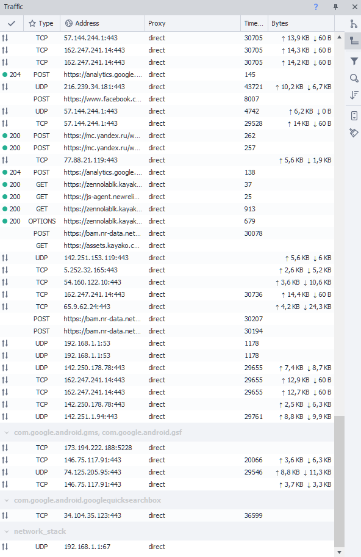

import DisclaimerNotice from '@site/src/components/DisclaimerNotice';

# Traffic Window
<DisclaimerNotice />

:::info **Available starting from ZennoDroid 2.6.3.0.**
:::

## Description.
The **Traffic** window shows where the connected phone goes on the network: Chrome requests, the connections of all apps, and, when the phone's traffic goes through a proxy, the content of the apps' requests too. It shows what requests an app makes, and any request can be turned into an [**HTTP request**](../../project-editor/http-and-ftp/HTTP) action right away.

**The Traffic window with the rows grouped by application.**

<!--All you need is a blank line-->

_______________________________________________
## How to open it.
In the top menu, **Window → Traffic**. Traffic is recorded while the window is open: closing it stops the recording.

{/* VIDEO "An example of turning on the monitoring:" ./assets/Traffic_Window/Traffic_Window_Monitoring.mp4 - needs a recording in the English PM */}
_______________________________________________
## What gets into the window.
- **Chrome requests** — in full: address, method, headers, cookies, request and response bodies.
- **App connections** — which app connected to which address and how much data it transferred. The host name and the volume show when the phone goes online through Clash or through the computer's internet connection (the methods are described in [**How to set up a proxy**](../../Android/Enterprise/setting#how-to-set-up-a-proxy)). ZennoDroid counts the volume of the other connections only on a rooted phone.
- **Content of the apps' requests** — address, method, headers and bodies, like Chrome's, but only under certain conditions: see [**Content decryption**](#content-decryption).

The phone's incoming connections, adb debugging over Wi-Fi for one, stay out of the window, and the proxy password is hidden in the phone's rows.
_______________________________________________
## Rows and window settings.
Besides the status, type, address, proxy and time, the phone's rows have the **Application** column, the package the traffic came from, and **Bytes**. When the app can't be determined, the cell is empty.

- **Group by application** — the rows are gathered by app, so you see at once who went online.
- **Requests only** — hides the connections and leaves the requests.

A connection row is marked in the result column with an up-and-down arrows icon. An empty result cell of a request means the response hasn't arrived yet.

A double click on a request opens its details: headers, cookies, parameters and response. The request's context menu lets you copy its data or pick **Create action from request**: a filled-in [**HTTP request**](../../project-editor/http-and-ftp/HTTP) action appears on the canvas. Check the values that got into it.
_______________________________________________
## Content decryption.
App requests other than Chrome's are encrypted. ZennoDroid decrypts them on the computer while the Traffic window is open, if:
- the phone's traffic goes through Clash, on the phone or through the computer, or through the computer's internet connection with the Proxifier and ProxyBridge methods;
- the phone is rooted: ZennoDroid installs its own root certificate on it, which apps trust like the system ones;
- the proxy isn't given as an IPv6 address.

Without a proxy and without the connection through the computer there is no content: traffic can only be decrypted on its way through the computer or Clash. The phone's external IP doesn't change during the recording: the traffic still leaves through the proxy. The apps' fingerprint doesn't change either.

Some requests, those of Google Play services for one, aren't decrypted even then: only their connections show in the window.

Decryption starts a few seconds after the window opens: what the phone sent before stays without content. If you change the proxy or stop the device during the recording, decryption stops: close the Traffic window and open it again.

The certificate is installed on the phone once and stays on it until the phone reboots.

### Certificate pinning.
Some apps check their server's certificate and accept no other. Such a host has a refusal icon in the result column, its connections stay without content, and the app keeps working.

The ZennoDroid module for LSPosed helps decrypt such apps too: the **Traffic decryption → Disable certificate pinning** item in the device window's [**actions menu**](./DeviceWindow#traffic-decryption) gives the module the ZennoDroid certificate, and the apps accept it in place of their own. The app has to be in the scope of the module and restarted afterwards.

### Certificate.
ZennoDroid comes with its own root certificate, *ZennoDroid Traffic CA*. It is the same on every computer, so the phone and the module can be prepared in advance, before the first recording. You can set your own certificate instead with the **Traffic decryption → Import a certificate** item: decryption and installation on the phone then use it.
_______________________________________________
## Useful links.
- [**Device window**](./DeviceWindow)
- [**Device settings (Enterprise)**](../../Android/Enterprise/setting)
- [**LSPosed setup**](../../Enterprise/LSPosed)
- [**HTTP requests**](../../project-editor/http-and-ftp/HTTP)
- [**android-ssl-pinning-demo.apk**](https://github.com/httptoolkit/android-ssl-pinning-demo/releases/latest)
