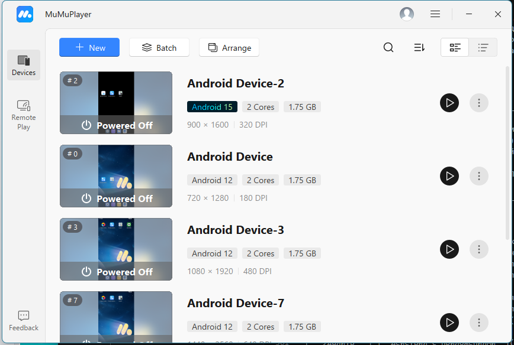

import DisclaimerNotice from '@site/src/components/DisclaimerNotice';

# Installing MuMu
<DisclaimerNotice />

## What is MuMu Player?
MuMu Player is an Android emulator by NetEase. It runs several devices on the computer at once, and devices on Android 12 and Android 15 can run side by side.

**The MuMuPlayer window with the list of devices.**

<!--All you need is a blank line-->

In the MuMuPlayer window every device shows its name, number, Android version, number of cores, amount of memory and screen resolution. The name or the number picks the device in the [**Select Device**](../Android/pro-lite/action#how-do-i-select-a-device) action.

:::info **MuMu is supported starting with ZennoDroid 2.6.2.0.**
:::
_______________________________________________
## Which version to install.
ZennoDroid works with MuMu Player 6.x — this is the version the installer from the official website sets up, and after that MuMu updates itself.
_______________________________________________
## System requirements.
The recommended requirements from the [**official MuMu website**](https://www.mumuplayer.com/):
- **Operating system**: Windows 8 or later, DirectX 11 or OpenGL 4.x.
- **Processor**: Intel Core i5-7500 or better, 4 cores or more.
- **Hardware virtualization (VT) enabled**.
- **Graphics card**: NVIDIA GeForce GTX 950 or better.
- **RAM**: 4 GB or more.
- **Free space**: 2 GB or more on the installation drive and 1.5 GB or more on the system drive.

#### Note:
- Cores and memory are set for each device separately, so working in several threads needs a reserve of both.
- We don't recommend running MuMu inside another virtual machine.
_______________________________________________
## How to install MuMu?
1. Download the Windows installer [**from the official website**](https://www.mumuplayer.com/download/).
2. Run it and install MuMu Player (preferably on an SSD).
3. Launch MuMu Player and check that the device boots.

New devices are created in the MuMuPlayer window or with the [**Create device**](../Android/pro-lite/action#how-do-i-create-a-device) action. The action creates a device on Android 12 or 15 only if MuMu already has the image of that version. Otherwise it ends with the error *There is no Android ... image* followed by the list of installed versions.
_______________________________________________
## Enabling virtualization.
MuMu creates a virtual Android device with hardware virtualization, so virtualization has to be enabled in the BIOS: [**more**](./Virtualization).
_______________________________________________
## Working with MuMu in ZennoDroid.
### Choosing the emulator.
MuMu is chosen in the [**Emulator type**](../Settings/Settings_for_Android#emulator-type) list in the Android settings or in the same list in the status bar of the [**device window**](../pm/Interface/DeviceWindowEmulator#emulator-type).

**The device window with MuMu chosen.**

<!--All you need is a blank line-->

### Starting a device.
ZennoDroid gets superuser rights by itself — there is no need to turn root on in the MuMu settings. Text, Cyrillic and emoji included, is typed without a separate keyboard.

### MuMu settings.
With MuMu chosen, the [**Android settings**](../Settings/Settings_for_Android#mumu-image-patch) have two switches that change the shared system image of all MuMu devices:
- **Disable ads** — removes the ads from the player's loading screen, and the MuMu store with its ads from the devices' home screen. For MuMu the switch is on by default.
- **Patch the MuMu image: spoof android_id, the operator and the SIM** — without it MuMu devices don't get the android_id, operator, IMSI and SIM serial number set for them.

Stop all MuMu devices before changing either switch: while at least one of them is running, the image can't be changed. After a MuMu update, turn the image patch on again.

### What is available on MuMu.
- Proxy through Proxifier, Redsocks and Clash.
- [**Actions with Device**](../Android/pro-lite/action): creating, cloning, renaming, exporting and importing (a `.mumudata` file), full reset and deleting.
- [**Device Settings**](../Android/pro-lite/setting), except the camera type and shared folders. The model, identifiers, operator, performance, screen resolution, rendering mode and root take effect at the next device start.
- Backing up and restoring app data.

### Things to know.
- The *Download*, *Pictures*, *Music*, *Movies* and *Screenshots* folders are shared by all MuMu devices: they are the computer's `Documents\MuMuSharedFolder` folder. A file put there on one device is visible on all of them, and a full device reset doesn't delete these files.
- On MuMu the system language changes only on a running device.
_______________________________________________
## Useful links.
- [**Enabling Virtualization**](./Virtualization).
- [**Turning off Hyper-V**](./Hyper-V).
- [**Device Window (Emulators)**](../pm/Interface/DeviceWindowEmulator).
- [**Android Settings (Lite/Pro)**](../Settings/Settings_for_Android).
