---
sidebar_position: 2
title: "Action Constructor and XPath Search"
description: ""
date: "2025-08-18"
converted: true
originalFile: "Конструктор действий и Поиск по XPath.txt"
targetUrl: "https://zennolab.atlassian.net/wiki/spaces/RU/pages/483426337/XPath"
---
import DisclaimerNotice from '@site/src/components/DisclaimerNotice';

<DisclaimerNotice />

> 🔗 **[Original page](https://zennolab.atlassian.net/wiki/spaces/RU/pages/483426337/XPath)** — Source of this material

_______________________________________________  
## Description
The Action Constructor is a tool for working with web page elements. You can use it to choose the properties ZennoPoster uses to find an element, then perform an action on it: for example, click a button, fill in a field, or retrieve text.

:::warning Basic knowledge of HTML is recommended for this feature
It will help you understand the page structure, element names, and their attributes.
:::

### How to open it?
There are two ways to open the constructor:

#### Method 1. From the page context menu
Right-click the desired element on the page and select **Send to Action Constructor**:

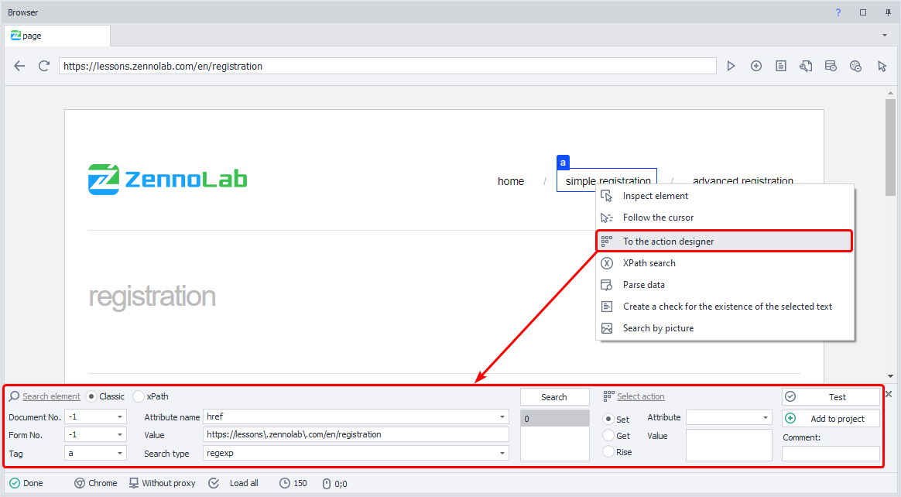

#### Method 2. From the Element Tree
Open the [Element Tree](/zennoposter/ProjectMaker/Program-interface/Element_Tree_Window) window, then right-click the desired element and select **Send to Action Constructor**:

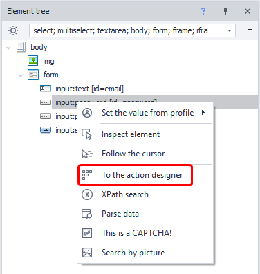

:::tip Note
When you add an element to the Action Constructor, its available properties and values automatically appear in the **Element Properties** window.
:::
_______________________________________________ 
## Search parameters 
There are two ways to search for elements: classic search and XPath search.  

### Classic Search
This method finds an element by its HTML tag, attributes, and their values.  

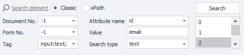

#### Document number
Enter `-1` to search for the element in all documents on the page. This makes the search more versatile.

#### Form number
Enter `-1` to search for the element in all forms on the page. If you specify a particular form number, the template may stop working when the site structure changes.  

<details>
  <summary><b>Example</b></summary>

The page contains three forms: search, registration, and product order. The order form is number 2 because numbering starts at zero.  

If the developers add a login form before it, the order form will have a different number. As a result, ZennoPoster may fail to find the required button or perform the action on a different element.
</details>

:::tip Search in all forms/documents on the page
If you enable these options in **Recording Settings**, the form and document numbers will always default to `-1`.
:::

#### **Tag**
The HTML tag of the element to find.

For example:  
```
<div class="visible" id="username"></div>
```
In this example, `div` is the tag name.

#### **Attribute name**
The HTML tag attribute ZennoPoster uses to find the element.

In our example:  
```
<div class="visible" id="username"></div>
``` 

`class` and `id` are attribute names.

#### **Value**
The value of the selected attribute.

In the example above:  
- **`visible`** is the value of the *`class`* attribute;
- **`username`** is the value of the *`id`* attribute.

#### **Search type**
Three search types are available:  
- *`text`* — the attribute value must fully or partially match the specified text;
- *`notext`* — the attribute value must not contain the specified text;
- *`regexp`* — search using a regular expression.  

The search is case-insensitive by default. For example, `Username` and `username` are treated as identical.  

> *To make a regular expression case-sensitive, add `(?-i)` at the beginning.*

:::info In the screenshot above, clicking **Search** found three elements.
Where possible, choose parameters that leave only the desired element in the results. Otherwise, ZennoPoster may perform the action on the wrong element.
:::
 
### XPath Search
XPath finds elements by their position and properties within the HTML document structure. It lets you create a more flexible search that is more resilient to changes in the site's layout.

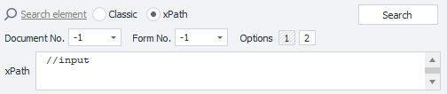

**Document number** and **Form number** work the same way as in classic search. To search all documents and forms, set both to `-1`.

#### XPath 
The field for entering the XPath expression ZennoPoster uses to find the element.

#### Variants
You can select one of the XPath expressions generated automatically by the **Action Constructor**.

:::tip If the suggested options do not suit your needs
You can write your own XPath expression and enter it in the XPath field.
:::
_______________________________________________
## Choosing an action
After configuring the search, choose the action ZennoPoster should perform on the element it finds. Three options are available: **Set**, **Get**, and **Rise**.

### Set (set a value)
The [Set value](/zennoposter/ProjectMaker/Project-editor/Actions-in-ProjectMaker-Actions-Blocks/Tabs/Setting_Value) action changes the value of the selected attribute.

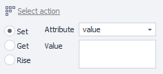

- **Attribute** — the element attribute to assign a new value to.
- **Value** — the data to write to the attribute. You can use plain text or project variables, such as `{-Variable.someVar-}` or `{-Profile.Name-}`.

### Get (get a value)
An action for [getting the value](/zennoposter/ProjectMaker/Project-editor/Actions-in-ProjectMaker-Actions-Blocks/Tabs/Getting_Value) of the selected attribute.  

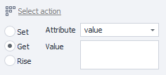

- **Attribute** — the attribute whose value you want to get.
- **Value** — the value of the attribute found.

### Rise (perform an event)
[Performs an action](/zennoposter/ProjectMaker/Project-editor/Actions-in-ProjectMaker-Actions-Blocks/Tabs/Perform_Event) on the element found. For example, you can click it or trigger another available action from the list.  

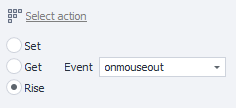   

> *For **drag** and **drop** actions, two additional fields appear for specifying coordinates.*  
>
> 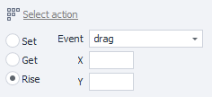 
_______________________________________________
## Final steps
After configuring the search and choosing an action, we recommend checking the result and adding a clear comment before saving the action to the project.

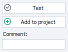

### Testing
Once you have configured the search parameters and the action, click the test button. This lets you check in advance that ZennoPoster finds the right element and performs the selected action correctly.  

:::info If the wrong element is found or the action is performed incorrectly
Return to the settings and change the search parameters.
:::

### Comment
Add a short, clear comment to the action.  

Default automatic comments do not always make it easy to understand what an action does.

| Default comments | Custom comments |
| :--------: | :-------: |
| 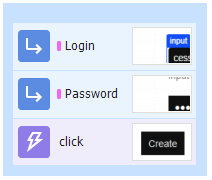 | 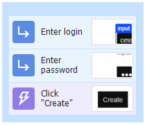 |


### Adding to project
Make sure that:
- the search parameters are configured;
- ZennoPoster finds the right element;
- the correct action is selected;
- the test has passed.

Then click **Add to project**. The new action will appear in the project, ready to use. 
_______________________________________________
## Useful links

- [❗→ XPath](https://zennolab.atlassian.net/wiki/spaces/RU/pages/862093419 "https://zennolab.atlassian.net/wiki/spaces/RU/pages/862093419")
- [❗→ Regular expression tester](https://zennolab.atlassian.net/wiki/spaces/RU/pages/534086111 "https://zennolab.atlassian.net/wiki/spaces/RU/pages/534086111")
- [❗→ Set value](https://zennolab.atlassian.net/wiki/spaces/RU/pages/534315117 "https://zennolab.atlassian.net/wiki/spaces/RU/pages/534315117")
- [❗→ Perform event](https://zennolab.atlassian.net/wiki/spaces/RU/pages/534020211 "https://zennolab.atlassian.net/wiki/spaces/RU/pages/534020211")
- [❗→ Get value](https://zennolab.atlassian.net/wiki/spaces/RU/pages/534315124 "https://zennolab.atlassian.net/wiki/spaces/RU/pages/534315124")
- [❗→ Element Properties window](https://zennolab.atlassian.net/wiki/spaces/RU/pages/735608879 "https://zennolab.atlassian.net/wiki/spaces/RU/pages/735608879")
- [ZennoPoster + xPath with Yandex.Market example](https://zennolab.com/discussion/threads/obzor-zennoposter-xpath-na-primere-jandeks-marketa.37497/ "https://zennolab.com/discussion/threads/obzor-zennoposter-xpath-na-primere-jandeks-marketa.37497/") (contest article from the forum)