---
sidebar_position: 0
title: "Browser Window"
description: ""
date: "2025-08-18"
converted: true
originalFile: "Окно браузера.txt"
targetUrl: "https://zennolab.atlassian.net/wiki/spaces/RU/pages/534315373"
---
import DisclaimerNotice from '@site/src/components/DisclaimerNotice';

<DisclaimerNotice />

> 🔗 **[Original page](https://zennolab.atlassian.net/wiki/spaces/RU/pages/534315373)** — Source of this material

_______________________________________________  
## Description
The browser window is one of the main elements in ProjectMaker for building web automation templates. Essentially, it is a fully functional browser instance with additional tools to make project development easier and faster.  

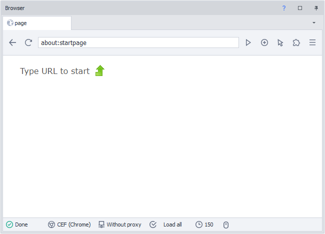

The interface consists of three main parts: the top and bottom toolbars and the central workspace (viewing area). In many ways, interacting with this window and using its basic functionality is similar to working in a regular web browser.  

## Tools
Let's look at each tool in the browser window.

### Open Tabs Area

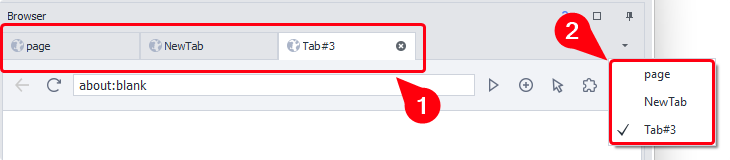

The **panel (1)** displays all currently open tabs. The button on the right side of the **panel (2)** opens a list for quick navigation among open tabs.

> *You can create, activate, and close tabs using the [Manage Browser Tab](/zennoposter/ProjectMaker/Project-editor/Actions-in-ProjectMaker-Actions-Blocks/Browser/Browser_tab_management) action.*

### “Back” Button
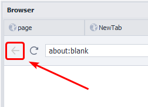

Navigates through your browsing history and returns you to the previous page.  

> *You can do the same with code:*  
> *C#: `instance.ActiveTab.GoBack();`*  
> *JS: `history.back();`*  

### “Refresh” Button
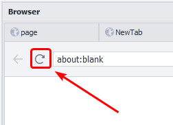

Reloads the current page. While data is being retrieved, the icon changes to a cross; clicking it stops loading.

### Address Bar
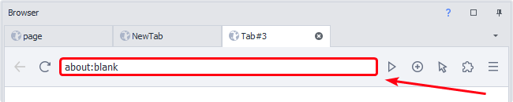

A field for entering, editing, and displaying the page URL. It works just like the address bar in regular browsers. 

### Go to Page
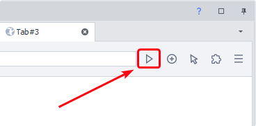

Clicking this button navigates to the address you entered. You can also simply press Enter instead of clicking the button.

> *Within a project, use the [Go to Page](/zennoposter/ProjectMaker/Project-editor/Actions-in-ProjectMaker-Actions-Blocks/Tabs/Navigate_to_Page) action to open the websites you need.* 

### Open a New Tab

Opens a modal window where you enter the name of the new tab.  

> *You can do the same using the [Manage Browser Tab](/zennoposter/ProjectMaker/Project-editor/Actions-in-ProjectMaker-Actions-Blocks/Browser/Browser_tab_management) action block.* 

### Input Mode

Lets you choose how to interact with the browser: using a regular mouse or emulating a touchscreen.  

This primarily affects template recording. In touch mode, all your taps and swipes automatically become blocks with touch events. In mouse mode, regular clicks are recorded instead.

### Extensions
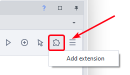

Allows you to interact with installed extensions (activate them, configure settings, view details, and remove them). You can install new extensions from crx files.

> *Read more about [Working with Extensions](/zennoposter/ProjectMaker/Project-editor/Actions-in-ProjectMaker-Actions-Blocks/Browser/Working_with_extensions).*

### Web Developer Tools
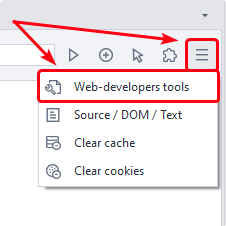

Opens the [Web Developer Tools](/zennoposter/ProjectMaker/Browser_Window/Web_Developer_Tools_DevTools) window, similar to the one in Chrome. It is used for advanced work with the DOM, applications, and page traffic.

:::warning This window applies only to the active tab
:::

### View Page Source
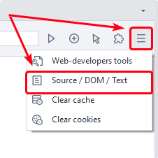

This button opens the [page structure viewer](/zennoposter/ProjectMaker/Browser_Window/View_Page_Text) for the active tab. Three data formats are available: source code, the DOM tree, and visible page text.

You can also retrieve this information during execution without opening the window, using these special environment variables:  

`{ -Page.Dom- }`
`{ -Page.Source- }`
`{ -Page.Text- }`

### Clear Cache
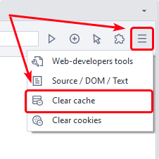

Provides quick access to the functionality of the [corresponding action block](/zennoposter/ProjectMaker/Project-editor/Actions-in-ProjectMaker-Actions-Blocks/Browser/Browser_settings#clear-cache): clearing the entire browser cache. 

### Clear Cookies
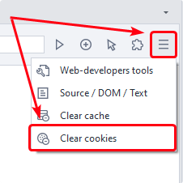

Clears all cookies in the instance.  

> *You can also do this with the [Clear Cookies](/zennoposter/ProjectMaker/Project-editor/Actions-in-ProjectMaker-Actions-Blocks/Browser/Browser_settings#clear-cookies) action.*

:::info [New action for working with cookies](/zennoposter/ProjectMaker/Project-editor/Actions-in-ProjectMaker-Actions-Blocks/Browser/Browser-cookies/Working_with_Cookies) 
Added in ZennoPoster 7.3.1.0, this action lets you not only clear cookies but also load and save them in various formats.
:::

### Page Loading Status Indicator
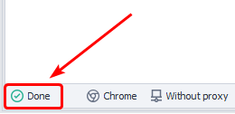

It has three states:
- **Ready** — loading is complete;
- **Loading** — loading is in progress;
- **Finishing Up** — scripts and plugins are loading additional data.

### Current Browser Type
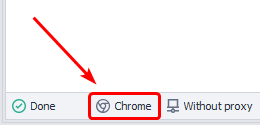

Shows the browser type set for the instance. 

You can change the browser type in several ways:

- globally, for all new projects through [program settings](/zennoposter/ZennoPoster/Settings_ZP_and_ProxyChecker/Instance_Settings);
- in the [current project settings](/zennoposter/ProjectMaker/Project-editor/Static_blocks/Project_Settings#browser-type);
- using the [Start Instance](/zennoposter/ProjectMaker/Project-editor/Actions-in-ProjectMaker-Actions-Blocks/Browser/Browser_settings#start-instance) action to change it while a project is running.

### Browser Proxy
Shows the current proxy.  

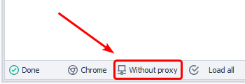

:::tip You can set a proxy by clicking this button 
Available since version 7.3.2.0.
:::

> *You can also set a proxy through the [Profile Window](/zennoposter/ProjectMaker/Program-interface/Profile_Window),  
> or using the [Set Proxy](/zennoposter/ProjectMaker/Project-editor/Actions-in-ProjectMaker-Actions-Blocks/Browser/Browser_settings#set-proxy) action block.*

### Content Loading Rules
This button opens a menu where you can use checkboxes to allow or block specific types of web page content.  

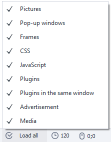

This helps optimize performance: for example, disabling images and CSS styles significantly speeds up page loading and saves resources.

You can manage these rules not only in the window interface but also in other ways:  
- [globally for the entire template](/zennoposter/ProjectMaker/Project-editor/Static_blocks/Project_Settings#do-not-use-browser);  
- [programmatically using actions](/zennoposter/ProjectMaker/Project-editor/Actions-in-ProjectMaker-Actions-Blocks/Browser/Browser_settings).

### Set Timeout
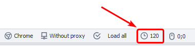  

Opens a window where you can limit the maximum time in seconds allowed for the current page to load. If loading takes too long and exceeds the limit, it stops, preventing the template from hanging indefinitely.    

> *You can also [configure](/zennoposter/ProjectMaker/Project-editor/Actions-in-ProjectMaker-Actions-Blocks/Tabs/Web_Page_Settings) this parameter within the project.* 

### Mouse Cursor Coordinates
Shows the exact X and Y coordinates of the cursor in pixels, where (**0;0**) is the top-left corner of the active page. 

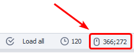

Use this feature to quickly determine the location of web elements when developing a template.
_______________________________________________ 
## Context Menu
Right-clicking inside the ProjectMaker workspace opens a context menu that differs significantly from those in regular browsers such as Chrome or Firefox.  

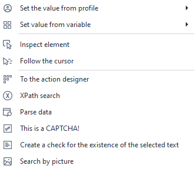

Instead of basic user commands, it contains functions designed specifically for automation and extracting data from page elements.  

### Set Value from Profile/Variable
These options are available when you right-click a text field. They let you quickly fill it with profile data or the value of an existing variable.  

### Inspect Element
Opens the Element Tree and Element Properties panels. You can examine the page's HTML structure and the selected node's attributes in detail, then send it to the Action Constructor to configure a click, text input, or data extraction.  

### Follow Cursor
In this mode, hovering over page elements automatically highlights them with an outline (unless disabled in the settings). This lets you quickly find the required blocks on a site and track their properties in the properties window in real time.  

### Send to Action Constructor
Sends the selected HTML element to the [Action Constructor](/zennoposter/ProjectMaker/Browser_Window/Action_Constructor_and_XPath_Search) window to configure interaction with it in detail, such as clicking or entering text.  

### XPath Search
Opens the Action Constructor with the mode for finding the required element using an XPath expression automatically enabled.  

### Parse Data
Creates an action for quickly extracting the required information (text or attribute values) from the selected page element.  

### This is a Captcha!
This item is available when you open the context menu on an image. It marks the selected image as a captcha and automatically adds the [corresponding recognition action](/zennoposter/ProjectMaker/Project-editor/Actions-in-ProjectMaker-Actions-Blocks/Tabs/Captcha_Recognition) to the canvas.  

:::warning Works only with simple text captchas
:::

### Create Check for Selected Text
Automatically creates an [action that checks](/zennoposter/ProjectMaker/Project-editor/Actions-in-ProjectMaker-Actions-Blocks/Tabs/Text_Presence_Check) whether the text you selected is present on the current web page.  

> *This tool works slightly differently depending on the program version (**updated in version 7.3.1.0**).*  

### Image Search
Adds an action for finding an element on the page by its visual sample (image). This is a useful alternative when you cannot use HTML code or XPath to identify it.  

## Useful Links

- [❗→ View Page Text](/zennoposter/ProjectMaker/Browser_Window/View_Page_Text)
 - [❗→ Action Constructor and XPath Search](/zennoposter/ProjectMaker/Browser_Window/Action_Constructor_and_XPath_Search)
 - [❗→ Parse Data](/zennoposter/ProjectMaker/Browser_Window/Parse_Data)
 - [❗→ Create Check for Selected Text](/zennoposter/ProjectMaker/Browser_Window/Create_Selected_Text_Check)
 - [❗→ Image Search](/zennoposter/ProjectMaker/Browser_Window/Image_Search)
 - [❗→ Web Developer Tools (DevTools)](/zennoposter/ProjectMaker/Browser_Window/Web_Developer_Tools_DevTools)
 - [❗→ Font Emulation](/zennoposter/ProjectMaker/Browser_Window/Font_Emulation)
