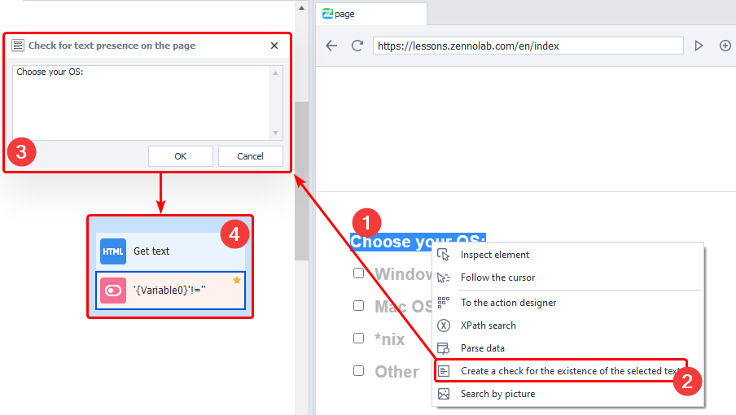
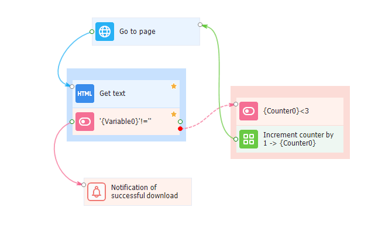

---
sidebar_position: 4
title: "Selected Text Presence Check"
description: ""
date: "2025-08-18"
converted: true
originalFile: "Создать проверку наличия выделенного текста.txt"
targetUrl: "https://zennolab.atlassian.net/wiki/spaces/RU/pages/534053296"
---
import DisclaimerNotice from '@site/src/components/DisclaimerNotice';

<DisclaimerNotice />

> 🔗 **[Original page](https://zennolab.atlassian.net/wiki/spaces/RU/pages/534053296)** — Source of this material

_______________________________________________  
## Description
:::info Legacy feature
ZennoPoster 7.3.1.0 introduced a new action: [Text Presence Check](/zennoposter/ProjectMaker/Project-editor/Actions-in-ProjectMaker-Actions-Blocks/Tabs/Text_Presence_Check).
:::

This feature checks whether specific text is present on a page. It is not a separate action, but a group of actions:

1. The [Data](/zennoposter/ProjectMaker/Project-editor/Actions-in-ProjectMaker-Actions-Blocks/Tabs/Data_Tab_Operations) action performs the search.
2. [IF](/zennoposter/ProjectMaker/Project-editor/Actions-in-ProjectMaker-Actions-Blocks/Logic/IF_Condition) performs the check.

### How to add this action to your project?
1. In ProjectMaker's browser, select the text you want to check for.
2. Right-click the selected text → **Create Check for Selected Text**.
3. A window containing the selected text will open. Check it and edit it if necessary, then click **OK**.
4. ProjectMaker automatically adds two actions to the project:  
    - [Get tab text](/zennoposter/ProjectMaker/Project-editor/Actions-in-ProjectMaker-Actions-Blocks/Tabs/Data_Tab_Operations) — retrieves the text of the current tab;  
    - [IF](/zennoposter/ProjectMaker/Project-editor/Actions-in-ProjectMaker-Actions-Blocks/Logic/IF_Condition) — checks whether it contains the selected text.

If the text is found, the **if** action succeeds and execution continues *along the green branch*. If the text is not found, execution follows *the red branch*.

:::warning Always test both situations
Test when the required text is present on the page and when it is absent.  

Sometimes text is hidden from the user but remains in the page code. In that case, ProjectMaker may find it and continue along the green branch.  

This behavior depends on the layout of the particular site.
:::

_______________________________________________
## How it works
A text presence check helps determine whether an action succeeded or an error appeared on the page.

For example, you can use it:
- after registration;
- after publishing data;
- after loading a page;
- after solving a captcha.

If the required text is found, execution continues along the green branch. If it is not found, execution follows the red branch.

### Example usage
Let's look at checking whether a page loaded successfully.

Sometimes a site loads incorrectly, especially when using unstable proxies. This may result in a blank page or an HTTP error such as 403, 404, or 503.  

To check that the page loaded:  
1. Find static text on the page that appears when it loads successfully.  
2. After navigating to the site, check whether this text is present.  
3. If the text is found, continue running the project.  
4. If the text is not found, try loading the page again.  

You can configure retries using a loop and the [Go to Page](/zennoposter/ProjectMaker/Project-editor/Actions-in-ProjectMaker-Actions-Blocks/Tabs/Navigate_to_Page) action. Check for the selected text again after each page load.

:::tip Limit the number of retries
This prevents the project from entering an infinite loop if the site remains unavailable for a long time.
:::
## Useful links

- [❗→ Regular Expressions Tester](https://zennolab.atlassian.net/wiki/spaces/RU/pages/534086111 "https://zennolab.atlassian.net/wiki/spaces/RU/pages/534086111")
- [❗→ IF (If ... then ... condition)](https://zennolab.atlassian.net/wiki/spaces/RU/pages/534315151 "https://zennolab.atlassian.net/wiki/spaces/RU/pages/534315151")
- [❗→ Data (tab operations)](https://zennolab.atlassian.net/wiki/spaces/RU/pages/534085840 "https://zennolab.atlassian.net/wiki/spaces/RU/pages/534085840")