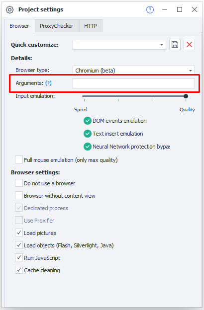
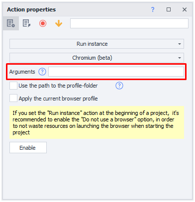

---
sidebar_position: 7
title: "Font Emulation"
description: ""
date: "2025-08-18"
converted: true
originalFile: "Эмуляция шрифтов.txt"
targetUrl: "https://zennolab.atlassian.net/wiki/spaces/RU/pages/2131066881"
---
import DisclaimerNotice from '@site/src/components/DisclaimerNotice';

<DisclaimerNotice />

> 🔗 **[Original page](https://zennolab.atlassian.net/wiki/spaces/RU/pages/2131066881)** — Source of this material

_______________________________________________  
## Description
Font emulation lets you specify which fonts are available to the browser. This helps you configure the browser environment more precisely and improve the quality of its emulation.

:::info If this setting is not used, the browser uses *system fonts*.
:::
_______________________________________________ 
## How it works
### Setup
To use a custom font set, add the `--zl-fonts-dir` argument when launching the browser. Specify the path to the folder containing the fonts in this argument.  

:::tip For example:
`--zl-fonts-dir=Z:\Fonts`

In this case, the browser will use the fonts found in **Z:\Fonts**.
:::

The specified folder must contain at least one font from this list:  
- *Sans*
- *Arial*
- *MS UI Gothic*
- *Microsoft Sans Serif*
- *Segoe UI*
- *Calibri*
- *Times New Roman*
- *Courier New*

If the `--zl-fonts-dir` argument is not specified, the fonts installed on the system are used.

### Where to specify the launch argument
There are two ways to do this:

#### Method 1. In the project settings  
Open the [Project Settings | Arguments](/zennoposter/ProjectMaker/Project-editor/Static_blocks/Project_Settings#arguments) static block and enter the argument in the corresponding field:

#### Method 2. In the action that starts the instance
Add the **Settings → Start Instance** action and enter the argument in the dedicated section:  

_______________________________________________ 
## Font sets
### Ready-made sets
You can use ready-made font sets for different Windows 10 configurations:

- Clean Windows 10 Pro - [ru.zip](https://www.dropbox.com/s/jzigwy17p0v9z34/ru.zip?dl=0) and [en.zip](https://www.dropbox.com/s/jw2jzyuxtqddzx2/en.zip?dl=0)
- Windows 10 Pro + Office - [ru.zip](https://www.dropbox.com/s/4fyudzexzp7pmpl/ru.zip?dl=0) and [en.zip](https://www.dropbox.com/s/5n46v94h2nweve1/en.zip?dl=0)
- Windows 10 Pro + VisualStudio 2022 - [ru.zip](https://www.dropbox.com/s/ertyj80yajtv333/ru.zip?dl=0) and [en.zip](https://www.dropbox.com/s/mhvb5pvqt0u0vqq/en.zip?dl=0)
- Windows 10 Pro + Office + VisualStudio 2022 - [ru.zip](https://www.dropbox.com/s/00pocd1edahsfrs/ru.zip?dl=0) and [en.zip](https://www.dropbox.com/s/foi7lb37cdt914u/en.zip?dl=0)

:::info These archives contain only the font sets needed to emulate the corresponding environment.
You do not need to install Windows 10 Pro, Office, or Visual Studio on the computer running ZennoPoster.
:::

### Custom sets
You can also prepare your own font set for the Windows configuration you need:  
1. Install Windows on a virtual machine.
2. Install the applications whose font set you want to emulate. *Some applications add their own fonts to the system during installation.*
3. Open `C:\Windows\Fonts`, which contains most installed fonts. Copy the fonts you need to a separate folder.
4. Transfer this folder to the computer running ZennoPoster. Specify its path in the --zl-fonts-dir argument.  

:::tip Keep different font sets in separate folders.
This lets you quickly switch between configurations by changing only the path in the launch argument.
:::