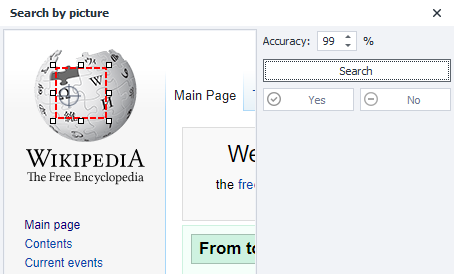
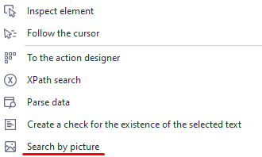
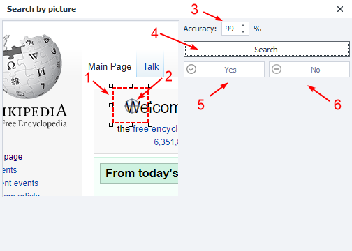
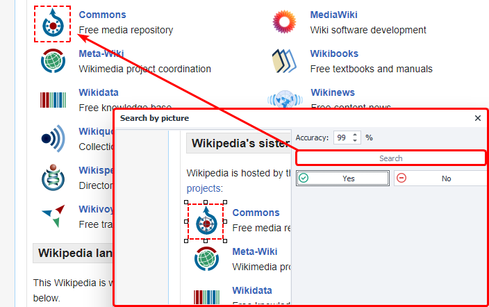
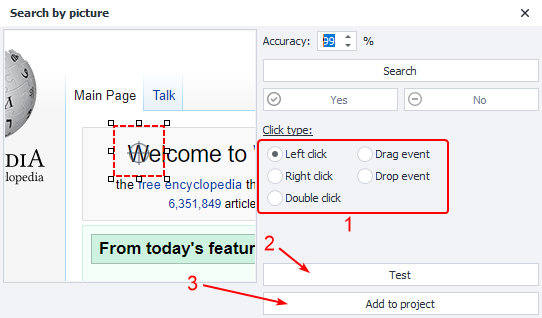
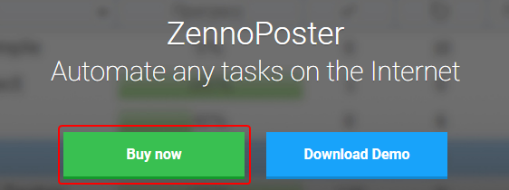
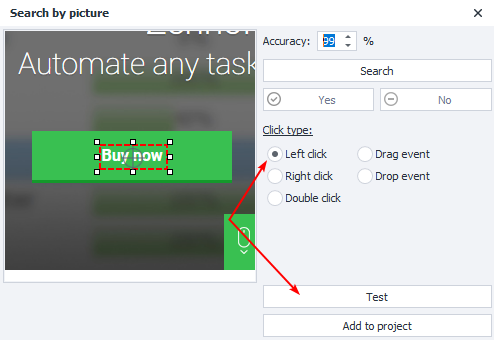
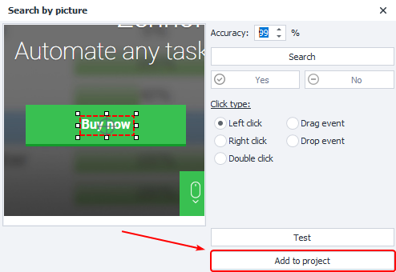
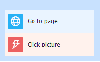

---
sidebar_position: 5
title: "Image Search"
description: ""
date: "2025-08-18"
converted: true
originalFile: "Поиск по картинке.txt"
targetUrl: "https://zennolab.atlassian.net/wiki/spaces/RU/pages/492044304"
---
import DisclaimerNotice from '@site/src/components/DisclaimerNotice';

<DisclaimerNotice />

> 🔗 **[Original page](https://zennolab.atlassian.net/wiki/spaces/RU/pages/492044304)** — Source of this material

_______________________________________________  
## Description
Allows you to click an element using visual search. We recommend using it when you cannot find the element by other means. It is also suitable for Flash and [Canvas](https://developer.mozilla.org/ru/docs/Web/API/Canvas_API).

:::warning Uses a lot of computer resources
:::

### How to add to your project?
Hover your mouse over the element and right-click to open the context menu:

_______________________________________________ 
## How it works

1. **Adjustable search area** — select a unique part of the element that distinguishes it from the others.
2. **Click target** — sets the click location inside the search area and can be moved.
3. **Match accuracy** — specify, as a percentage, how closely the element must match the sample.
4. **Search** — search in the browser window.

:::info The element found will be highlighted with a red frame

:::

5. **Yes** — confirm that the element found meets your criteria.

6. **No** — reject the result to change the search parameters.

### Click settings
These apply to the successfully found element.

1. Choose the **Click type**:
    - *Left click* — a regular left mouse button click;
    - *Right click* — a right mouse button click on the element;
    - *Double click* — a double left mouse button click;
    - *Drag event* — an event that occurs while the object is being **dragged**;
    - *Drop event* — an event that occurs when the object is **released** in a valid area.
2. Test the click in the browser window.
3. Add the configured action to your project.
_______________________________________________ 
## Example usage
### Search example
Suppose you need to find a particular button to click on a page:  

Open image search in the browser window and specify a unique area:

| Unique area | Contains a lot of uniform color |
| -------- | ------- |
|  |  |

Now choose the click type (**Left click** in this example) and test it in the browser window: 

The click succeeded, so add the action to the project canvas:

  
### Project example
This feature can be useful in Flash games or applications where you cannot access individual elements. The workflow is as follows:

1. Go to the page and wait for it to fully load.
2. Hover your mouse over the element, open the context menu, and select **Image Search**.
3. Specify a unique search area and the click parameters.
4. Test in the browser window.
5. Add the action to your project.

_______________________________________________ 
## Useful links

- [❗→ Mouse Emulation](https://zennolab.atlassian.net/wiki/spaces/RU/pages/534315158 "https://zennolab.atlassian.net/wiki/spaces/RU/pages/534315158")
- [❗→ Browser Window](https://zennolab.atlassian.net/wiki/spaces/RU/pages/534315373 "https://zennolab.atlassian.net/wiki/spaces/RU/pages/534315373")