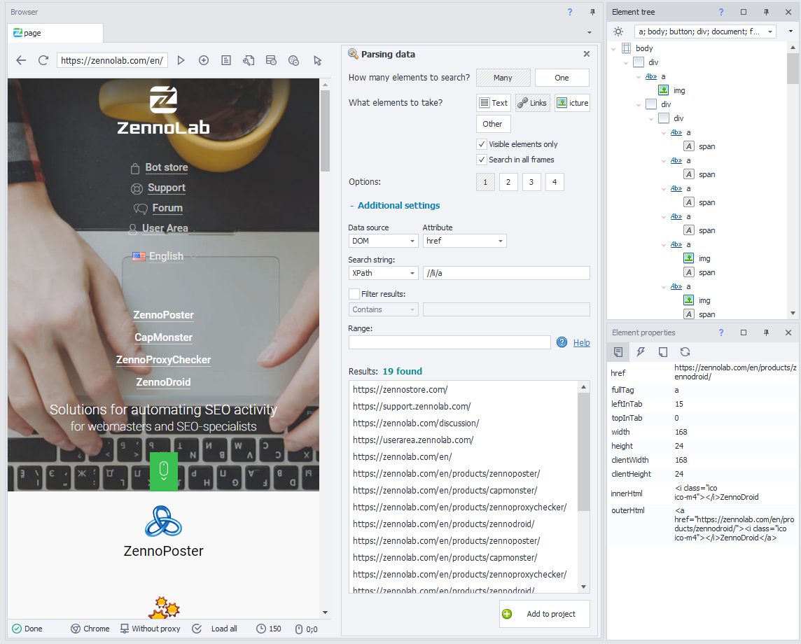
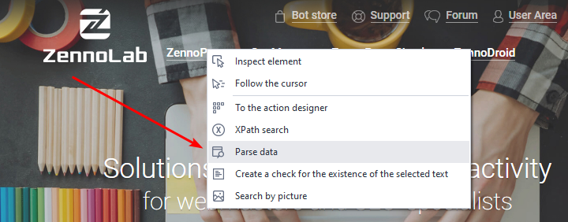
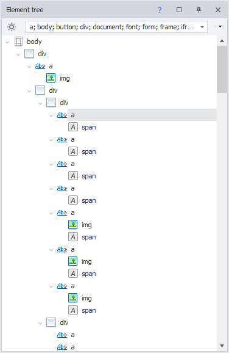
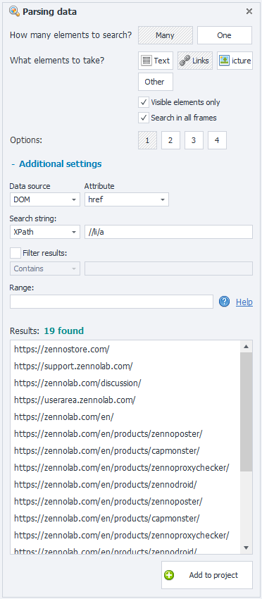
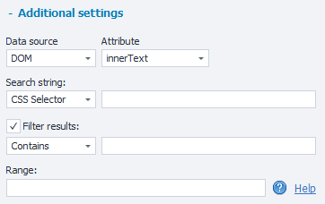
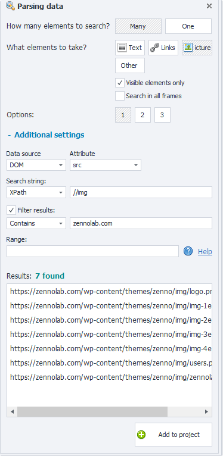

---
sidebar_position: 3
title: "Parse Data"
description: ""
date: "2025-08-18"
converted: true
originalFile: "Парсить данные.txt"
targetUrl: "https://zennolab.atlassian.net/wiki/spaces/RU/pages/534053279"
---
import DisclaimerNotice from '@site/src/components/DisclaimerNotice';

<DisclaimerNotice />

> 🔗 **[Original page](https://zennolab.atlassian.net/wiki/spaces/RU/pages/534053279)** — Source of this material

_______________________________________________  
## Description
ZennoPoster offers various tools for finding and collecting information from web pages. **Data Parsing** is one of them. It lets you select the elements you need on the current page and configure data collection in just a few clicks, without writing code.

### How to open this window?
Select **Parse Data** from the [Browser Window](/zennoposter/ProjectMaker/Browser_Window/) context menu: 

Or select **Parse Data** from the **Element Tree** context menu:

## How it works
The **Data Parsing** window is divided logically into **Quick Search** and a more detailed search with **Additional settings**:

### How many are we looking for?
You can find **Many** elements matching the specified conditions or select just **One**.

### **What to grab?**
Choose which data to retrieve from the elements found:  
- **Text** — the element's visible text.
- **Links** — the addresses the links found point to.
- **Images** — image paths. For example: https://zennolab.com/wp-content/themes/zenno/img/logo.png.
- **Other** — lets you select or specify the HTML element data you need.
- **Only visible elements** — include only elements currently displayed on the page.
- **Search in all frames** — search for data in embedded frames as well as in the main document.
- **Variants** — automatically generated search condition variants: [1], [2], [3], and so on. Choose the one that finds the required data most accurately.

:::tip *Frame*
*An independent HTML document loaded within a page.*
:::

### Additional settings
These provide a more flexible search, letting you specify more precisely where and what data to find.

- **Data source** — the page code to search: DOM or the original HTML.
- **Attribute** — the HTML element attribute whose value you want to retrieve.
- **Search string** — the query ZennoPoster uses to find the required elements. You can use XPath or a CSS selector.
- **Filter results** — keep only values that match the selected condition:  
    - *contains*;
    - *does not contain*;
    - *regex* *— filtering using a regular expression*.
- **Range** — a condition that selects only part of the array of elements found.

### **Results**
This window shows a preview of the search results. Check that ZennoPoster found exactly the data you need.

_______________________________________________   
## Add to Project
Once all conditions are configured, check the data found in the preview window and click **Add to project**.  

A Parse Data action will appear in the workspace. In its settings, **you must specify where to save** the retrieved data.
  

## Example usage
Suppose you need to collect the addresses of all images on the active web page.  

> *This example uses the [official ZennoLab website](https://zennolab.com/ru/).*

1. Open the required page.
2. Open **Data Parsing**.
3. Under **How many are we looking for?**, select *Many*.
4. Under **What to grab?**, select *Images*.
5. Check the addresses found in the preview window.

Done: ZennoPoster has collected the image addresses from the current page. You can now add the result to the project and save it to the required variable or list.
_______________________________________________ 
## Useful links

- [❗→ Action Constructor and XPath Search](https://zennolab.atlassian.net/wiki/spaces/RU/pages/483426337 "https://zennolab.atlassian.net/wiki/spaces/RU/pages/483426337")
- [❗→ Element Tree window](https://zennolab.atlassian.net/wiki/spaces/RU/pages/727777355 "https://zennolab.atlassian.net/wiki/spaces/RU/pages/727777355")
- [❗→ Element Properties window](https://zennolab.atlassian.net/wiki/spaces/RU/pages/735608879 "https://zennolab.atlassian.net/wiki/spaces/RU/pages/735608879")
- [❗→ XPath](https://zennolab.atlassian.net/wiki/spaces/RU/pages/862093419 "https://zennolab.atlassian.net/wiki/spaces/RU/pages/862093419")
