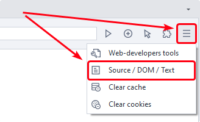
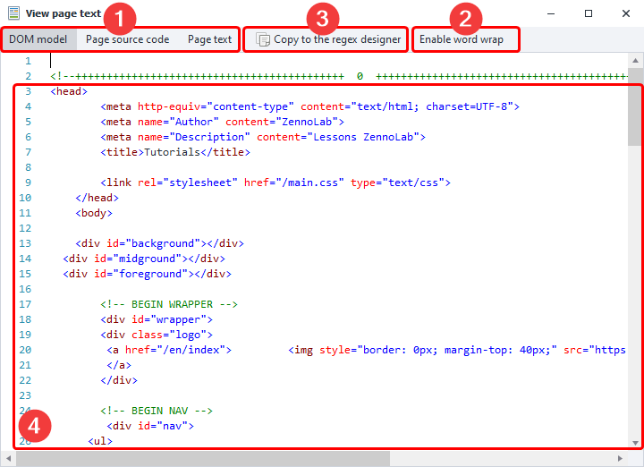
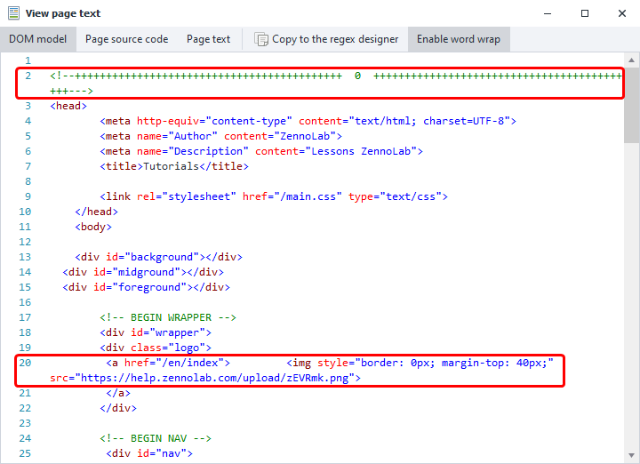
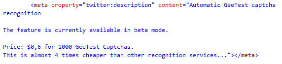
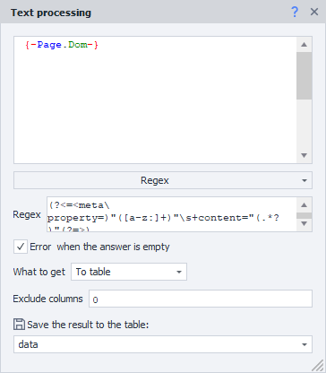
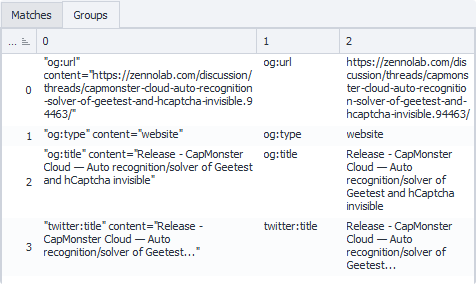

---
sidebar_position: 1
title: "Viewing Page Text"
description: ""
date: "2025-08-18"
converted: true
originalFile: "Просмотр текста страницы.txt"
targetUrl: "https://zennolab.atlassian.net/wiki/spaces/RU/pages/735903769"
---
import DisclaimerNotice from '@site/src/components/DisclaimerNotice';

<DisclaimerNotice />

> 🔗 **[Original page](https://zennolab.atlassian.net/wiki/spaces/RU/pages/735903769)** — Source of this material

_______________________________________________  
## Description
This tool lets you view the source code (Source), DOM model, and visible text of the web page loaded in the browser.  

:::tip When using the *chrome* engine in your project
You can use the standard web developer tools (DevTools) as an alternative.
:::

### What is this used for?
The viewer lets you analyze the page structure in depth in the following situations:
- **Identifying elements:** finding unique attributes or data to configure actions precisely (clicking, reading, or setting a value).
- **Complex data extraction:** extracting information you cannot access through the standard Action Constructor.  
- **Debugging:** quickly copying source code, DOM, or text directly into the [Regular Expression Tester](/zennoposter/ProjectMaker/Tools/Regular_Expression_Tester) to check your logic.

### How to open the window?
The button for this tool is on the toolbar, to the right of the browser's address bar.


_______________________________________________ 
## How it works
Clicking the tool icon opens the following window:



### Selecting content (1)
Lets you select the format in which to display data: **DOM** (selected by default), **source code** (Source), or the page's **visible text**.  

### Word wrap (2)
Enables automatic wrapping of long text lines. When disabled, text extends beyond the right edge of the window, and you need to scroll horizontally to view it in full.  

An example of the window with word wrap enabled:  



### Copy to Regex Builder (3)
Automatically opens the [Regex Builder](/zennoposter/ProjectMaker/Tools/Regular_Expression_Tester) and copies the window's entire current contents into it for further work and testing.
_______________________________________________ 
## Usage Example
Suppose you need to retrieve all `<meta>` tags with the property attribute from a [ZennoLab forum topic page](https://zennolab.com/discussion/threads/capmonster-cloud-novyj-servis-avtomaticheskogo-raspoznavanija-kapch.59736/). These tags are not displayed on the page itself, so the **Action Constructor** cannot find them. Instead, we will work with the page code.  

### Step 1. Find the required tags in the page code  
Open the required page and launch the code viewer.  

> In this example, you can use either the DOM or the page source code: the result will be the same.  

Find the `<meta>` tags with the `property` attribute. The screenshot shows one of them:  



The tags we need have a similar structure:  
- the tag starts with `<meta property="`;  
- `property` is followed by the property name;  
- the `content` attribute contains its value;  
- the tag ends with `>`.

### Step 2. Create a regular expression  
Copy the page contents into the [Regex Builder](/zennoposter/ProjectMaker/Tools/Regular_Expression_Tester). Use the following regular expression to find the required values:

```
(?<=<meta\ property=)"([a-z:]+)"\s+content="(.*?)"(?=>)
```
It uses two groups:  
1. `([a-z:]+)` — retrieves the value of the property attribute.  
2. `(.*?)` — retrieves the contents of the content attribute.

### Step 3. Save the values found  
Add the [Text Processing](/zennoposter/ProjectMaker/Project-editor/Actions-in-ProjectMaker-Actions-Blocks/Data/Text_Processing) action and select the **Regex** operation.  

Enter the regular expression you created, search the page code, and save the values found to a table:  



In this example, the regular expression is applied to the DOM of the current tab. The page contents are available through special variables:  
- `{-Page.Dom-}` — the DOM of the current tab;  
- `{-Page.Source-}` — the page source code;  
- `{-Page.Text-}` — the visible page text.

> *You can find other available variables in the [Variables Window](/zennoposter/ProjectMaker/Program-interface/Variables_Window).*

#### Why exclude column 0?
The regular expression uses two groups:  
```
([a-z:]+)
(.*?)
```
However, the result contains three columns:  
- *column `0`* contains the entire match;  
- *column `1`* contains the value of the `property` attribute;
- *column `2`* contains the value of the `content` attribute.

In other words, numbering starts at zero. If you do not need the full match, exclude column `0`.  

You can view the groups found on the **Groups** tab in the Regex Builder:




* * *

## Useful links

- [❗→ Regular Expression Tester](https://zennolab.atlassian.net/wiki/spaces/RU/pages/534086111 "https://zennolab.atlassian.net/wiki/spaces/RU/pages/534086111")
- [❗→ XPath](https://zennolab.atlassian.net/wiki/spaces/RU/pages/862093419 "https://zennolab.atlassian.net/wiki/spaces/RU/pages/862093419")
- [❗→ Text Processing](https://zennolab.atlassian.net/wiki/spaces/RU/pages/488865793 "https://zennolab.atlassian.net/wiki/spaces/RU/pages/488865793")
- [❗→ 💻Browser Window](https://zennolab.atlassian.net/wiki/spaces/RU/pages/534315373 "https://zennolab.atlassian.net/wiki/spaces/RU/pages/534315373")