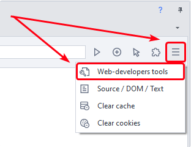
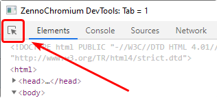
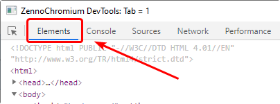
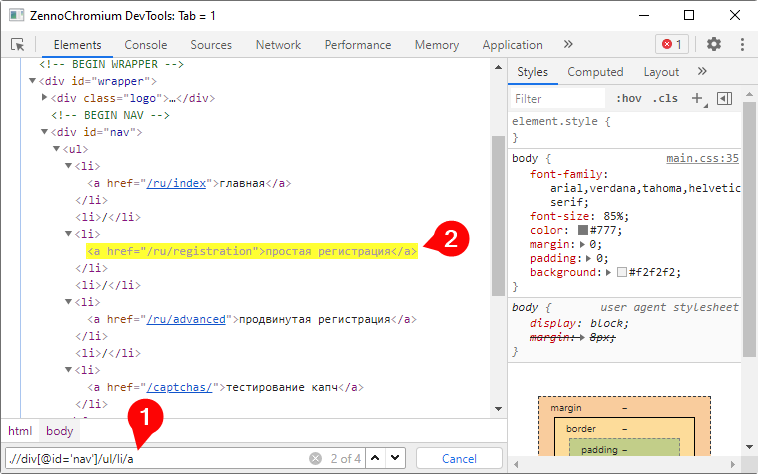
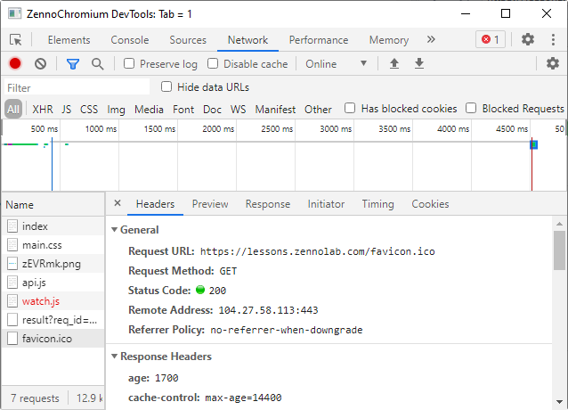

---
sidebar_position: 6
title: "Web Developer Tools (DevTools)"
description: ""
date: "2025-08-18"
converted: true
originalFile: "Инструменты web-разработчика (DevTools).txt"
targetUrl: "https://zennolab.atlassian.net/wiki/spaces/RU/pages/1331134465/web-+DevTools"
---
import DisclaimerNotice from '@site/src/components/DisclaimerNotice';

<DisclaimerNotice />

> 🔗 **[Original page](https://zennolab.atlassian.net/wiki/spaces/RU/pages/1331134465/web-+DevTools)** — Source of this material

_______________________________________________  
## Description
**DevTools** is a set of tools built into the browser for viewing and analyzing web pages. You can use it to:  
- view the page's HTML code and structure;
- inspect CSS styles;
- find an element and its attributes;
- view network requests;
- see JavaScript errors;
- temporarily change the page's content or appearance.

:::warning Available only for the Chrome engine
:::

### How to open the window?
Click the corresponding button to the right of the address bar in ProjectMaker's browser:

_______________________________________________ 
## How it works
### Inspect Button  
Lets you quickly find the HTML code of the required element.

Click it, then hover over an element on the page and click the element. The selected element will be highlighted on the **Elements** tab.  

### Elements Tab
Displays the DOM of the current page.  

On this tab, you can:  
- examine the HTML structure;
- view tags and their attributes;
- change an element's text or HTML code;
- add or remove an attribute;
- temporarily hide or remove an element.  

:::info Changes apply only to the current tab
They disappear when the page is refreshed.
:::

#### Searching with XPath
You can use this window to test XPath queries.  

  

Open the Elements tab and press **`Ctrl`** + **`F`**:  
1. Enter plain text, an XPath query, or a CSS selector in the field that appears.  
2. Matching elements will be highlighted in the page code.  

### Console Tab
Here you can run and test JavaScript code.  

The code runs in the context of the open page, so it has access to the objects, functions, and libraries loaded on that page.  

Once the code is ready, you can transfer it to ProjectMaker and run it using the [JavaScript Code](/zennoposter/ProjectMaker/Project-editor/Actions-in-ProjectMaker-Actions-Blocks/Custom_code/JavaScript_Code) action.

### Network Tab
This tab displays network requests sent by the page while loading and during use.  

:::tip If the request list is empty
Reopen the Network tab and refresh the page.
:::

Here you can view:
- the request URL;
- the HTTP method used;
- headers and transmitted data;
- the server response;
- the status code, such as 200, 403, or 404;
- the request duration.

This information is useful when creating your own [HTTP requests](/zennoposter/ProjectMaker/Project-editor/Actions-in-ProjectMaker-Actions-Blocks/Http/HTTP-request).
_______________________________________________ 
## Useful Links

- [Official documentation](https://developer.chrome.com/docs/devtools/ "https://developer.chrome.com/docs/devtools/") (in English)
- [Overview of all Chrome DevTools developer tools](https://habr.com/ru/company/simbirsoft/blog/337116/ "https://habr.com/ru/company/simbirsoft/blog/337116/") (Habr)
- [❗→ Traffic window](https://zennolab.atlassian.net/wiki/spaces/RU/pages/735805465 "https://zennolab.atlassian.net/wiki/spaces/RU/pages/735805465")