---
sidebar_position: 2
title: "Action Properties"
description: ""
date: "2025-08-18"
converted: true
originalFile: "Свойства действия.txt"
targetUrl: "https://zennolab.atlassian.net/wiki/spaces/RU/pages/494731280"
---
import DisclaimerNotice from '@site/src/components/DisclaimerNotice';

<DisclaimerNotice />

> 🔗 **[Original page](https://zennolab.atlassian.net/wiki/spaces/RU/pages/494731280)** — Source of this material

_______________________________________________  
## Description
While editing and debugging your project, you can modify any previously recorded action parameters. 

### How to open the window? {#how-to-open-the-window}
This depends on the display mode of the open project:

#### Without browser
Double-click an action to open its properties window. In this mode, you can open properties windows for several actions at once.

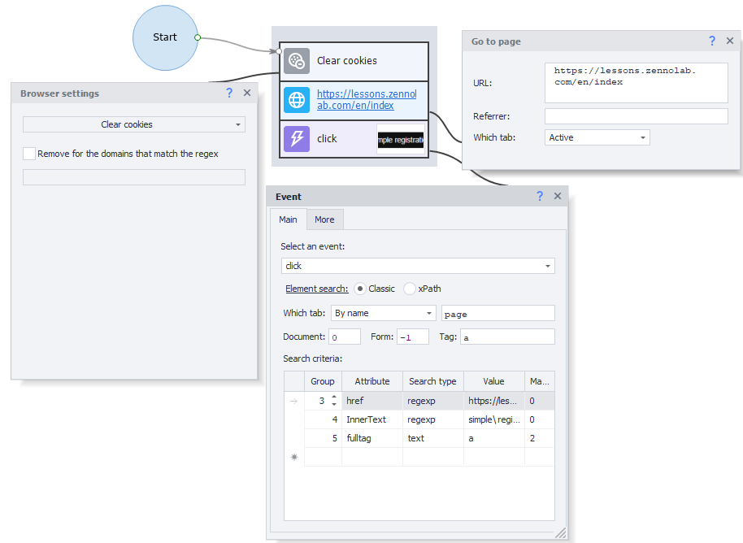

#### With browser
Enable the window via **Window → Action Properties**. The window that appears displays the settings of the selected action.

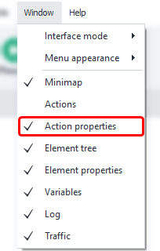

:::tip Properties windows for several actions at once
This is also possible in this mode.  
Go to **Edit → Settings → Editor**.  
Enable the “Open multiple action settings” option.
:::

| “With browser” mode | “Without browser” mode |
| -------- | ------- |
| 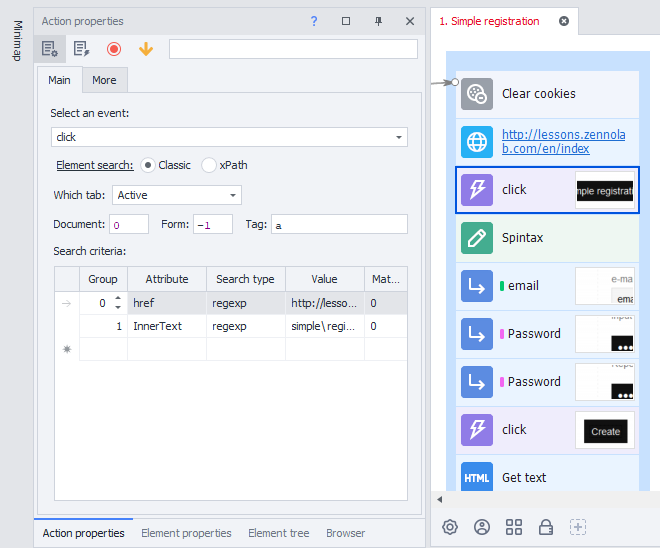 | 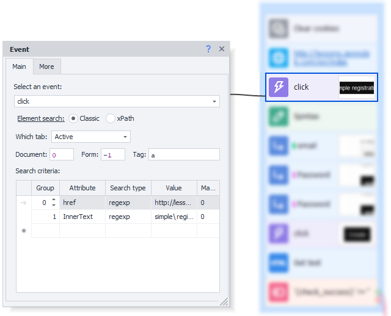 |

_______________________________________________ 
## The “Completed” Button
If you encounter an error while debugging an action, you can change its parameters in real time:

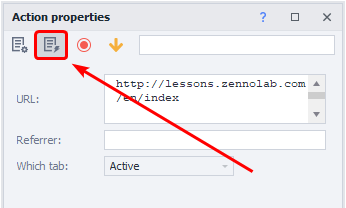

Once you activate this feature, [variables](https://zennolab.atlassian.net/wiki/spaces/RU/pages/735608872 "https://zennolab.atlassian.net/wiki/spaces/RU/pages/735608872") are replaced with their stored values.

:::warning This only works after the action has been executed
:::

| Before activation | After activation |
| -------- | ------- |
| 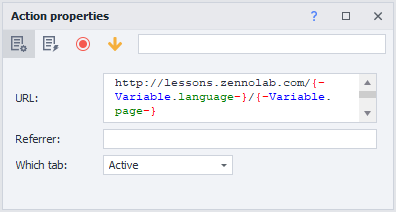 | 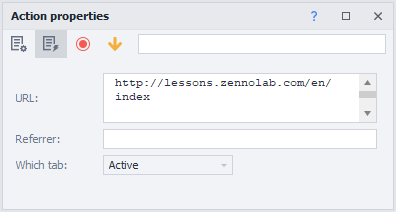 |

_______________________________________________ 
## Comment
For easier navigation within your project, you can add a comment to any action:

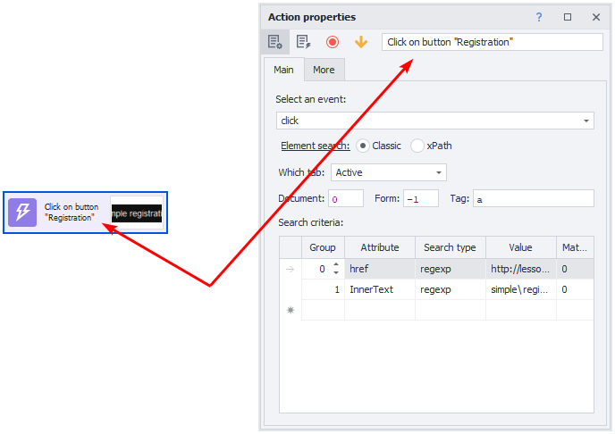

You can then change this text by right-clicking the action and selecting **Comment** from the context menu:

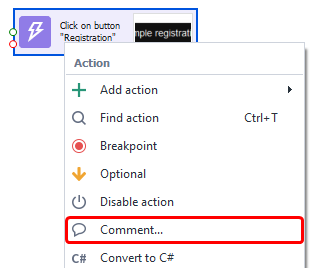
_______________________________________________
## Breakpoint
A breakpoint pauses project execution at the selected action. This is useful for debugging when you need to analyze the contents of variables or the page at a specific point in the project's execution.

There are two ways to enable it: through the context menu or the action properties.

| Context menu | Action properties |
| -------- | ------- |
| 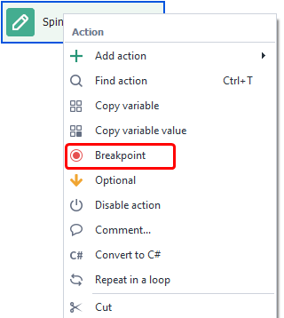 | 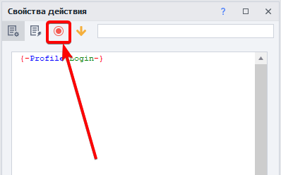 |

:::info Once enabled, a red circle appears:
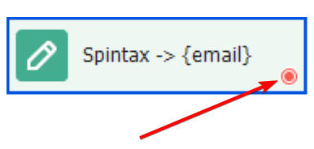
:::
_______________________________________________
## Optional
When this option is enabled, the action always follows the successful (green) branch, even if it actually ends with an error.

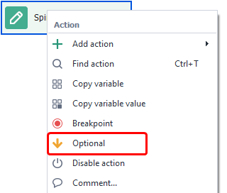

As with breakpoints, you can make an action optional in two ways: through the context menu or the action properties.

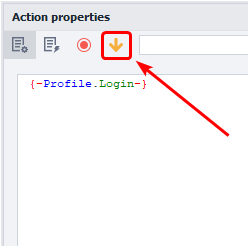

:::info Once enabled, an arrow appears next to the action:
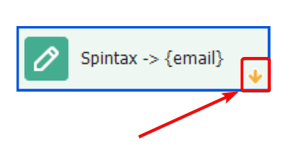
:::

_______________________________________________

